<p align="center">
  
</p>

<h1 align="center">UNLOCK</h1>

<p align="center">
  <em>Design for the day it breaks.</em>
</p>

<p align="center">
  An AI agent that redesigns a physical product so its failed part can actually be replaced —<br/>
  then proves the redesign is safe with a CAD kernel <strong>before anyone cuts metal.</strong>
</p>

<p align="center">
  <a href="https://github.com/Shrenzoo/unlock/assets/readme/hero-trapped-part.svg"></a>
</p>

<p align="center">
  
  
  
  
  
</p>

---

## Contents

<table>
<tr>
<td width="50%">

**The argument**
1. [The problem](#the-problem)
2. [What UNLOCK does](#what-unlock-does)
3. [Why this pushes the frontier](#why-this-pushes-the-frontier)
4. [Why nothing like this exists](#why-nothing-like-this-exists)

</td>
<td width="50%">

**The substance**
5. [How it works](#how-it-works)
6. [The trust boundary](#the-trust-boundary)
7. [The eight tools](#the-eight-tools)
8. [The live run](#the-live-run)
9. [Verification](#verification)

</td>
</tr>
<tr>
<td>

10. [Architecture](#architecture)
11. [Getting started](#getting-started)
12. [The API surface](#the-api-surface)

</td>
<td>

13. [Evidence & reproducibility](#evidence--reproducibility)
14. [Scope, honestly](#scope-honestly)
15. [Built during the hackathon](#built-during-the-hackathon)

</td>
</tr>
</table>

---

## The problem

Every product is designed for the factory. Almost none are designed for the day it breaks.

A fan module dies inside a sealed enclosure. A bracket — never meant to be removed — sits directly above it. The service manual says *replace the fan*. Geometry says *the fan cannot leave*. So the enclosure goes in a skip, and a €200 part failure becomes a €2,000 replacement plus the embodied carbon of an entirely new machine.

This is not a rounding error in the waste stream. It is the waste stream. Right-to-repair legislation keeps trying to mandate an answer, and keeps discovering that the answer cannot be legislated into existence — because the obstruction is not a policy decision. **It is a shape.**

Fixing the shape requires someone to reason about geometry, motion, tool access and constraint compliance together, and then to be *certain* they got it right. That combination is exactly what has been missing.

<p align="center">
  
</p>

<sub><code>fixture B02</code> — the baseline search returns <code>no_path_supported</code> with two confirmed geometric obstructions and an actual BRep witness. After the relief, the route is a single verified translation. Both halves of this diagram are computed, not illustrated.</sub>

---

## What UNLOCK does

You point it at a mechanical assembly and name the part that failed. UNLOCK then runs a seven-stage loop:

```text
 01  inspect      ── parse the STEP assembly, measure real bounds, freeze a revision
 02  baseline     ── search for a supported removal path for the failed part
 03  obstruction  ── find what is actually in the way, with BRep evidence
 04  interventions── list the finite redesigns the server will allow
 05  construct    ── build the proposed edit with a trusted CAD constructor
 06  verify       ── independently reconstruct and check twelve mandatory constraints
 07  compare      ── original versus revised, under one frozen policy
```

Stages 01–05 are where **Muse Spark 1.3** earns its keep: it reads the obstruction evidence, chooses which component to modify and by how much, and iterates on its own proposals.

Stages 06–07 are where the model is deliberately, structurally powerless. Nothing it says is accepted as true. A CAD kernel rebuilds the geometry from frozen parameters and decides for itself.

The output is not an opinion. It is a **verification report** — a specific, machine-checkable claim that under a named numerical policy, on a named revision, with named evidence handles, this part can now be removed along a stated axis in a stated number of millimetres.

### One sentence

> UNLOCK asks an AI to redesign a product so its broken part can actually be replaced — then proves the redesign is safe before anyone cuts metal.

### What it refuses to claim

This matters as much as what it does. A passing report is a geometry result for one target under one stated policy. UNLOCK states plainly, in the product itself, what has **not** been assessed:

<ul>
<li>Strength, stiffness and fatigue</li>
<li>Electrical safety and shielding</li>
<li>Manufacturing feasibility</li>
<li>Restored product function</li>
<li>Torque, forces, cables, clips and adhesives</li>
</ul>

An engineering tool that overstates its own certainty is more dangerous than no tool at all. Every number in UNLOCK is either computed, or explicitly labelled as not computed.

---

## Why this pushes the frontier

> **Push the Frontier** — Use Meta's models to tackle challenges in software, robotics, manufacturing, energy, materials and beyond. Give a machine a new capability, accelerate a scientific experiment, or unlock a better way to understand and control a physical system. Show us what becomes possible when these models meet the real world.

That track asks for a specific thing: *what becomes possible when these models meet the real world.* Not what becomes faster. Not what becomes cheaper. **Possible.**

Here is the honest answer for this project.

### Before: a question no software could answer

Take a real enclosure with a dead fan behind a bracket. Ask the entire existing toolchain:

> *"Can this part be removed, and if not, what is the smallest change to the housing that makes it removable?"*

- **The CAD system** cannot answer. It will model whatever you draw. It has no opinion about whether a shape is removable.
- **The PLM system** cannot answer. It knows the part numbers and the change history, not the geometry of motion.
- **The simulation package** cannot answer. It can tell you if a part collides, given a path you supply. It cannot invent the path, and it certainly cannot redesign the obstruction.
- **A search heuristic** answers badly. Your own `stable_enumeration` selector — deliberately included as a control — tried three candidates and returned **`NO_VERIFIED_IMPROVEMENT`**.

The question was genuinely unanswerable. Not unanswerable *quickly*. Unanswerable.

### After: a machine that answers it, and shows its work

A language model reads the BRep witness that pins the obstruction to coordinates `(0, −20, 36)` mm, reasons that the bracket's web is the only material in the removal envelope, picks a relief window from a finite server-side domain, proposes `T01 · 40 × 16 mm`, gets told its first attempt was rejected for an uncitable claim, resubmits correctly, and arrives at a design that a CAD kernel independently confirms:

```text
original   no_path_supported        ← no feasible route under supported operations
revised    feasible                 ← target TRANSLATE Z+ 80 mm, cost (0,0,0,1)
checks     12/12 mandatory passed   ← reconstruction, envelope, keep-outs, intersections…
material   2,560 mm³ removed        ← 0 mm³ outside the declared editable web
replay     forward ✓  reverse ✓     ← the path is executable in both directions
```

**A part that could not be serviced can now be serviced.** That is not a faster version of something that existed. It is a capability that did not exist, expressed in millimetres and verified against a B-rep.

<p align="center">
  
</p>

### The capability, stated precisely

What UNLOCK gives a machine that it did not have before:

<table>
<tr>
<th width="33%">A new capability</th>
<th>What that makes possible</th>
</tr>
<tr>
<td><strong>Geometric reasoning over real B-reps</strong></td>
<td>A model reasons about solids it cannot see, in millimetres, against measured bounds — and its reasoning is checked against the actual topology rather than its description of it.</td>
</tr>
<tr>
<td><strong>Closed-loop redesign under constraint</strong></td>
<td>The model may only choose from finite, server-owned parameter grids. It cannot emit arbitrary geometry, so it cannot emit arbitrary risk.</td>
</tr>
<tr>
<td><strong>Self-correction driven by measured feedback</strong></td>
<td>When a proposal fails, the model receives the measurement — not a vibe. It then adjusts the design against real numbers.</td>
</tr>
<tr>
<td><strong>Machine-checkable engineering claims</strong></td>
<td>Every "this is safe" resolves to a named policy, a geometry hash, and twelve checked constraints. A third party can re-run it.</td>
</tr>
</table>

### Why it had to be a frontier project, not a product project

This could not have been built as *"AI for our workflow."* There is no workflow where a human feeds a STEP file to a language model and trusts the answer — because the human cannot verify the answer either, which is the entire problem. The frontier being pushed here is not model capability. It is **the interface between probabilistic reasoning and deterministic proof**, and the specific finding is:

> A frontier model can be dropped into a safety-relevant engineering loop with *zero* trust, given *bounded* authority, and still reach a correct, verified, physically real outcome — because every claim it makes is resolved by a kernel that does not care what it said.

That is a transferable result. It applies to robotics motion planning, to materials substitution, to any domain where the cost of a confident wrong answer is high. UNLOCK is the worked example.

---

## Why nothing like this exists

It is worth being blunt about why this corner of the map was empty, because the obstacles were not technical fashion. They were real, and each one has a specific name.

<table>
<tr>
<th width="28%">The obstacle</th>
<th>Why it stopped everyone else</th>
<th>How UNLOCK gets past it</th>
</tr>
<tr>
<td><strong>"Just let the LLM write the CAD script."</strong></td>
<td>The model emits Python that builds a solid. It runs. It produces a plausible shape. Nobody — including the author — can say whether that shape preserves a mounting interface until someone builds a fixture and measures it.</td>
<td>The model never writes code and never emits geometry. It chooses integers from a server-owned finite grid: <code>width_mm ∈ {24, 40, 46, 52}</code>. A trusted constructor builds it. There is no code path from model output to unbounded behaviour.</td>
</tr>
<tr>
<td><strong>"Verification is too slow to be practical."</strong></td>
<td>Real B-rep boolean checks are expensive. Cold-starting OCCT costs 4–6 s per native operation. A naive loop spends its whole budget importing libraries.</td>
<td>A warm, single-use standby worker absorbs the import cost, overlapping the model's thinking time. Peak memory stays at the cold path (~440 MiB RSS). The documented run completed in <strong>48.1 s</strong> against a hard 120 s ceiling.</td>
</tr>
<tr>
<td><strong>"The model will hallucinate a pass."</strong></td>
<td>It will. A language model asked "is this safe?" will say yes, fluently, with confidence, and be wrong.</td>
<td>Model-supplied pass flags are <strong>never accepted</strong>. The verifier reconstructs the candidate from frozen parameters in a separate process and inspects actual material and voids. The model's final <code>"safe": true</code> is recorded, and then ignored.</td>
</tr>
<tr>
<td><strong>"You can't reason about physical motion with an LLM."</strong></td>
<td>Correct — alone. Collision-free extraction is a sweep problem over six axes with tool-approach constraints, not a text problem.</td>
<td>The planner does the motion. It demands validated conservative coverage plus complete analytic sweep separation to admit a translation. Witness sampling may <em>reject</em> or leave <em>unknown</em> — it can never admit.</td>
</tr>
<tr>
<td><strong>"One demo, no reliability."</strong></td>
<td>The most common failure at this scale: a single golden path, presented as a product.</td>
<td>Two deterministic selectors were frozen and run <em>before</em> the live call, as controls. One matched the model, one failed entirely. The comparison is published, including the fact that the model did <em>not</em> beat the deterministic selector. See <a href="#the-live-run">the live run</a>.</td>
</tr>
</table>

### The specific design decision that made it possible

Almost every "AI for CAD" project makes the same early choice: **trust the model's self-report.** It is the natural choice, because building an independent verifier is most of the work, and the model's self-report is right often enough to feel like proof.

UNLOCK's core decision was to treat that instinct as the bug it is. The model is given bounded, read-mostly tools; every proposal must cite run-issued evidence handles; a proposal citing only weak handles is **refused before construction ever starts**; and the resulting claim is resolved by a kernel that shares no state with the model.

The cost of that decision is roughly a doubling of implementation effort. The benefit is that the word *verified* in the output means something a third party can check.

<p align="center">
  
</p>

---

## How it works

<p align="center">
  
</p>

### Stage 01–02 — Inspect and baseline

A package is accepted only as a flat `assembly.step` (AP214 or AP242, explicit uniform millimetre units), a `manifest.json`, and an optional `attribution.txt`. Inputs are bounded *before* any native parsing: scripts, external references, symlinks, encrypted archives and arbitrary archive paths are rejected outright.

The import runs in an isolated native worker and produces an immutable revision. Frozen constraints, keep-outs and envelope are hashed into that revision's identity — so a later check against stale inputs cannot silently pass.

The baseline planner then searches for a supported removal path for the frozen target. On B02 it returns `no_path_supported`, **complete**, with two `CONFIRMED_GEOMETRIC_OBSTRUCTION` rejections carrying an actual BRep witness. Note what it refuses to do: it does not invent an operation count for an infeasible baseline, so no percentage improvement against a zero can ever be reported later.

### Stage 03–05 — Obstruction, intervention, construction

The model receives compact structured evidence — never a STEP file, never raw geometry. It is shown the witness position, the rejection certificate, and the finite domains the server will allow:

```python
# backend/src/unlock_engine/templates.py — the model's entire decision space
SERVER_DOMAINS = {
    "T01": dict(
        center_x_mm=(-4.0, 0.0, 4.0),
        center_y_mm=(-28.0, -20.0, -12.0, -4.0),
        width_mm=(24.0, 40.0, 46.0, 52.0),
        depth_mm=(8.0, 12.0, 16.0, 20.0),
    ),
    "T02": dict(offset_y_mm=(-12.0, 12.0, 24.0, 36.0)),
}
```

Twelve numbers. That is the model's entire authority over physical geometry. It cannot widen the domain, cannot add a template, and cannot construct anything outside it — arguments carrying extra fields, invalid IDs, unsupported templates or out-of-domain parameters are rejected before any native process starts.

Construction happens in an isolated worker and returns a candidate with a real changed solid. **Construction is not verification** — the tool description says so in as many words.

### Stage 06–07 — Verify and compare

The verifier does not receive the candidate the model saw. It reconstructs the bracket *from the frozen parameters*, in a separate process, and compares the result against the original by two-way B-rep difference. Then it runs the twelve mandatory checks, re-plans the removal, replays the path forward, and inserts it in reverse.

Only then does comparison run — under the same target and the same frozen policy, so the two sides of the table are genuinely comparable.

```
┌──────────────────────────────────────────────────────────────────────┐
│  the model                    the boundary        the kernel         │
│  ─────────                    ────────────        ─────────          │
│  reads evidence      ───▶      accepts only       rebuilds from      │
│  picks integers       ───▶      bounded args       frozen params     │
│  cites handles        ───▶      rej_/plan_/ver_    real B-rep ops    │
│  claims "safe"        ───▶      recorded, ignored  decides the pass  │
└──────────────────────────────────────────────────────────────────────┘
```

### The evidence chain

Every artefact carries a content hash, and every hash is checked:

```text
manifest  ──SHA-256──▶  revision  ──▶  plan  ──▶  candidate
    │                      │             │           │
    └── geometry hash ─────┴── constraint hash ──────┘
                              │
                              ▼
                    verification report
                    (policy digest included in identity)
```

Numerical assumptions live in a single `contracts.Policy`. The full policy is part of the evidence identity, which means changing a tolerance invalidates every geometry and constraint hash derived under the old one. Stale evidence cannot masquerade as fresh evidence.

---

## The trust boundary

This is the idea the whole project turns on, so it gets its own section rather than a footnote.

**The model proposes. The kernel disposes. There is exactly one place they meet, and it is one-way.**

```mermaid
flowchart LR
    subgraph MODEL["Muse Spark 1.3 — untrusted proposer"]
        A[Reads structured evidence] --> B[Reasons about the obstruction]
        B --> C[Chooses template + integers]
        C --> D[Cites run-issued evidence handle]
    end

    subgraph BOUNDARY["The dispatcher — the only door"]
        E{Schema valid?<br/>Identity frozen?<br/>Domain finite?<br/>Handle citable?}
    end

    subgraph KERNEL["OCCT kernel — trusted authority"]
        F[Trusted constructor builds] --> G[Independent reconstruction]
        G --> H[12 mandatory checks]
        H --> I[Re-plan · replay · reverse]
        I --> J[Comparison under frozen policy]
    end

    D --> E
    E -->|"INVALID_PROPOSAL"| D
    E -->|"accepted"| F
    J --> K[Verification report]
    E -.->|"model self-report"| X[(recorded, ignored)]

    style MODEL fill:#1a2233,stroke:#3268f5,color:#e9e8e3
    style BOUNDARY fill:#2a1a14,stroke:#e4602f,color:#e9e8e3
    style KERNEL fill:#14211c,stroke:#34866b,color:#e9e8e3
    style X fill:#1d2023,stroke:#4f5357,color:#7d8287
```



### The four rules that give it teeth

**1. Every proposal must cite evidence the run itself issued.**
Not a plausible-sounding identifier. Not the model's memory of an earlier turn. A `rej_`, `plan_` or `ver_` handle that this specific run handed out. A proposal citing anything else is refused *before construction starts*.

<p align="center">
  
</p>

**2. Unknown is a distinct result from pass and from fail.**
`clear`, `blocked` and `unknown` are kept as separate statuses and never merged. A mandatory check that is unknown, missing or stale **forbids a passing aggregate**. There is no partial-credit path to green.

**3. Witness sampling may reject. It may never admit.**
Only validated conservative coverage plus complete analytic sweep separation can admit a translation. This is the difference between a checker that is conservative by construction and one that is merely usually right.

**4. The frontend never derives a status.**
It renders what a report says. The single place in the UI that decides how a result is drawn — `ui/Evidence.tsx` — will only paint green when provenance is `live` or `computed_earlier`. An illustrative pass is drawn as an outline, never green.

```tsx
// frontend/src/ui/Evidence.tsx — the whole trust story in nine lines
export function resultLabel(result: CheckResult, provenance: ProvenanceKind) {
  const computed = provenance !== 'illustrative'
  switch (result) {
    case 'pass':
      return { tone: computed ? 'verified' : 'pass-illustrative',
               text: computed ? 'Passed' : 'Pass (illustrative)' }
    // …
  }
}
```

Green is not a colour in this product. It is a claim about provenance.

---

## The eight tools

UNLOCK exposes **exactly eight tools** to Muse Spark 1.3 through the Meta Model API. There is no shell tool, no Python tool, no URL tool, no filesystem tool, no acceptance tool, no release tool. If a capability is not on this list, the model physically cannot invoke it — an unexposed tool returns a typed `TOOL_NOT_ALLOWED` and is never dispatched.

| Tool | What it actually runs | Access |
|:--|:--|:--:|
| `inspect_assembly` | Validated manifest + measured native inventory | read |
| `inspect_constraints` | Frozen constraints, regions, keep-outs, envelope | read |
| `analyze_removal` | Deterministic Stage A `PlanResult` | read |
| `inspect_blocker` | Rejection certificates + actual BRep findings | read |
| `list_interventions` | Server template domains ∩ manifest | read |
| `construct_candidate` | Trusted T01/T02 constructor in an isolated worker | **write** |
| `verify_candidate` | Fresh reconstruction, 12 checks, re-planning, replay, reverse insertion | read |
| `compare_candidates` | Planner comparison, same target, same frozen policy | read |

One tool can change geometry. Everything else is inspection.

```python
# backend/src/unlock_engine/ai/schemas.py — verbatim production descriptions
TOOL_DESCRIPTIONS = {
    "inspect_assembly":     "Declared roles, retaining relations, movement axes and measured bounds for up to 12 components.",
    "inspect_constraints":  "Frozen constraints, protected/editable regions, keep-outs and envelope (empty list = all). Read only.",
    "analyze_removal":      "Authoritative baseline removal search for the frozen target. Returns status, steps and rejection IDs.",
    "inspect_blocker":      "Details of one rejected action: obstacles, evidence classification and BRep witness when available.",
    "list_interventions":   "Server-owned templates enabled for a bracket, with the exact finite parameter values allowed.",
    "construct_candidate":  "Ask the trusted CAD constructor to build one bounded template edit. evidence_ids must include a "
                            "rej_, plan_ or ver_ ID. Construction is not verification.",
    "verify_candidate":     "Independent reconstruction, mandatory constraint checks, removal replanning and reverse insertion.",
    "compare_candidates":   "Authoritative original-versus-candidate comparison under the PRD improvement rule.",
}
```

Note the last sentence of `construct_candidate`. It is in the tool description the model reads, every single turn: *construction is not verification.* The model is told, in its own interface, that building a thing is not the same as proving it.

### What the dispatcher enforces on every call

Arguments reject **extra properties**, invalid or stale IDs, unsupported templates, and out-of-domain parameter values. Imported metadata is treated as untrusted. Project, revision and target identity are checked against the frozen run — a foreign project ID or a stale revision returns `STALE_EVIDENCE` rather than executing.

```python
# every call, without exception
if call.name not in TOOL_ARGS:
    return ToolResult(status="error", error_code="TOOL_NOT_ALLOWED", …)   # never dispatched
model = TOOL_ARGS[call.name]
args = model.model_validate(call.arguments)        # additionalProperties: false
```

### Controller budgets — fixed, not tunable at runtime

| Budget | Limit | Why it is this number |
|:--|:--:|:--|
| Candidates | **3** | Bounds native work per run |
| Tool calls | **12** | Bounds the interaction surface |
| Model turns | **6** | Bounds conversation drift |
| Billed output tokens | **16,000** | Reserved **before every attempt**, retained on failure |
| Wall clock | **120 s** | Native operations each carry a 30 s limit |
| Schema repairs | **1** | A second malformed response is a failure, not a negotiation |

Output tokens are reserved before *every* attempt and retained even when the request fails or is never reported — so the budget cannot be gamed by dropping a response. Plain text that establishes no outcome gets exactly one bounded clarification; it never becomes a fabricated tool call.

### The protocol, exactly as Meta documents it

```python
response = client.chat.completions.create(
    model="muse-spark-1.3",
    messages=history,                      # original assistant tool_calls + tool results
    tools=tool_definitions,                # derived from production TOOL_ARGS schemas
    tool_choice="auto",                    # never forced
    reasoning_effort="medium",             # no higher effort chosen automatically
    max_completion_tokens=16_000,          # not the deprecated max_tokens
)
```

`tool_choice="auto"`, `max_completion_tokens` rather than the deprecated `max_tokens`, SDK retries **off** — the controller owns bounded retries so there is exactly one retry policy in the system. No OpenAI-only response format, no sampling parameters, no log-probabilities, no agent-framework scaffolding.

---

## The live run

Everything in this section is a real call to the Meta Model API against real CAD geometry. The report is committed to the repository as [`backend/evidence/live-b02/live_run.json`](backend/evidence/live-b02/live_run.json) (160 KB) alongside the constructed bracket as a real STEP file.

<p align="center">
  
</p>

```text
UNLOCK AI run run_983d811a0f174f9a  [live_model]
  outcome     VERIFIED_IMPROVEMENT_FOUND  (stop: model_final)
  why         cand_eaafba557ae0 (T01 40 × 16 mm) passed independent verification
              and the planner comparison
  baseline    no_path_supported  complete=True
              geometric blocks ×2  CONFIRMED_GEOMETRIC_OBSTRUCTION
  candidate 1 T01 {'center_x_mm': 0.0, 'center_y_mm': -20.0,
                   'depth_mm': 16.0, 'width_mm': 40.0}
              → VERIFIED_IMPROVEMENT   revised=feasible   reverse=passed
  usage       turns=6  tool_calls=6  candidates=1
              tokens in/out = 28,272 / 2,850   48.147 s
```

### The decision sequence, exactly as recorded

| t (s) | Turn | Tool call | Result |
|--:|:--|:--|:--|
| 16.0 | — | Stage A baseline | `no_path_supported`, complete. Two confirmed obstructions with BRep witness |
| 20.7 | 1 | `inspect_blocker` + `list_interventions` | Blocked witness at (0, −20, 36) mm; T01/T02 finite domains |
| 25.4 | 2 | `construct_candidate` T01 **24 × 12**, citing two `ev_` handles | **Refused before construction** — `INVALID_PROPOSAL` |
| 34.4 | 3 | `construct_candidate` T01 **40 × 16**, citing `rej_17a84dbaf811` | Built. 2,560 mm³ removed, all inside the editable web |
| 44.5 | 4 | `verify_candidate` | Static checks passed, then independent replanning |
| 46.1 | 5 | `compare_candidates` | `verified_improvement: true` |
| 48.1 | 6 | Final JSON (`candidate_proposed`) | **Recorded as a model statement with no authority** |

**Five of the eight tools were called live.** `inspect_assembly`, `inspect_constraints` and `analyze_removal` were not needed — the opening context already carried the baseline rejections. All eight remain covered offline in `tests/test_ai_toolbox.py`.

**One proposal was refused by validation, live, in front of the model.** That is the moment worth watching in the demo video.

### Verification of the result

- **12/12 mandatory checks passed** — integrity, solid validity, trusted reconstruction, actual change (2,560 mm³), editable region (0 mm³ outside it), protected interfaces, hole geometry, fixed components, placements, envelope, keep-outs, assembled intersections.
- **No failed, unknown, missing or stale checks.**
- **Revised plan:** `feasible`, complete, optimal within scope — `target TRANSLATE Z+ 80 mm`, cost `(0,0,0,1)`, with a 0.5 mm non-contact clearance lower bound.
- **Forward replay passed. Reverse insertion passed.**

### The controls

Two deterministic selectors were frozen and run **before** the live call, unmodified, on the same fixture under the same policy:

| | Muse Spark 1.3 (live) | `geometry_ranked` | `stable_enumeration` (PRD C2) |
|:--|:--|:--|:--|
| Outcome | VERIFIED_IMPROVEMENT_FOUND | VERIFIED_IMPROVEMENT_FOUND | NO_VERIFIED_IMPROVEMENT |
| Proposals / built | 2 / 1 (1 refused) | 1 / 1 | 3 / 3 (all failed) |
| Verified design | T01 40 × 16, 2,560 mm³ | T01 24 × 12, 1,152 mm³ | — |
| Revised route | target Z+ 80 mm | same | — |
| Tool calls | 6 | 2 | 4 |
| Runtime | 48.1 s | 24.1 s | 30.3 s |
| Model cost | ≈ $0.030 | $0 | $0 |

<p align="center">
  
</p>

### Stated plainly, because our own evidence says it

**Muse matched the geometry-ranked selector. It did not outperform it.** Its verified relief removes about 2.2× more material than the minimal verified relief; both give the same revised route and cost. It needed one more proposal, four more tool calls and roughly twice the runtime.

One run on one synthetic fixture is a protocol check, not a statistical comparison. We publish this because the control group is the thing that makes the verification layer credible — a claim of model supremacy we could not support would undermine the entire argument.

What the run *does* establish, unambiguously: **a frontier model drove a real CAD redesign loop, was caught by its own guardrails mid-run, recovered, and produced a physically real, independently verified improvement in 48 seconds.**

### API usage

| | Requests | Input tokens | Output tokens | Total | Latency |
|:--|--:|--:|--:|--:|--:|
| Tool-calling check (B01) | 2 | 2,903 | 411 (199 reasoning) | 3,314 | 5.77 s |
| Full redesign (B02) | 6 | 28,272 (16,068 cached) | 2,850 (1,596 reasoning) | 31,122 | 20.0 s model / 48.1 s wall |

Estimated **$0.0054** and **$0.0298** respectively at Meta's public Standard list price. Both figures are list-price estimates from [Meta's published pricing](https://dev.meta.ai/docs/pricing-rate-limits), not account-verified charges — the API reports no credit balance. Reported rate limits: 3,000 requests and 4,000,000 tokens per minute.

---

## Verification

Verification is not a checkbox at the end of the pipeline. It is a separate process that does not trust anything the previous process told it.

<p align="center">
  
</p>

### The twelve mandatory checks

| # | Check | What it actually measures |
|--:|:--|:--|
| 1 | `integrity` | The rebuilt solid is structurally intact |
| 2 | `solid_validity` | OCCT reports a valid B-rep |
| 3 | `trusted_reconstruction` | Independent rebuild, compared by **two-way B-rep difference** |
| 4 | `actual_change` | Material really was removed — 2,560 mm³, measured |
| 5 | `editable_region` | **0 mm³** removed outside the declared editable region |
| 6 | `protected_interfaces` | Mounting pads and interfaces untouched |
| 7 | `hole_geometry` | Hole axes within tolerance (≤ 0.01 mm) |
| 8 | `fixed_components` | Fixed parts are still fixed |
| 9 | `placements` | No placement drifted |
| 10 | `design_envelope` | Still inside the declared envelope |
| 11 | `keep_outs` | No declared keep-out violated |
| 12 | `assembled_intersections` | Assembled state intersects only at declared contacts |

Plus `tool_access`, deferred to state-aware replay rather than judged statically — because whether a screwdriver can physically reach a screw head is a motion question, not a static one.

### Why `trusted_reconstruction` is the important one

Checks 1, 2 and 4–12 would all pass on a shape the model *described correctly*. Check 3 is the one that closes the loop: the verifier throws away the candidate geometry the model's constructor produced and **rebuilds the bracket from the frozen parameters in its own process**, then compares the two solids with a two-way B-rep difference.

If the constructor and the verifier disagree about what those parameters mean, check 3 fails. There is no shared code path that could make them agree by accident.

### The aggregation rule

```python
# statuses stay separate — they are never coerced into a single boolean
clear ────────▶ a translation is admitted
blocked ──────▶ a translation is refused, with witness evidence
unknown ──────▶ nothing is admitted AND a mandatory unknown forbids a passing aggregate
```

This is the rule that separates a checker from a scorecard. A system that folds `unknown` into `pass` — or quietly into `fail` — produces a green dashboard that means nothing. UNLOCK will return `unknown` and refuse to aggregate rather than round up.

**Original B-reps are never mutated.** OCCT booleans, compound assembly, STEP transfer and tessellation can all silently change shared topology flags, so private deep copies are taken at every mutation boundary. It costs memory. It is the only way to keep the original geometry true.

### Export is verified too

A STEP export is not considered successful because a file appeared. Success requires **real reimport** of the exported file, followed by geometry and path checks on the reimported result. Hierarchy and occurrence placements are preserved; where a part-only fallback was used, it is labelled explicitly rather than passed off as a full assembly.

---

## Architecture

<p align="center">
  
</p>

```text
┌─────────────────────────────────────────────────────────────────────────┐
│  React 19 · TypeScript · Vite 7 · Three.js / R3F                        │
│  renders what a report says · never derives a status of its own         │
├─────────────────────────────────────────────────────────────────────────┤
│  FastAPI coordinator    immutable revisions · frozen targets            │
│                         ordered resumable SSE · cancellation            │
│                         SQLite + FKs · one serial job queue             │
├─────────────────────────────────────────────────────────────────────────┤
│  AI controller          8 allowlisted tools · hard budgets              │
│  (Meta Model API)       output reserved before every attempt            │
├─────────────────────────────────────────────────────────────────────────┤
│  disassembly planner    conservative coverage + analytic sweep          │
│  independent verifier   fresh reconstruction · 12 mandatory checks      │
│  template constructors  T01/T02 · finite server-owned grids             │
├─────────────────────────────────────────────────────────────────────────┤
│  OCCT / CadQuery 2.6.1  real BReps · private deep copies                │
│  isolated subprocesses  30 s wall limit · 120 s parent budget           │
└─────────────────────────────────────────────────────────────────────────┘
```

### The isolation model

Every native operation runs in its **own subprocess**. Credentials are stripped from the worker environment before any process starts. Operations and work directories are allowlisted *before* a process is spawned — not discovered after.

| Property | Value |
|:--|:--|
| Import | Isolated worker, bounded before native parsing |
| Demo prep / verification / export | Separate workers each |
| Native wall limit | 30 s per operation |
| Parent budget | 120 s |
| Peak worker RSS on B02 | ~440 MiB |
| Warm standby | Single-use, one request then exits |

The warm standby exists because OCCT cold-starts cost 4–6 s per native operation under load. A standby imports the libraries, takes exactly one request, lowers its CPU cap to that operation's own limit, and exits. It is best-effort: if the OS refuses a standby, the operation simply cold-starts. Per-operation isolation, independent reconstruction, phase deadlines and credential stripping are all unchanged.

At most one pooled CAD process exists at a time, and a replacement starts only after the operation using the previous one has exited — so peak memory equals the cold path.

### Data flow

```text
  package ─▶ import ─▶ revision (immutable, hashed)
                            │
                            ▼
                     run (frozen target + policy)
                       │            │
              baseline plan    model loop ──▶ candidate
                       │            │              │
                       └───── comparison ◀── verification
                                        │
                                        ▼
                              decision (append-only)
                                        │
                                        ▼
                              checked STEP export
                                        │
                                        ▼
                              reimport + re-verify
```

No candidate from a cancelled, active or superseded run can be accepted or exported. Export re-checks acceptance **both** before native work and again at commit. Artifacts are addressed by SHA-256 rather than caller-supplied paths, so nothing can be smuggled in through a filename.

### Frontend integration

```
src/
  domain/types.ts     contracts mirrored from the PRD — manifest, plan,
                      proposal, verification, events, errors
  api/                UnlockApi interface · fixture adapter · HTTP/SSE adapter
  three/              procedural assembly, studio lighting, label projector
  app/workspace/      state model, tree, viewport + compare, evidence panels
  ui/                 logo, evidence tags — result and provenance rules
```

The `UnlockApi` interface is the single boundary between UI and engine. Screens depend on that interface only, so swapping the bundled illustrative fixture for the live coordinator is a one-line change in `api/index.ts`:

```ts
// frontend/src/api/index.ts
const base = import.meta.env.VITE_UNLOCK_MODE === 'fixture'
  ? undefined
  : (import.meta.env.VITE_UNLOCK_API as string | undefined) ?? 'http://127.0.0.1:8000'

export const api: UnlockApi = base ? createHttpApi(base) : fixtureApi
```

**Illustrative mode is explicit and visibly labelled.** Setting `VITE_UNLOCK_MODE=fixture` runs the UI against prepared records with zero engineering computation, and the interface says so in the header. It is a demo mode that cannot be mistaken for a live one.

---

## Getting started

### Prerequisites

| | Version | Why |
|:--|:--|:--|
| Python | **3.12.x** | Pinned `>=3.12,<3.13` — OCP wheels are version-specific |
| Node | 18+ | Vite 7 |
| Disk | ~1.5 GB | CadQuery + OCP + VTK wheels are large |

### 1 — Backend

```sh
cd backend
python3.12 -m venv .venv
.venv/bin/python -m pip install -r requirements.lock
.venv/bin/python -m pip install --no-deps --no-build-isolation -e .
cp -n .env.example .env          # then add your key, see below

# start the coordinator
.venv/bin/python -m unlock_engine.api --port 8000
```

B01/B02/B03 import once, on first startup — real synthetic STEP assemblies, generated and parsed through the isolated worker. Expect the first start to take a little longer.

### 2 — Frontend

```sh
cd frontend
npm ci
npm run dev -- --host 127.0.0.1 --port 5183 --strictPort
```

Open **http://localhost:5183/projects**.

### 3 — Configure Meta

`backend/.env` is backend-only. **Never put a credential in `frontend/`** — environment files are ignored at every depth, and only `.env.example` templates are committed.

```dotenv
AI_PROVIDER=meta
MODEL_API_KEY=YOUR_REAL_META_KEY
META_MODEL=muse-spark-1.3
META_BASE_URL=https://api.meta.ai/v1
META_REASONING_EFFORT=medium
RUN_META_LIVE_TESTS=0
```

Restart the backend after changing it. `high` effort is available via `META_REASONING_EFFORT`; nothing higher is ever chosen automatically.

### 4 — Run the full workflow

Open **B02**, select `target`, set it as the repair target, then:

```text
Analyze → Run baseline analysis → Explore a redesign → Request redesign
```

With a key configured, that last click performs **real inference** against Meta's Model API. Without one, the baseline remains fully viewable and redesign returns `Model unavailable` — it does not silently fall back to mock.

### Offline demonstration

For a complete, explicitly-labelled offline run — real CAD, real planner, real verifier, scripted AI policy — start the backend with:

```sh
AI_PROVIDER=mock .venv/bin/python -m unlock_engine.api --port 8000
```

The browser reports the scripted provider while performing genuine engineering computation. This is never reported as live Meta.

To inspect the illustrative UI alone, with no engineering computation at all:

```sh
VITE_UNLOCK_MODE=fixture npm run dev
```

### Tests

```sh
cd backend
.venv/bin/python -m pytest -q          # 327 passed, 17 deselected
.venv/bin/ruff check src tests scripts
.venv/bin/python -m pip check
```

Paid `meta_live` tests are **excluded by default** and skip even when a key is present, unless `RUN_META_LIVE_TESTS=1` is also set. Ordinary `pytest` never spends your credits.

### Browser acceptance

With the backend running under `AI_PROVIDER=mock` and the frontend up:

```sh
cd backend
.venv/bin/python scripts/browser_qa.py
```

Drives real headless Chrome through the actual HTTP service: selection → analysis → rejection → revised improvement → comparison → acceptance → checked export. Screenshots and a request/error report are written to `.work/meta-validation/browser/`.

### On a Mac without Python 3.12

If `python3.12` is not on your machine, [`uv`](https://docs.astral.sh/uv/) gets you a pinned interpreter in seconds without touching system packages:

```sh
curl -LsSf https://astral.sh/uv/install.sh | sh
uv python install 3.12
uv venv --python 3.12 .venv
uv pip install --python .venv/bin/python -r requirements.lock
uv pip install --python .venv/bin/python --no-deps --no-build-isolation -e .
```

Verified working on macOS ARM64 with Python 3.12.16, CadQuery 2.6.1, cadquery-ocp 7.8.1.1.post1, Pydantic 2.12.3, pytest 8.4.2.

---

## The API surface

Interactive documentation is served at **http://127.0.0.1:8000/docs**. Artifacts are immutable SHA-256 identifiers rather than caller-supplied filesystem paths — nothing can be smuggled in through a filename.

| Method | Path | Purpose |
|:--|:--|:--|
| `GET` | `/health` | Provider, model, credential state — **never the key** |
| `GET` | `/v1/projects` | Fixture and imported projects |
| `GET` | `/v1/projects/{id}` | Project detail and revision list |
| `POST` | `/v1/projects/{id}/imports` | Upload a validated package → job |
| `GET` | `/v1/revisions/{id}` | Manifest, inventory, readiness |
| `POST` | `/v1/revisions/{id}/runs` | Start a frozen-target baseline run |
| `POST` | `/v1/runs/{id}/redesign` | Bounded model loop + independent verification |
| `GET` | `/v1/runs/{id}` | Full run record with candidates and metrics |
| `GET` | `/v1/jobs/{id}/events` | **Ordered, resumable SSE** stage stream |
| `POST` | `/v1/jobs/{id}/cancel` | Cooperative cancellation |
| `GET` | `/v1/candidates/{id}` | Candidate evidence and verification report |
| `POST` | `/v1/candidates/{id}/decision` | Append-only accept / reject |
| `POST` | `/v1/candidates/{id}/exports` | Checked STEP export bundle |
| `GET` | `/v1/artifacts/{id}` | Content-addressed download |

### Errors are typed, not stringly

```json
{
  "error_code": "CONSTRAINT_VIOLATION",
  "message": "editable_region: 41.2 mm³ removed outside the declared region",
  "retryable": false,
  "field_errors": [],
  "evidence_ids": ["ver_8c1a…", "rej_17a84dbaf811"],
  "run_id": "run_983d811a0f174f9a"
}
```

Fifteen error codes cover the real failure surface — `INVALID_PACKAGE`, `UNSUPPORTED_SEMANTICS`, `STALE_REVISION`, `VERIFICATION_UNKNOWN`, `MODEL_SCHEMA_ERROR`, `CANCELLED` and the rest. Every envelope carries the evidence IDs and run ID needed to trace it back to the exact computation that produced it.

### SSE that survives a disconnect

Stage events are ordered and **resumable**. If the stream drops mid-run, the run continues on the server; reconnecting resumes from the last delivered sequence number rather than restarting the analysis. The client tells you this explicitly:

> *"Event stream interrupted. The run continues on the server; reconnect to resume."*

### Idempotency

Every state-changing POST accepts an `Idempotency-Key` header. Retrying a redesign request after a network blip returns the original job rather than burning another 31,000 tokens.

### The coordinator is deliberately not a platform

One serial queue, loopback clients, trusted hosts, explicit CORS origins. It is a local engineering tool with real concurrency limits, not a public multi-user scheduler — and the README says so rather than pretending otherwise. Public hosting, authentication and project ownership are separate deployment work, deliberately out of scope.
