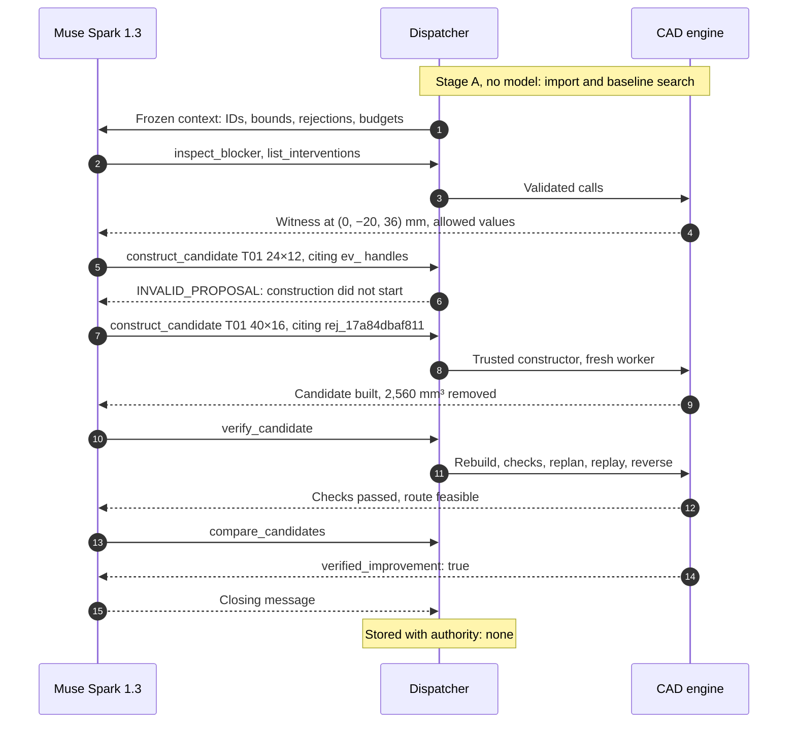
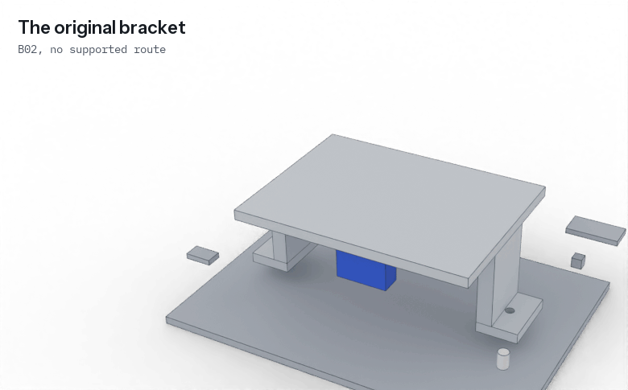
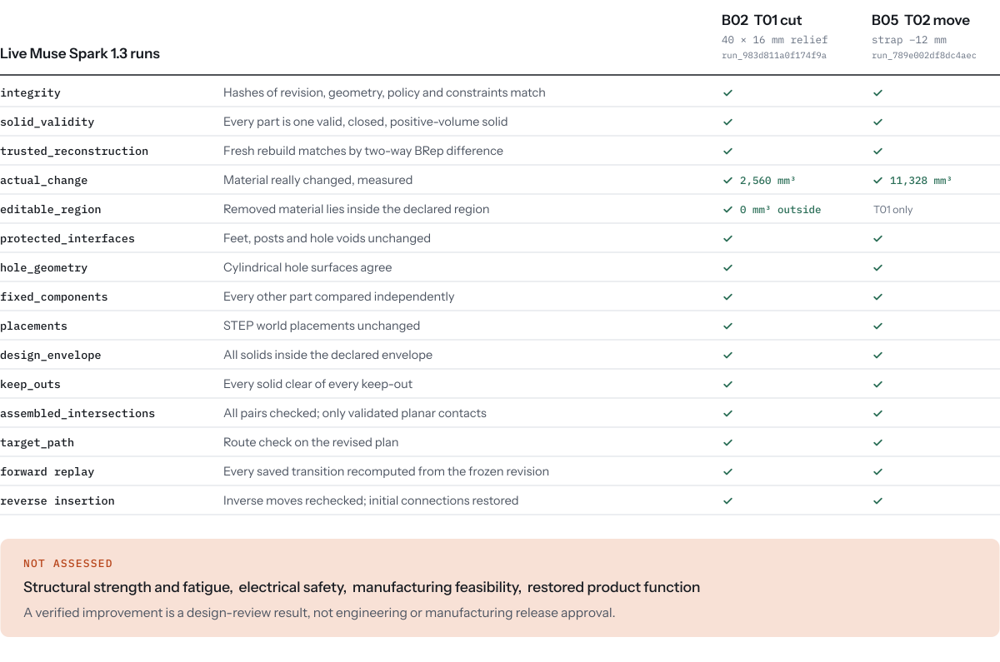
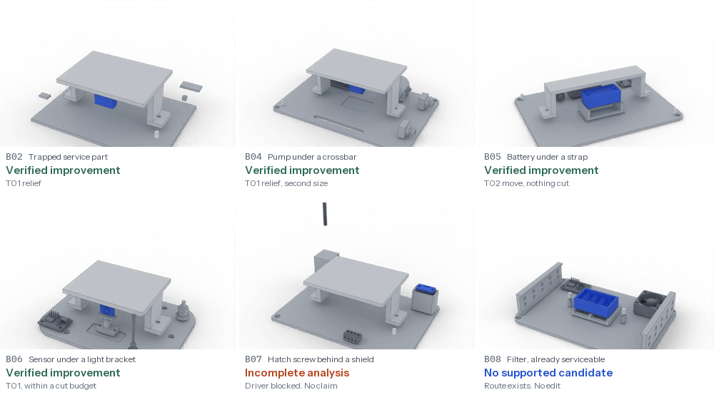

<p align="center">
  <a href="https://unlock-labs.pages.dev">
    <picture>
      <source media="(prefers-color-scheme: dark)" srcset="assets/readme/brand-dark.svg">
      <source media="(prefers-color-scheme: light)" srcset="assets/readme/brand-light.svg">
      
    </picture>
  </a>
</p>

<p align="center">
  <picture>
    <source media="(prefers-reduced-motion: reduce) and (prefers-color-scheme: dark)" srcset="assets/readme/hero-poster-dark.png">
    <source media="(prefers-reduced-motion: reduce)" srcset="assets/readme/hero-poster-light.png">
    <source media="(prefers-color-scheme: dark)" srcset="assets/readme/hero-dark.gif">
    <source media="(prefers-color-scheme: light)" srcset="assets/readme/hero-light.gif">
    
  </picture>
</p>

<p align="center">
  <strong>A broken part shouldn't make a product disposable.</strong><br>
  UNLOCK reads a CAD assembly, finds exactly what stops a failed part from coming out, lets Meta's Muse Spark 1.3 propose a constrained design change, builds that change in real CAD, and checks the result with a verifier whose verdict the model cannot change.
</p>

<p align="center">
  <a href="https://unlock-labs.pages.dev"><strong>Open the live demo</strong></a>
  &nbsp;·&nbsp;
  <a href="#05--the-ai-agent">How the agent works</a>
  &nbsp;·&nbsp;
  <a href="#10--measured-evidence">Evidence</a>
  &nbsp;·&nbsp;
  <a href="docs/README.md">Technical docs</a>
</p>
<!-- A link to the demo film goes in the row above once the final video has a public URL. -->

<p align="center">
  <sub>A research prototype on synthetic CAD fixtures, built for the Meta Global AI Developer Hackathon 2026, Indie Developer track, Push the Frontier theme. Not affiliated with or endorsed by Meta.</sub>
</p>

<p align="center">
  <sub>
    <a href="#01--the-problem">Problem</a> ·
    <a href="#02--the-idea">Idea</a> ·
    <a href="#03--see-it-work">See it work</a> ·
    <a href="#04--the-trust-boundary">Trust boundary</a> ·
    <a href="#05--the-ai-agent">Agent</a> ·
    <a href="#06--the-engineering-engine">Engine</a> ·
    <a href="#07--independent-verification">Verification</a> ·
    <a href="#08--real-results">Results</a> ·
    <a href="#09--engineering-architecture">Architecture</a> ·
    <a href="#10--measured-evidence">Evidence</a> ·
    <a href="#11--try-unlock">Try it</a> ·
    <a href="#12--reproducibility">Reproduce</a> ·
    <a href="#13--scope-and-limitations">Limits</a> ·
    <a href="#14--future-direction">Next</a> ·
    <a href="#15--credits-and-licenses">Credits</a>
  </sub>
</p>

## 01 · The problem

Most products are designed to be built. Far fewer are designed to be taken apart.

A part that is meant to be replaced can still be impossible to reach. A strap runs across the battery. A bracket spans the module. A screw head sits under a shield. Each of those parts has a reason to be there, and together they can turn a routine replacement into a teardown, an expensive service job, or a product in the bin.

The world generated a record 62 million tonnes of e-waste in 2022, and 22.3% of it was documented as formally collected and recycled ([Global E-waste Monitor 2024](https://www.unitar.org/about/news-stories/press/global-e-waste-monitor-2024-electronic-waste-rising-five-times-faster-documented-e-waste-recycling)). Repair is one part of that picture, and geometry is one part of repair: spare parts, documentation, connectors and adhesives matter too. But geometry is the part decided in CAD, long before anyone holds a screwdriver, when changing it is still cheap.

UNLOCK works on one question: **can this part come out, and if it can't, what is the smallest supported change that lets it?**

## 02 · The idea

A failed part is trapped. UNLOCK works through the problem the way an engineer would, with a hard line between what may be guessed and what must be measured.

1. **Inspect.** Import a STEP assembly and its manifest. Freeze the revision, the target and every constraint under a hash.
2. **Explain.** A deterministic planner searches for a removal route. If there is none, it reports what blocks the part, with exact BRep evidence.
3. **Investigate.** Muse Spark 1.3 reads that evidence through eight tools and proposes an edit from a finite list, citing the evidence it responds to.
4. **Construct.** A trusted CAD constructor builds the edit. The model writes no code and no geometry.
5. **Verify.** A fresh worker rebuilds the design, measures the material, searches for a route again, replays it forward and reverses it.
6. **Export.** A person accepts the result. The STEP file is written, reimported and rechecked, and every artifact is addressed by SHA-256.

What comes out is an inspectable engineering record. The model's own opinion of that record is stored alongside it, marked as carrying no authority.

## 03 · See it work

<p align="center">
  <picture>
    <source media="(prefers-color-scheme: dark)" srcset="assets/readme/sequence-dark.png">
    <source media="(prefers-color-scheme: light)" srcset="assets/readme/sequence-light.png">
    
  </picture>
</p>

Every frame on this page is rendered from the engine's own geometry, by [scripts in this repository](assets/readme/src/README.md) that refuse to run unless the redesigned part's hash matches the design recorded in evidence.

The [live demo](https://unlock-labs.pages.dev) lets you open the same assemblies, turn the exact BRep models, read each check and play the route. Be clear about what is computed where:

| Path | What you can do | What runs |
|:--|:--|:--|
| **[Public demo](https://unlock-labs.pages.dev)** | Open six projects, inspect geometry and evidence, download checked exports | Nothing new. The site serves recorded runs from a read-only snapshot and refuses every write. |
| **Judge access** | Enter a private code, upload a supported package | Fresh offline analysis on a private cloud worker, using the scripted policy. No Meta inference. |
| **Local** | The whole workflow, including live Muse Spark 1.3 with your own key | Everything, on your machine. See [Try UNLOCK](#11--try-unlock). |

<p align="center">
  <a href="https://unlock-labs.pages.dev/projects/fixture_B05"></a>
</p>

## 04 · The trust boundary

Language models are good at reading messy evidence and deciding what to try next. They can also state something false, fluently and with confidence. In a chat that is an inconvenience. In engineering it can't be what declares a part removable.

So UNLOCK gives the model plenty of room to investigate and no authority at all.

<p align="center">
  <picture>
    <source media="(prefers-color-scheme: dark)" srcset="assets/readme/trust-boundary-dark.svg">
    <source media="(prefers-color-scheme: light)" srcset="assets/readme/trust-boundary-light.svg">
    
  </picture>
</p>

Three decisions follow from that.

**Bounded tools instead of generated code.** A generated CAD script is an unbounded action space: it can build any solid, and it can quietly break a constraint in ways nobody sees until much later. UNLOCK's model chooses from [`SERVER_DOMAINS`](backend/src/unlock_engine/templates.py#L21), 196 possible designs that you can read in one dictionary. The cost is real generality. It can only make edits it has a template for.

**Verification that re-derives the result.** Reading the model's account of a candidate, or even the candidate's own record, would only show that the system agrees with itself. The verifier starts again from the frozen inputs and measures actual material.

**No authority for the model's assertions.** The outcome is [computed from candidate records and the planner's comparison](backend/src/unlock_engine/ai/controller.py#L252). A [test](backend/tests/test_ai_controller.py#L197) has the model claim success on failing candidates, and the verdict doesn't move.

None of the parts are new on their own. Disassembly planning, tool-access analysis and redesign for part access all have substantial prior art, and [our own requirements document](backend/docs/source/UNLOCK_PRD.txt) says novelty is not established. What UNLOCK contributes is a working combination: a frontier model driving real CAD redesign, inside a system where nothing it says can make a result pass.

More in [design decisions](docs/design-decisions.md) and [objections we would raise ourselves](docs/objections.md).

## 05 · The AI agent

The agent is [Muse Spark 1.3](https://dev.meta.ai/docs/models) through the direct Meta Model API, using native tool calling with `tool_choice="auto"`. SDK retries are off, so one [bounded controller](backend/src/unlock_engine/ai/controller.py) owns every retry and every budget.

### Eight tools

[`TOOL_ARGS`](backend/src/unlock_engine/ai/schemas.py#L65) is the complete list. There is no shell, Python, URL or filesystem tool, and no accept or export tool. Each definition sent to the model is generated from the same schema that later validates the call.

| Tool | What it runs | Live use |
|:--|:--|:--:|
| `inspect_assembly` | Validated manifest and measured inventory | B01, B05 |
| `inspect_constraints` | Frozen constraints, regions, keep-outs, envelope | Offline only |
| `analyze_removal` | The deterministic baseline plan for the frozen target | B05 |
| `inspect_blocker` | One rejection's certificates and BRep witness | B02, B05 |
| `list_interventions` | Server templates and the exact values allowed | B02, B05 |
| `construct_candidate` | The trusted constructor, in a fresh worker. The original revision never changes | B02, B05 |
| `verify_candidate` | Rebuild, mandatory checks, replanning, replay, reverse insertion | B02, B05 |
| `compare_candidates` | The planner's comparison under the same frozen policy | B02, B05 |

### What stops it

Every call goes through one [dispatcher](backend/src/unlock_engine/ai/toolbox.py#L298), in this order:

| Gate | Rule | On failure |
|:--|:--|:--|
| Allowlist | The tool must be one of the eight | `TOOL_NOT_ALLOWED`, never dispatched |
| Schema | Strict parsing: no extra properties, wrong types, NaN or unknown enums | `SCHEMA_ERROR`, one repair allowed per run |
| Identity | Project, revision and target must equal the frozen run | `STALE_EVIDENCE` |
| Evidence | Every cited handle was issued by this run, and at least one is a `rej_`, `plan_` or `ver_` | `INVALID_PROPOSAL`, construction does not start |
| Domain | The template is enabled and every value is on the server's list | `INVALID_PROPOSAL` |
| Budget | 3 candidates, 12 tool calls, 6 turns, 16,000 output tokens (4,096 per turn), 120 s | `BUDGET_EXHAUSTED`, then the run stops |

[These ceilings](backend/src/unlock_engine/ai/toolbox.py#L40) raise an error if set higher, and output tokens are reserved before each request. Failures return typed feedback with measured values copied from engine records, so the model can respond to numbers and not to prose. Constraints are frozen under the revision hash and read-only, so a proposal can't relax them.

### A real run

This is the B02 run as recorded. It includes the moment the model got something wrong.



The refused 24×12 was in fact the smallest design that works. It was refused for its citations, and the refusal message didn't say the same values could be resubmitted, so Muse moved to a larger cut. [That was our defect](docs/build-log.md#defects-worth-reading), fixed in `fffc1e4` with a regression test.

### Where the model matters, and where it doesn't

Muse decides what to inspect, which edit to try, and how to size it. On B05 its recorded rationale reads: *"Witness y=8 vs target y 4-26 overlaps bridge y -12..12; shift web -12 to clear Z+ path."*

It does not beat a good rule on these fixtures. On B02 a deterministic `geometry_ranked` selector found a verified design with less material removed, in half the time, for free. On B05 the offline scripted policy picks the same offset. What the live runs show is that a frontier model can work inside this boundary and reach a verified result on two assemblies with two different edit types. How it compares on constraints a hand-written rule doesn't anticipate has not been measured.

Full budgets, decision tables and token usage are in [the agent loop](docs/agent-loop.md).

## 06 · The engineering engine

**STEP and BRep.** Assemblies arrive as STEP files (ISO 10303, AP214 or AP242). A STEP file carries a boundary representation: exact surfaces and edges, in millimetres, the form CAD systems treat as the source of truth. A mesh is only an approximation of that. UNLOCK does all engineering on the BRep through [CadQuery](https://github.com/CadQuery/cadquery) and [OpenCASCADE](https://dev.opencascade.org/) (via OCP). Preview meshes are marked `authoritative: false` and never enter verification.

**Assembly topology.** A manifest declares each part's role, what retains what, and how the target may leave. Import measures the real solids, and the revision is immutable: constraints, keep-outs and envelope are hashed into its identity.

**Finding the obstruction.** The [planner](backend/docs/PLANNER.md) runs a state search over which parts have been removed, along six world axes. It admits a translation only with validated analytic coverage of the whole sweep plus the policy's 0.5 mm clearance. Sampled BRep queries can reject a move or leave it `unknown`, and can never admit it. A rejection carries a witness: on B05, the pack overlaps the strap by 1,397 mm³ after 12 mm of travel.

**Fastener access.** A screw is removed by a declared driver, whose shaft and handle solids are checked along the way. That is why B07, with its screw under a fixed shield, reports `TOOL_ACCESS_BLOCKED`.

**Constrained edits.** The model never describes a shape. It picks a template and values, and the [constructor](backend/src/unlock_engine/templates.py) builds the solid.

| Template | What changes | Allowed values | Recorded live |
|:--|:--|:--|:--|
| **T01** relief | A rectangular window through the bracket's web | Centre x 3, centre y 4, width 4, depth 4: 192 designs | B02: 40 × 16 mm, 2,560 mm³ removed |
| **T02** offset | The web moves sideways; feet and posts stay | Offset y: −12, +12, +24, +36 mm | B05: −12 mm, nothing cut |

<p align="center">
  <picture>
    <source media="(prefers-reduced-motion: reduce) and (prefers-color-scheme: dark)" srcset="assets/readme/relief-poster-dark.png">
    <source media="(prefers-reduced-motion: reduce)" srcset="assets/readme/relief-poster-light.png">
    <source media="(prefers-color-scheme: dark)" srcset="assets/readme/relief-dark.gif">
    <source media="(prefers-color-scheme: light)" srcset="assets/readme/relief-light.gif">
    
  </picture>
</p>

<p align="center"><sub>T01 on B02, the design the live run chose. The highlighted block is the actual boolean difference between the original and revised brackets.</sub></p>

**Frozen policy.** Tolerances and limits live in one [`Policy`](backend/src/unlock_engine/contracts.py#L60), and its full value is part of evidence identity. Change a tolerance and every hash derived under the old one goes stale.

## 07 · Independent verification

<h3 align="center">The model proposes. The verifier decides.</h3>

<p align="center">
  <picture>
    <source media="(prefers-color-scheme: dark)" srcset="assets/readme/verification-ledger-dark.svg">
    <source media="(prefers-color-scheme: light)" srcset="assets/readme/verification-ledger-light.svg">
    
  </picture>
</p>

**The count depends on the edit, and on who is counting.** A T01 cut has 12 mandatory static checks and a T02 move has 11, since `editable_region` only applies to cuts. Adding `target_path`, the live reports list 13 and 12 at plan level. With forward replay and reverse insertion, that makes 15 and 14 distinct checks. The workspace shows a higher figure, 25 on B05 and 27 on B02, because it lists the static checks a second time as route constraints.

**What "independent" means here.** The verifier runs in a fresh process, re-imports the frozen package and rebuilds the candidate from its parameters, then compares solids by two-way BRep difference. It is independent of the model and of the candidate record: [a forged candidate with recomputed hashes fails](backend/tests/test_templates_verification.py#L135). It is not a second implementation of the constructor. It [uses the same trusted `modify`](backend/src/unlock_engine/verification.py#L238), so a constructor bug would not show up in `trusted_reconstruction`. The other checks and the planner's own search examine the resulting material directly.

**Unknown is not a pass.** A missing or unknown mandatory check [prevents a passing result](backend/src/unlock_engine/verification.py#L66). In the interface, [a pass is only green when computed evidence backs it](frontend/src/ui/Evidence.tsx#L53).

**Export is checked too.** [`export_bundle`](backend/src/unlock_engine/export.py#L30) refuses a candidate with no current passing report, then reads the written STEP back and verifies the reimported geometry before calling it a success.

**What a pass means.** Under stated assumptions, on this synthetic geometry, a rigid part can follow this translation without the modelled collisions, and the edit respected the declared constraints. It does not establish strength, fatigue life, electrical safety, manufacturability or that the repaired product works. Every run report [says so in its own `limitations` field](backend/evidence/live-b02/live_run.json).

The full definition of every check is in [verification](docs/verification.md).

## 08 · Real results

Six assemblies, four kinds of answer. Each outcome was written down [before its run](backend/src/unlock_engine/fixture_catalog.py), and the job runner refuses to record a mismatch.

<p align="center">
  <picture>
    <source media="(prefers-reduced-motion: reduce) and (prefers-color-scheme: dark)" srcset="assets/readme/gallery-poster-dark.png">
    <source media="(prefers-reduced-motion: reduce)" srcset="assets/readme/gallery-poster-light.png">
    <source media="(prefers-color-scheme: dark)" srcset="assets/readme/gallery-dark.gif">
    <source media="(prefers-color-scheme: light)" srcset="assets/readme/gallery-light.gif">
    
  </picture>
</p>

| Fixture | Assembly | Recorded outcome | Why |
|:--|:--|:--|:--|
| [`B02`](https://unlock-labs.pages.dev/projects/fixture_B02) | Trapped service component | **Verified improvement** | Scripted policy: relief 24×8 leaves too little clearance and is rejected; 24×12 verifies |
| [`B04`](https://unlock-labs.pages.dev/projects/fixture_B04) | Pump cartridge under a crossbar | **Verified improvement** | The smallest relief still blocks the lift; the next size verifies |
| [`B05`](https://unlock-labs.pages.dev/projects/fixture_B05) | Battery pack under a strap | **Verified improvement** | Only T02 is allowed. The strap moves −12 mm and nothing is cut |
| [`B06`](https://unlock-labs.pages.dev/projects/fixture_B06) | Sensor pod under a light bracket | **Verified improvement** | A 1,200 mm³ cut budget leaves only small reliefs; the first passes |
| [`B07`](https://unlock-labs.pages.dev/projects/fixture_B07) | Service hatch behind a shield | **Incomplete analysis** | The screw is under a fixed shield, and no allowed edit frees it. The verifier rejects each one as `TOOL_ACCESS_BLOCKED` until the turn budget ends. No claim is made |
| [`B08`](https://unlock-labs.pages.dev/projects/fixture_B08) | Filter cartridge, already serviceable | **No supported candidate** | An existing route works: two screws, then a lift. There is no bracket to edit, and nothing to redesign |

The last two rows matter as much as the first four. A system that can only say yes isn't checking anything.

### What produced each record

These are different kinds of evidence, and they should not be blurred.

| Record | Decisions by | Geometry | Evidence |
|:--|:--|:--|:--|
| **Six-project gallery** (the public demo) | Offline scripted policy. **No model inference** | Real, on a private Modal CPU worker, 2026-11-01 | [`gallery-release-lighter/`](backend/evidence/gallery-release-lighter/validation.json) |
| **Live redesign, B02** | Muse Spark 1.3 | Real, local, 2026-10-29 | [`live-b02/`](backend/evidence/live-b02/), [write-up](backend/docs/LIVE_B02_REDESIGN.md) |
| **Live redesign, B05** | Muse Spark 1.3 | Real, local, 2026-11-01 | [`live-b05/`](backend/evidence/live-b05/), [write-up](backend/docs/LIVE_B05_REDESIGN.md) |
| **Live tool-calling check, B01** | Muse Spark 1.3, read-only, 2 requests | Unchanged | [`meta-tool-smoke/`](backend/evidence/meta-tool-smoke/live_report.json), [write-up](backend/docs/META_TOOL_CALLING_VERIFICATION.md) |
| **Judge upload** | Offline scripted policy | Real, a genuine upload on the deployed worker, 2026-10-31 | [`judge-access/`](backend/docs/judge-access/verification.json), [write-up](backend/docs/JUDGE_ACCESS.md) |

So B02 has two results that differ on purpose. The live run chose 40×16; the public gallery's scripted policy verifies 24×12. Both are recorded, and neither is presented as the other.

Corrections along the way are [kept in the record](backend/docs/GALLERY.md#corrections-made-on-the-way-recorded-rather-than-hidden), including B07, whose first registered expectation was wrong.

## 09 · Engineering architecture

<p align="center">
  <picture>
    <source media="(prefers-color-scheme: dark)" srcset="assets/readme/architecture-dark.svg">
    <source media="(prefers-color-scheme: light)" srcset="assets/readme/architecture-light.svg">
    
  </picture>
</p>

**One engine, two ways in.** The interactive workflow runs locally, where a [FastAPI coordinator](backend/src/unlock_engine/api/) keeps immutable revisions, a single serial job queue and resumable event streams. The cloud deployment reuses the same engine for private jobs and publishes only composed snapshots.

**The public path computes nothing.** [`unlock-demo`](backend/modal_web.py) mounts one read-only Volume subdirectory. A [publication guard](backend/src/unlock_engine/deployment/publication.py) refuses to serve unless each project has a recorded offline run, a license grant and its pre-registered outcome, and verified exports pass their hash checks. The gallery release attached no Meta secret, and `/health` reports a mock provider with no credentials.

**Native work is contained.** Each CAD operation runs in its own subprocess, with a wall-clock limit, an allowlisted operation and credentials stripped from its environment. A hung kernel call costs one operation.

**The interface only reports.** The React workspace [renders what reports say](frontend/src/ui/Evidence.tsx), and it has no code path that decides an engineering status.

Security detail is in the [security model](docs/security-model.md), and routes are in the [API reference](docs/api.md).

## 10 · Measured evidence

Each number has a source, and none generalizes beyond these synthetic fixtures.

| Measurement | Result | Source |
|:--|:--|:--|
| Live redesign runs | 2 of 2 reached `VERIFIED_IMPROVEMENT_FOUND` | [B02](backend/evidence/live-b02/live_summary.txt), [B05](backend/evidence/live-b05/live_summary.txt) |
| Live tool calls recorded | 14 across 3 sessions: 13 executed, 1 refused by validation | [B01](backend/evidence/meta-tool-smoke/live_report.json), `tool_results` in each run report |
| Tools exercised live | 7 of 8 (`inspect_constraints` has not been) | Same |
| Live run time | B02 48.1 s, B05 73.3 s, against a 120 s budget | Run reports |
| Live API use | About 31,000 to 33,000 tokens per redesign, about $0.03 at list price (an estimate, not a billed figure) | [Agent loop](docs/agent-loop.md#api-usage) |
| Constructed CAD | B02: 2,560 mm³ removed, 0 mm³ outside the editable region. B05: 11,328 mm³ changed | [`live_changed_bridge.step`](backend/evidence/live-b02/live_changed_bridge.step) and run reports |
| Deterministic comparison, B02 | `geometry_ranked`: verified, 1,152 mm³, 24.1 s. `stable_enumeration`: none verified, 30.3 s. **Muse matched the first and did not beat it** | [`selector_*.json`](backend/evidence/live-b02/selector_geometry_ranked.json) |
| Cloud execution | 6 of 6 Modal jobs matched pre-registered outcomes, 58 to 154 s each | [`validation.json`](backend/evidence/gallery-release-lighter/validation.json) |
| Export integrity | First gallery release: 71 of 71 artifacts hash-exact, 28 of 28 write attempts refused | [`gallery-release/validation.json`](backend/evidence/gallery-release/validation.json) |
| Genuine upload on the deployed worker | `VERIFIED_IMPROVEMENT_FOUND` in 76.3 s, downloaded bytes matched the recorded hash | [`JUDGE_ACCESS.md`](backend/docs/JUDGE_ACCESS.md#published-verification-2026-10-31) |
| Test suite | 389 tests collected, 357 in the default selection. Last recorded full run: 342 passed, 27 deselected, 2026-10-31. Paid tests never run by default | [`backend-tests.txt`](backend/docs/judge-access/backend-tests.txt) |

The test count moved after that recorded run, and this documentation-only change did not rerun the CAD suite. See the [validation report](docs/validation-report.md) for what was and wasn't executed.

Timing conditions and limits are in [performance](docs/performance.md).

## 11 · Try UNLOCK

### Hosted, no install

Open **<https://unlock-labs.pages.dev>**. No account, key or code is needed. Everything is read-only.

### Judge access

Judges with a private code can enter it on the [projects page](https://unlock-labs.pages.dev/projects) to upload a supported package and start a fresh offline analysis on a private worker. Uploads are limited to 10 MiB, and six attempts are shared across the whole event, so failed attempts count. There is no live model inference on this path. [Details](backend/docs/JUDGE_ACCESS.md).

### Local, offline, no key

This runs the real CAD engine and planner with the labelled scripted policy. It makes no paid calls.

| Prerequisite | Version | Why |
|:--|:--|:--|
| Python | 3.12 | Pinned `>=3.12,<3.13`, because OCP wheels are version-specific |
| Node | 20.19+ or 22.12+ | Required by Vite 7 |
| Disk | About 1.5 GB | CadQuery, OCP and VTK wheels are large |

Tested on macOS ARM64. Linux is exercised through the Modal image.

```bash
git clone https://github.com/Shrenzoo/unlock.git && cd unlock/backend
```

```bash
python3.12 -m venv .venv
```

```bash
.venv/bin/python -m pip install -r requirements.lock && .venv/bin/python -m pip install --no-deps --no-build-isolation -e .
```

Then pick one.

**Command line only.** One complete run prints its outcome and writes a full report.

```bash
.venv/bin/python -m unlock_engine.ai demo --offline --fixture B05 --output .work/b05
```

**Full workspace.** Start the backend, then the frontend in a second terminal from the repository root.

```bash
AI_PROVIDER=mock .venv/bin/python -m unlock_engine.api --port 8000
```

```bash
cd frontend && npm ci && npm run dev -- --host 127.0.0.1 --port 5183 --strictPort
```

Open <http://localhost:5183/projects>. The first backend start generates and imports the fixtures, so give it a minute or two. The [five-minute walkthrough](docs/demo-walkthrough.md) goes screen by screen, from the failed baseline to a checked STEP package.

### Live Meta inference

This spends API credits. It needs a key from the [Meta Model API](https://dev.meta.ai).

```bash
cp -n backend/.env.example backend/.env
```

Put your key in `backend/.env` as `MODEL_API_KEY`, leave `AI_PROVIDER=meta`, and restart the backend. Keys belong only in `backend/.env`, which Git ignores at every depth. Redesign requests then call Muse Spark 1.3. If no key is configured the baseline still works, and redesign reports `Model unavailable` instead of quietly falling back to the scripted policy.

Paid tests never run by accident: they need both a key and `RUN_META_LIVE_TESTS=1`, and ordinary `pytest` deselects them.

## 12 · Reproducibility

Everything below runs from the repository root, and needs nothing except [`jq`](https://jqlang.org/). No key, no network.

**The live outcome, and what the model's claim is worth:**

```bash
jq -r '.outcome, .live_model, .model.model_id, .final_model_message.authority' backend/evidence/live-b02/live_run.json
```

**Every live tool call and its status, including the refusal:**

```bash
jq -r '.engineering_evidence.tool_results[] | "\(.tool) \(.status) \(.feedback.category // "")"' backend/evidence/live-b02/live_run.json
```

**Every plan-level check on the T02 run:**

```bash
jq -r '.candidates[0].revised_plan.constraint_checks[] | "\(.constraint_id) \(.result)"' backend/evidence/live-b05/live_run.json
```

**The constructed bracket's bytes match its recorded hash** (`3963ce4d…`):

```bash
shasum -a 256 backend/evidence/live-b02/live_changed_bridge.step
```

**It is a real AP214 STEP file:**

```bash
grep -m1 FILE_SCHEMA backend/evidence/live-b02/live_changed_bridge.step
```

**The tool-calling check's 15 outcomes:**

```bash
jq -r '.checks[] | "\(.name) \(.result)"' backend/evidence/meta-tool-smoke/live_report.json
```

With the backend installed, the checks that matter most cover forged geometry, invalid proposals, unknown checks and false success claims:

```bash
cd backend && .venv/bin/python -m pytest -q tests/test_ai_toolbox.py tests/test_ai_controller.py tests/test_templates_verification.py
```

### Where things are

| Path | Contents |
|:--|:--|
| [`backend/evidence/live-b02/`](backend/evidence/live-b02/), [`live-b05/`](backend/evidence/live-b05/) | Complete live reports, constructed brackets, selector controls, timing benchmarks |
| [`backend/evidence/meta-tool-smoke/`](backend/evidence/meta-tool-smoke/) | The live tool-calling check |
| [`backend/evidence/gallery-release-lighter/`](backend/evidence/gallery-release-lighter/) | Current public gallery: jobs, outcomes, export hashes |
| [`backend/evidence/meta/`](backend/evidence/meta/) | Frozen integration record, with a checked export and its [`SHA256.json`](backend/evidence/meta/SHA256.json) |
| [`backend/evidence/browser-acceptance/`](backend/evidence/browser-acceptance/) | Real-browser acceptance report and screenshots |
| [`backend/src/unlock_engine/fixtures.py`](backend/src/unlock_engine/fixtures.py), [`fixture_parts.py`](backend/src/unlock_engine/fixture_parts.py) | Source of every fixture, deterministic |
| [`backend/schemas/`](backend/schemas/) | JSON Schemas for reports, plans and certificates |
| [`assets/readme/src/`](assets/readme/src/README.md) | Scripts that regenerate this page's visuals from the engine and evidence |

The [claim ledger](docs/claims.md) maps each substantive claim on this page to its source. The [audit](docs/readme-audit.md) lists the errors found in the previous version of this README.
