<p align="center">
  
</p>

<h1 align="center">UNLOCK</h1>

<p align="center">
  <em>Design for the day it breaks.</em>
</p>

<p align="center">
  An AI agent that redesigns a physical product so its failed part can actually be replaced —<br/>
  then proves the redesign is safe with a CAD kernel <strong>before anyone cuts metal.</strong>
</p>

<p align="center">
  <a href="https://github.com/Shrenzoo/unlock/assets/readme/hero-trapped-part.svg"></a>
</p>

<p align="center">
  
  
  
  
  
</p>

---

## Contents

<table>
<tr>
<td width="50%">

**The argument**
1. [The problem](#the-problem)
2. [What UNLOCK does](#what-unlock-does)
3. [Why this pushes the frontier](#why-this-pushes-the-frontier)
4. [Why nothing like this exists](#why-nothing-like-this-exists)

</td>
<td width="50%">

**The substance**
5. [How it works](#how-it-works)
6. [The trust boundary](#the-trust-boundary)
7. [The eight tools](#the-eight-tools)
8. [The live run](#the-live-run)
9. [Verification](#verification)

</td>
</tr>
<tr>
<td>

10. [Architecture](#architecture)
11. [Getting started](#getting-started)
12. [The API surface](#the-api-surface)

</td>
<td>

13. [Evidence & reproducibility](#evidence--reproducibility)
14. [Scope, honestly](#scope-honestly)
15. [Built during the hackathon](#built-during-the-hackathon)

</td>
</tr>
</table>

---

## The problem

Every product is designed for the factory. Almost none are designed for the day it breaks.

A fan module dies inside a sealed enclosure. A bracket — never meant to be removed — sits directly above it. The service manual says *replace the fan*. Geometry says *the fan cannot leave*. So the enclosure goes in a skip, and a €200 part failure becomes a €2,000 replacement plus the embodied carbon of an entirely new machine.

This is not a rounding error in the waste stream. It is the waste stream. Right-to-repair legislation keeps trying to mandate an answer, and keeps discovering that the answer cannot be legislated into existence — because the obstruction is not a policy decision. **It is a shape.**

Fixing the shape requires someone to reason about geometry, motion, tool access and constraint compliance together, and then to be *certain* they got it right. That combination is exactly what has been missing.

<p align="center">
  
</p>

<sub><code>fixture B02</code> — the baseline search returns <code>no_path_supported</code> with two confirmed geometric obstructions and an actual BRep witness. After the relief, the route is a single verified translation. Both halves of this diagram are computed, not illustrated.</sub>

---

## What UNLOCK does

You point it at a mechanical assembly and name the part that failed. UNLOCK then runs a seven-stage loop:

```text
 01  inspect      ── parse the STEP assembly, measure real bounds, freeze a revision
 02  baseline     ── search for a supported removal path for the failed part
 03  obstruction  ── find what is actually in the way, with BRep evidence
 04  interventions── list the finite redesigns the server will allow
 05  construct    ── build the proposed edit with a trusted CAD constructor
 06  verify       ── independently reconstruct and check twelve mandatory constraints
 07  compare      ── original versus revised, under one frozen policy
```

Stages 01–05 are where **Muse Spark 1.3** earns its keep: it reads the obstruction evidence, chooses which component to modify and by how much, and iterates on its own proposals.

Stages 06–07 are where the model is deliberately, structurally powerless. Nothing it says is accepted as true. A CAD kernel rebuilds the geometry from frozen parameters and decides for itself.

The output is not an opinion. It is a **verification report** — a specific, machine-checkable claim that under a named numerical policy, on a named revision, with named evidence handles, this part can now be removed along a stated axis in a stated number of millimetres.

### One sentence

> UNLOCK asks an AI to redesign a product so its broken part can actually be replaced — then proves the redesign is safe before anyone cuts metal.

### What it refuses to claim

This matters as much as what it does. A passing report is a geometry result for one target under one stated policy. UNLOCK states plainly, in the product itself, what has **not** been assessed:

<ul>
<li>Strength, stiffness and fatigue</li>
<li>Electrical safety and shielding</li>
<li>Manufacturing feasibility</li>
<li>Restored product function</li>
<li>Torque, forces, cables, clips and adhesives</li>
</ul>

An engineering tool that overstates its own certainty is more dangerous than no tool at all. Every number in UNLOCK is either computed, or explicitly labelled as not computed.

---

## Why this pushes the frontier

> **Push the Frontier** — Use Meta's models to tackle challenges in software, robotics, manufacturing, energy, materials and beyond. Give a machine a new capability, accelerate a scientific experiment, or unlock a better way to understand and control a physical system. Show us what becomes possible when these models meet the real world.

That track asks for a specific thing: *what becomes possible when these models meet the real world.* Not what becomes faster. Not what becomes cheaper. **Possible.**

Here is the honest answer for this project.

### Before: a question no software could answer

Take a real enclosure with a dead fan behind a bracket. Ask the entire existing toolchain:

> *"Can this part be removed, and if not, what is the smallest change to the housing that makes it removable?"*

- **The CAD system** cannot answer. It will model whatever you draw. It has no opinion about whether a shape is removable.
- **The PLM system** cannot answer. It knows the part numbers and the change history, not the geometry of motion.
- **The simulation package** cannot answer. It can tell you if a part collides, given a path you supply. It cannot invent the path, and it certainly cannot redesign the obstruction.
- **A search heuristic** answers badly. Your own `stable_enumeration` selector — deliberately included as a control — tried three candidates and returned **`NO_VERIFIED_IMPROVEMENT`**.

The question was genuinely unanswerable. Not unanswerable *quickly*. Unanswerable.

### After: a machine that answers it, and shows its work

A language model reads the BRep witness that pins the obstruction to coordinates `(0, −20, 36)` mm, reasons that the bracket's web is the only material in the removal envelope, picks a relief window from a finite server-side domain, proposes `T01 · 40 × 16 mm`, gets told its first attempt was rejected for an uncitable claim, resubmits correctly, and arrives at a design that a CAD kernel independently confirms:

```text
original   no_path_supported        ← no feasible route under supported operations
revised    feasible                 ← target TRANSLATE Z+ 80 mm, cost (0,0,0,1)
checks     12/12 mandatory passed   ← reconstruction, envelope, keep-outs, intersections…
material   2,560 mm³ removed        ← 0 mm³ outside the declared editable web
replay     forward ✓  reverse ✓     ← the path is executable in both directions
```

**A part that could not be serviced can now be serviced.** That is not a faster version of something that existed. It is a capability that did not exist, expressed in millimetres and verified against a B-rep.

<p align="center">
  
</p>

### The capability, stated precisely

What UNLOCK gives a machine that it did not have before:

<table>
<tr>
<th width="33%">A new capability</th>
<th>What that makes possible</th>
</tr>
<tr>
<td><strong>Geometric reasoning over real B-reps</strong></td>
<td>A model reasons about solids it cannot see, in millimetres, against measured bounds — and its reasoning is checked against the actual topology rather than its description of it.</td>
</tr>
<tr>
<td><strong>Closed-loop redesign under constraint</strong></td>
<td>The model may only choose from finite, server-owned parameter grids. It cannot emit arbitrary geometry, so it cannot emit arbitrary risk.</td>
</tr>
<tr>
<td><strong>Self-correction driven by measured feedback</strong></td>
<td>When a proposal fails, the model receives the measurement — not a vibe. It then adjusts the design against real numbers.</td>
</tr>
<tr>
<td><strong>Machine-checkable engineering claims</strong></td>
<td>Every "this is safe" resolves to a named policy, a geometry hash, and twelve checked constraints. A third party can re-run it.</td>
</tr>
</table>

### Why it had to be a frontier project, not a product project

This could not have been built as *"AI for our workflow."* There is no workflow where a human feeds a STEP file to a language model and trusts the answer — because the human cannot verify the answer either, which is the entire problem. The frontier being pushed here is not model capability. It is **the interface between probabilistic reasoning and deterministic proof**, and the specific finding is:

> A frontier model can be dropped into a safety-relevant engineering loop with *zero* trust, given *bounded* authority, and still reach a correct, verified, physically real outcome — because every claim it makes is resolved by a kernel that does not care what it said.

That is a transferable result. It applies to robotics motion planning, to materials substitution, to any domain where the cost of a confident wrong answer is high. UNLOCK is the worked example.

---

## Why nothing like this exists

It is worth being blunt about why this corner of the map was empty, because the obstacles were not technical fashion. They were real, and each one has a specific name.

<table>
<tr>
<th width="28%">The obstacle</th>
<th>Why it stopped everyone else</th>
<th>How UNLOCK gets past it</th>
</tr>
<tr>
<td><strong>"Just let the LLM write the CAD script."</strong></td>
<td>The model emits Python that builds a solid. It runs. It produces a plausible shape. Nobody — including the author — can say whether that shape preserves a mounting interface until someone builds a fixture and measures it.</td>
<td>The model never writes code and never emits geometry. It chooses integers from a server-owned finite grid: <code>width_mm ∈ {24, 40, 46, 52}</code>. A trusted constructor builds it. There is no code path from model output to unbounded behaviour.</td>
</tr>
<tr>
<td><strong>"Verification is too slow to be practical."</strong></td>
<td>Real B-rep boolean checks are expensive. Cold-starting OCCT costs 4–6 s per native operation. A naive loop spends its whole budget importing libraries.</td>
<td>A warm, single-use standby worker absorbs the import cost, overlapping the model's thinking time. Peak memory stays at the cold path (~440 MiB RSS). The documented run completed in <strong>48.1 s</strong> against a hard 120 s ceiling.</td>
</tr>
<tr>
<td><strong>"The model will hallucinate a pass."</strong></td>
<td>It will. A language model asked "is this safe?" will say yes, fluently, with confidence, and be wrong.</td>
<td>Model-supplied pass flags are <strong>never accepted</strong>. The verifier reconstructs the candidate from frozen parameters in a separate process and inspects actual material and voids. The model's final <code>"safe": true</code> is recorded, and then ignored.</td>
</tr>
<tr>
<td><strong>"You can't reason about physical motion with an LLM."</strong></td>
<td>Correct — alone. Collision-free extraction is a sweep problem over six axes with tool-approach constraints, not a text problem.</td>
<td>The planner does the motion. It demands validated conservative coverage plus complete analytic sweep separation to admit a translation. Witness sampling may <em>reject</em> or leave <em>unknown</em> — it can never admit.</td>
</tr>
<tr>
<td><strong>"One demo, no reliability."</strong></td>
<td>The most common failure at this scale: a single golden path, presented as a product.</td>
<td>Two deterministic selectors were frozen and run <em>before</em> the live call, as controls. One matched the model, one failed entirely. The comparison is published, including the fact that the model did <em>not</em> beat the deterministic selector. See <a href="#the-live-run">the live run</a>.</td>
</tr>
</table>

### The specific design decision that made it possible

Almost every "AI for CAD" project makes the same early choice: **trust the model's self-report.** It is the natural choice, because building an independent verifier is most of the work, and the model's self-report is right often enough to feel like proof.

UNLOCK's core decision was to treat that instinct as the bug it is. The model is given bounded, read-mostly tools; every proposal must cite run-issued evidence handles; a proposal citing only weak handles is **refused before construction ever starts**; and the resulting claim is resolved by a kernel that shares no state with the model.

The cost of that decision is roughly a doubling of implementation effort. The benefit is that the word *verified* in the output means something a third party can check.

<p align="center">
  
</p>

---

## How it works

<p align="center">
  
</p>

### Stage 01–02 — Inspect and baseline

A package is accepted only as a flat `assembly.step` (AP214 or AP242, explicit uniform millimetre units), a `manifest.json`, and an optional `attribution.txt`. Inputs are bounded *before* any native parsing: scripts, external references, symlinks, encrypted archives and arbitrary archive paths are rejected outright.

The import runs in an isolated native worker and produces an immutable revision. Frozen constraints, keep-outs and envelope are hashed into that revision's identity — so a later check against stale inputs cannot silently pass.

The baseline planner then searches for a supported removal path for the frozen target. On B02 it returns `no_path_supported`, **complete**, with two `CONFIRMED_GEOMETRIC_OBSTRUCTION` rejections carrying an actual BRep witness. Note what it refuses to do: it does not invent an operation count for an infeasible baseline, so no percentage improvement against a zero can ever be reported later.

### Stage 03–05 — Obstruction, intervention, construction

The model receives compact structured evidence — never a STEP file, never raw geometry. It is shown the witness position, the rejection certificate, and the finite domains the server will allow:

```python
# backend/src/unlock_engine/templates.py — the model's entire decision space
SERVER_DOMAINS = {
    "T01": dict(
        center_x_mm=(-4.0, 0.0, 4.0),
        center_y_mm=(-28.0, -20.0, -12.0, -4.0),
        width_mm=(24.0, 40.0, 46.0, 52.0),
        depth_mm=(8.0, 12.0, 16.0, 20.0),
    ),
    "T02": dict(offset_y_mm=(-12.0, 12.0, 24.0, 36.0)),
}
```

Twelve numbers. That is the model's entire authority over physical geometry. It cannot widen the domain, cannot add a template, and cannot construct anything outside it — arguments carrying extra fields, invalid IDs, unsupported templates or out-of-domain parameters are rejected before any native process starts.

Construction happens in an isolated worker and returns a candidate with a real changed solid. **Construction is not verification** — the tool description says so in as many words.

### Stage 06–07 — Verify and compare

The verifier does not receive the candidate the model saw. It reconstructs the bracket *from the frozen parameters*, in a separate process, and compares the result against the original by two-way B-rep difference. Then it runs the twelve mandatory checks, re-plans the removal, replays the path forward, and inserts it in reverse.

Only then does comparison run — under the same target and the same frozen policy, so the two sides of the table are genuinely comparable.

```
┌──────────────────────────────────────────────────────────────────────┐
│  the model                    the boundary        the kernel         │
│  ─────────                    ────────────        ─────────          │
│  reads evidence      ───▶      accepts only       rebuilds from      │
│  picks integers       ───▶      bounded args       frozen params     │
│  cites handles        ───▶      rej_/plan_/ver_    real B-rep ops    │
│  claims "safe"        ───▶      recorded, ignored  decides the pass  │
└──────────────────────────────────────────────────────────────────────┘
```

### The evidence chain

Every artefact carries a content hash, and every hash is checked:

```text
manifest  ──SHA-256──▶  revision  ──▶  plan  ──▶  candidate
    │                      │             │           │
    └── geometry hash ─────┴── constraint hash ──────┘
                              │
                              ▼
                    verification report
                    (policy digest included in identity)
```

Numerical assumptions live in a single `contracts.Policy`. The full policy is part of the evidence identity, which means changing a tolerance invalidates every geometry and constraint hash derived under the old one. Stale evidence cannot masquerade as fresh evidence.

---

## The trust boundary

This is the idea the whole project turns on, so it gets its own section rather than a footnote.

**The model proposes. The kernel disposes. There is exactly one place they meet, and it is one-way.**

```mermaid
flowchart LR
    subgraph MODEL["Muse Spark 1.3 — untrusted proposer"]
        A[Reads structured evidence] --> B[Reasons about the obstruction]
        B --> C[Chooses template + integers]
        C --> D[Cites run-issued evidence handle]
    end

    subgraph BOUNDARY["The dispatcher — the only door"]
        E{Schema valid?<br/>Identity frozen?<br/>Domain finite?<br/>Handle citable?}
    end

    subgraph KERNEL["OCCT kernel — trusted authority"]
        F[Trusted constructor builds] --> G[Independent reconstruction]
        G --> H[12 mandatory checks]
        H --> I[Re-plan · replay · reverse]
        I --> J[Comparison under frozen policy]
    end

    D --> E
    E -->|"INVALID_PROPOSAL"| D
    E -->|"accepted"| F
    J --> K[Verification report]
    E -.->|"model self-report"| X[(recorded, ignored)]

    style MODEL fill:#1a2233,stroke:#3268f5,color:#e9e8e3
    style BOUNDARY fill:#2a1a14,stroke:#e4602f,color:#e9e8e3
    style KERNEL fill:#14211c,stroke:#34866b,color:#e9e8e3
    style X fill:#1d2023,stroke:#4f5357,color:#7d8287
```



### The four rules that give it teeth

**1. Every proposal must cite evidence the run itself issued.**
Not a plausible-sounding identifier. Not the model's memory of an earlier turn. A `rej_`, `plan_` or `ver_` handle that this specific run handed out. A proposal citing anything else is refused *before construction starts*.

<p align="center">
  
</p>

**2. Unknown is a distinct result from pass and from fail.**
`clear`, `blocked` and `unknown` are kept as separate statuses and never merged. A mandatory check that is unknown, missing or stale **forbids a passing aggregate**. There is no partial-credit path to green.

**3. Witness sampling may reject. It may never admit.**
Only validated conservative coverage plus complete analytic sweep separation can admit a translation. This is the difference between a checker that is conservative by construction and one that is merely usually right.

**4. The frontend never derives a status.**
It renders what a report says. The single place in the UI that decides how a result is drawn — `ui/Evidence.tsx` — will only paint green when provenance is `live` or `computed_earlier`. An illustrative pass is drawn as an outline, never green.

```tsx
// frontend/src/ui/Evidence.tsx — the whole trust story in nine lines
export function resultLabel(result: CheckResult, provenance: ProvenanceKind) {
  const computed = provenance !== 'illustrative'
  switch (result) {
    case 'pass':
      return { tone: computed ? 'verified' : 'pass-illustrative',
               text: computed ? 'Passed' : 'Pass (illustrative)' }
    // …
  }
}
```

Green is not a colour in this product. It is a claim about provenance.
