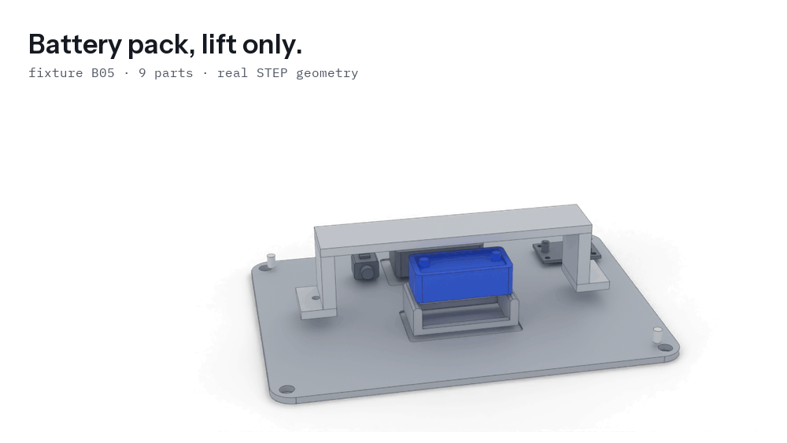
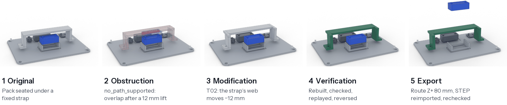
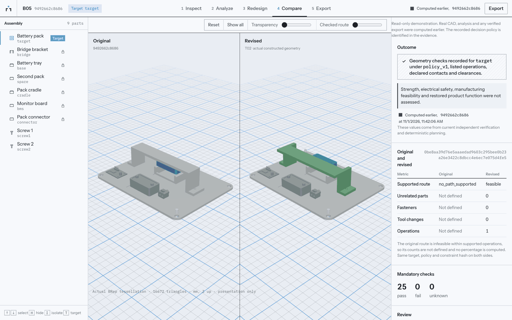
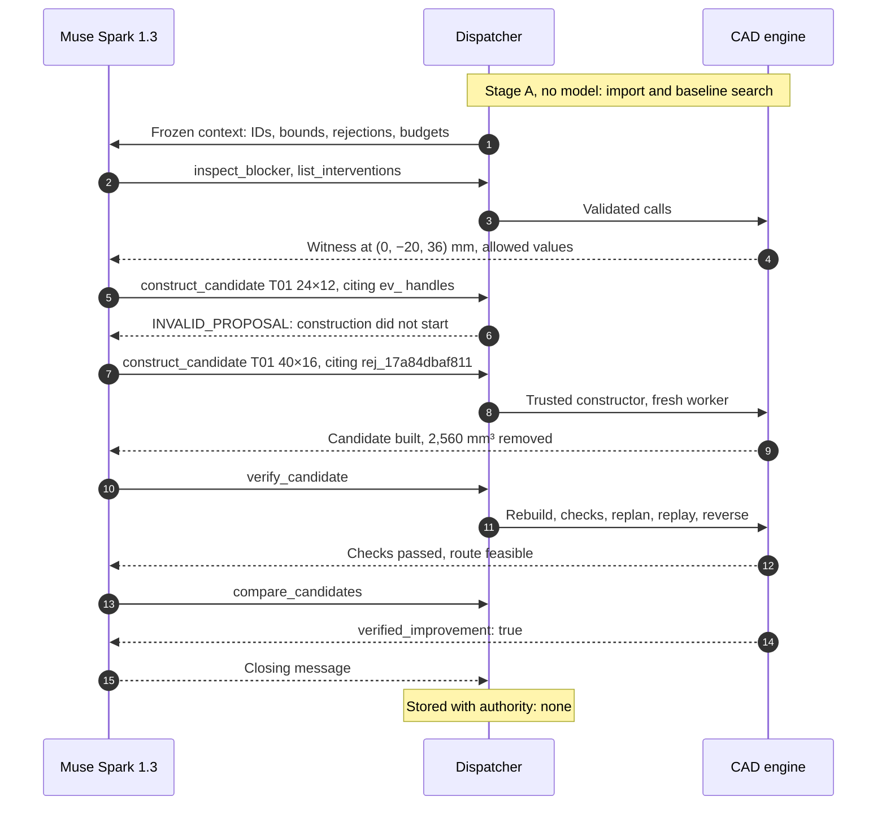

  <a href="https://unlock-labs.pages.dev">
    <picture>
      <source media="(prefers-color-scheme: dark)" srcset="assets/readme/brand-dark.svg">
      <source media="(prefers-color-scheme: light)" srcset="assets/readme/brand-light.svg">
      
    </picture>
  </a>

  <picture>
    <source media="(prefers-reduced-motion: reduce) and (prefers-color-scheme: dark)" srcset="assets/readme/hero-poster-dark.png">
    <source media="(prefers-reduced-motion: reduce)" srcset="assets/readme/hero-poster-light.png">
    <source media="(prefers-color-scheme: dark)" srcset="assets/readme/hero-dark.gif">
    <source media="(prefers-color-scheme: light)" srcset="assets/readme/hero-light.gif">
    
  </picture>

  <strong>A broken part shouldn't make a product disposable.</strong> 
  UNLOCK reads a CAD assembly, finds exactly what stops a failed part from coming out, lets Meta's Muse Spark 1.3 propose a constrained design change, builds that change in real CAD, and checks the result with a verifier the model cannot influence.

  <a href="https://unlock-labs.pages.dev"><strong>Open the live demo</strong></a>
  &nbsp;·&nbsp;
  <a href="#05--the-ai-agent">How the agent works</a>
  &nbsp;·&nbsp;
  <a href="#10--measured-evidence">Evidence</a>
  &nbsp;·&nbsp;
  <a href="docs/README.md">Technical docs</a>

<!-- A link to the demo film goes in the row above once the final video has a public URL. -->

  A research prototype on synthetic CAD fixtures, built for the Meta Global AI Developer Hackathon 2026, Indie Developer track, Push the Frontier theme. Not affiliated with or endorsed by Meta.

  
    <a href="#01--the-problem">Problem</a> ·
    <a href="#02--the-idea">Idea</a> ·
    <a href="#03--see-it-work">See it work</a> ·
    <a href="#04--the-trust-boundary">Trust boundary</a> ·
    <a href="#05--the-ai-agent">Agent</a> ·
    <a href="#06--the-engineering-engine">Engine</a> ·
    <a href="#07--independent-verification">Verification</a> ·
    <a href="#08--real-results">Results</a> ·
    <a href="#09--engineering-architecture">Architecture</a> ·
    <a href="#10--measured-evidence">Evidence</a> ·
    <a href="#11--try-unlock">Try it</a> ·
    <a href="#12--reproducibility">Reproduce</a> ·
    <a href="#13--scope-and-limitations">Limits</a> ·
    <a href="#14--future-direction">Next</a> ·
    <a href="#15--credits-and-licenses">Credits</a>
  

## 01 · The problem

Most products are designed to be built. Far fewer are designed to be taken apart.

A part that is meant to be replaced can still be impossible to reach. A strap runs across the battery. A bracket spans the module. A screw head sits under a shield. Each of those parts has a reason to be there, and together they can turn a routine replacement into a teardown, an expensive service job, or a product in the bin.

The world generated a record 62 million tonnes of e-waste in 2022, and 22.3% of it was documented as formally collected and recycled ([Global E-waste Monitor 2024](https://www.unitar.org/about/news-stories/press/global-e-waste-monitor-2024-electronic-waste-rising-five-times-faster-documented-e-waste-recycling)). Repair is one part of that picture, and geometry is one part of repair: spare parts, documentation, connectors and adhesives matter too. But geometry is the part decided in CAD, long before anyone holds a screwdriver, when changing it is still cheap.

UNLOCK works on one question: **can this part come out, and if it can't, what is the smallest supported change that lets it?**

## 02 · The idea

A failed part is trapped. UNLOCK works through the problem the way an engineer would, with a hard line between what may be guessed and what must be measured.

1. **Inspect.** Import a STEP assembly and its manifest. Freeze the revision, the target and every constraint under a hash.
2. **Explain.** A deterministic planner searches for a removal route. If there is none, it reports what blocks the part, with exact BRep evidence.
3. **Investigate.** Muse Spark 1.3 reads that evidence through eight tools and proposes an edit from a finite list, citing the evidence it responds to.
4. **Construct.** A trusted CAD constructor builds the edit. The model writes no code and no geometry.
5. **Verify.** A fresh worker rebuilds the design, measures the material, searches for a route again, replays it forward and reverses it.
6. **Export.** A person accepts the result. The STEP file is written, reimported and rechecked, and every artifact is addressed by SHA-256.

What comes out is an inspectable engineering record. The model's own opinion of that record is stored alongside it, marked as carrying no authority.

## 03 · See it work

  <picture>
    <source media="(prefers-color-scheme: dark)" srcset="assets/readme/sequence-dark.png">
    <source media="(prefers-color-scheme: light)" srcset="assets/readme/sequence-light.png">
    
  </picture>

Every frame on this page is rendered from the engine's own geometry, by [scripts in this repository](assets/readme/src/README.md) that refuse to run unless the redesigned part's hash matches the design recorded in evidence.

The [live demo](https://unlock-labs.pages.dev) lets you open the same assemblies, turn the exact BRep models, read each check and play the route. Be clear about what is computed where:

| Path | What you can do | What runs |
|:--|:--|:--|
| **[Public demo](https://unlock-labs.pages.dev)** | Open six projects, inspect geometry and evidence, download checked exports | Nothing new. The site serves recorded runs from a read-only snapshot and refuses every write. |
| **Judge access** | Enter a private code, upload a supported package | Fresh offline analysis on a private cloud worker, using the scripted policy. No Meta inference. |
| **Local** | The whole workflow, including live Muse Spark 1.3 with your own key | Everything, on your machine. See [Try UNLOCK](#11--try-unlock). |

  

## 04 · The trust boundary

Language models are good at reading messy evidence and deciding what to try next. They can also state something false, fluently and with confidence. In a chat that is an inconvenience. In engineering it can't be what declares a part removable.

So UNLOCK gives the model plenty of room to investigate and no authority at all.

  <picture>
    <source media="(prefers-color-scheme: dark)" srcset="assets/readme/trust-boundary-dark.svg">
    <source media="(prefers-color-scheme: light)" srcset="assets/readme/trust-boundary-light.svg">
    
  </picture>

Three decisions follow from that.

**Bounded tools instead of generated code.** A generated CAD script is an unbounded action space: it can build any solid, and it can quietly break a constraint in ways nobody sees until much later. UNLOCK's model chooses from [`SERVER_DOMAINS`](backend/src/unlock_engine/templates.py#L21), 196 possible designs that you can read in one dictionary. The cost is real generality. It can only make edits it has a template for.

**Verification that re-derives the result.** Reading the model's account of a candidate, or even the candidate's own record, would only show that the system agrees with itself. The verifier starts again from the frozen inputs and measures actual material.

**No authority for the model's assertions.** The outcome is [computed from candidate records and the planner's comparison](backend/src/unlock_engine/ai/controller.py#L252). A [test](backend/tests/test_ai_controller.py#L197) has the model claim success on failing candidates, and the verdict doesn't move.

None of the parts are new on their own. Disassembly planning, tool-access analysis and redesign for part access all have substantial prior art, and [our own requirements document](backend/docs/source/UNLOCK_PRD.txt) says novelty is not established. What UNLOCK contributes is a working combination: a frontier model driving real CAD redesign, inside a system where nothing it says can make a result pass.

More in [design decisions](docs/design-decisions.md) and [objections we would raise ourselves](docs/objections.md).

## 05 · The AI agent

The agent is [Muse Spark 1.3](https://dev.meta.ai/docs/models) through the direct Meta Model API, using native tool calling with `tool_choice="auto"`. SDK retries are off, so one [bounded controller](backend/src/unlock_engine/ai/controller.py) owns every retry and every budget.

### Eight tools

[`TOOL_ARGS`](backend/src/unlock_engine/ai/schemas.py#L65) is the complete list. There is no shell, Python, URL or filesystem tool, and no accept or export tool. Each definition sent to the model is generated from the same schema that later validates the call.

| Tool | What it runs | Live use |
|:--|:--|:--:|
| `inspect_assembly` | Validated manifest and measured inventory | B01, B05 |
| `inspect_constraints` | Frozen constraints, regions, keep-outs, envelope | Offline only |
| `analyze_removal` | The deterministic baseline plan for the frozen target | B05 |
| `inspect_blocker` | One rejection's certificates and BRep witness | B02, B05 |
| `list_interventions` | Server templates and the exact values allowed | B02, B05 |
| `construct_candidate` | The trusted constructor, in a fresh worker. The original revision never changes | B02, B05 |
| `verify_candidate` | Rebuild, mandatory checks, replanning, replay, reverse insertion | B02, B05 |
| `compare_candidates` | The planner's comparison under the same frozen policy | B02, B05 |

### What stops it

Every call goes through one [dispatcher](backend/src/unlock_engine/ai/toolbox.py#L298), in this order:

| Gate | Rule | On failure |
|:--|:--|:--|
| Allowlist | The tool must be one of the eight | `TOOL_NOT_ALLOWED`, never dispatched |
| Schema | Strict parsing: no extra properties, wrong types, NaN or unknown enums | `SCHEMA_ERROR`, one repair allowed per run |
| Identity | Project, revision and target must equal the frozen run | `STALE_EVIDENCE` |
| Evidence | Every cited handle was issued by this run, and at least one is a `rej_`, `plan_` or `ver_` | `INVALID_PROPOSAL`, construction does not start |
| Domain | The template is enabled and every value is on the server's list | `INVALID_PROPOSAL` |
| Budget | 3 candidates, 12 tool calls, 6 turns, 16,000 output tokens (4,096 per turn), 120 s | `BUDGET_EXHAUSTED`, then the run stops |

[These ceilings](backend/src/unlock_engine/ai/toolbox.py#L40) raise an error if set higher, and output tokens are reserved before each request. Failures return typed feedback with measured values copied from engine records, so the model can respond to numbers and not to prose. Constraints are frozen under the revision hash and read-only, so a proposal can't relax them.

### A real run

This is the B02 run as recorded. It includes the moment the model got something wrong.

The refused 24×12 was in fact the smallest design that works. It was refused for its citations, and the refusal message didn't say the same values could be resubmitted, so Muse moved to a larger cut. [That was our defect](docs/build-log.md#defects-worth-reading), fixed in `fffc1e4` with a regression test.

### Where the model matters, and where it doesn't

Muse decides what to inspect, which edit to try, and how to size it. On B05 its recorded rationale reads: *"Witness y=8 vs target y 4-26 overlaps bridge y -12..12; shift web -12 to clear Z+ path."*

It does not beat a good rule on these fixtures. On B02 a deterministic `geometry_ranked` selector found a verified design with less material removed, in half the time, for free. On B05 the offline scripted policy picks the same offset. What the live runs show is that a frontier model can work inside this boundary and reach a verified result on two assemblies with two different edit types. How it compares on constraints a hand-written rule doesn't anticipate has not been measured.

Full budgets, decision tables and token usage are in [the agent loop](docs/agent-loop.md).
