<p align="center">
  
</p>

<h1 align="center">UNLOCK</h1>

<p align="center">
  <em>Design for the day it breaks.</em>
</p>

<p align="center">
  An AI agent that redesigns a physical product so its failed part can actually be replaced —<br/>
  then proves the redesign is safe with a CAD kernel <strong>before anyone cuts metal.</strong>
</p>

<p align="center">
  
</p>

<p align="center">
  
  
  
  
  
</p>

---

## Contents

<table>
<tr>
<td width="50%">

**The argument**
<ol>
<li><a href="#the-problem">The problem</a></li>
<li><a href="#what-unlock-does">What UNLOCK does</a></li>
<li><a href="#why-this-pushes-the-frontier">Why this pushes the frontier</a></li>
<li><a href="#why-nothing-like-this-exists">Why nothing like this exists</a></li>
<li><a href="#the-trust-boundary">The trust boundary</a></li>
<li><a href="#objections-we-would-raise-ourselves">Objections we would raise ourselves</a>&#160; &#160; &#160; &#160; &#160; &#160; &#160; &#160; &#160; &#160; &#160; &#160; &#160; &#160; &#160; &#160; &#160; &#160; &#160; &#160; &#160; &#160; &#160; &#160; &#160; &#160; &#160; &#160; &#160; &#160; &#160; &#160; &#160; &#160; &#160; &#160; &#160; &#160; &#160; &#160; &#160; &#160; &#160; &#160; &#160; &#160; &#160; &#160; &#160; &#160; &#160; &#160; &#160; &#160; &#160; &#160; &#160; &#160; &#160; &#160;</li>
</ol>

</td>
<td width="50%">

**The mechanism**
<ol start="7">
<li><a href="#how-it-works">How it works</a></li>
<li><a href="#the-eight-tools">The eight tools</a></li>
<li><a href="#verification">Verification</a></li>
<li><a href="#architecture">Architecture</a></li>
<li><a href="#design-decisions-and-what-they-cost">Design decisions and what they cost</a></li>
<li><a href="#security-model">Security model</a>&#160; &#160; &#160; &#160; &#160; &#160; &#160; &#160; &#160; &#160; &#160; &#160; &#160; &#160; &#160; &#160; &#160; &#160; &#160; &#160; &#160; &#160; &#160; &#160; &#160; &#160; &#160; &#160; &#160; &#160; &#160; &#160; &#160; &#160; &#160; &#160; &#160; &#160; &#160; &#160; &#160; &#160; &#160; &#160; &#160; &#160; &#160; &#160; &#160; &#160; &#160; &#160; &#160; &#160; &#160; &#160; &#160; &#160; &#160; &#160;</li>
</ol>

</td>
</tr>
<tr>
<td>

**The evidence**
<ol start="13">
<li><a href="#the-live-run">The live run</a></li>
<li><a href="#evidence--reproducibility">Evidence &amp; reproducibility</a></li>
<li><a href="#scope-honestly">Scope, honestly</a></li>
<li><a href="#built-during-the-hackathon">Built during the hackathon</a></li>
<li><a href="#roadmap">Roadmap</a>&#160; &#160; &#160; &#160; &#160; &#160; &#160; &#160; &#160; &#160; &#160; &#160; &#160; &#160; &#160; &#160; &#160; &#160; &#160; &#160; &#160; &#160; &#160; &#160; &#160; &#160; &#160; &#160; &#160; &#160; &#160; &#160; &#160; &#160; &#160; &#160; &#160; &#160; &#160; &#160; &#160; &#160; &#160; &#160; &#160; &#160; &#160; &#160; &#160; &#160; &#160; &#160; &#160; &#160; &#160; &#160; &#160; &#160; &#160; &#160;</li>
</ol>

</td>
<td>

**Running it**
<ol start="18">
<li><a href="#getting-started">Getting started</a></li>
<li><a href="#the-demo-in-five-minutes">The demo in five minutes</a></li>
<li><a href="#performance-measured">Performance, measured</a></li>
<li><a href="#the-api-surface">The API surface</a></li>
<li><a href="#the-whole-thing-in-ninety-seconds">The whole thing in ninety seconds</a></li>
<li><a href="#glossary">Glossary</a></li>
<li><a href="#credits">Credits</a>&#160; &#160; &#160; &#160; &#160; &#160; &#160; &#160; &#160; &#160; &#160; &#160; &#160; &#160; &#160; &#160; &#160; &#160; &#160; &#160; &#160; &#160; &#160; &#160; &#160; &#160; &#160; &#160; &#160; &#160; &#160; &#160; &#160; &#160; &#160; &#160; &#160; &#160; &#160; &#160; &#160; &#160; &#160; &#160; &#160; &#160; &#160; &#160; &#160; &#160; &#160; &#160; &#160; &#160; &#160; &#160; &#160; &#160; &#160; &#160;</li>
</ol>

</td>
</tr>
</table>

<sub>New here? Read <a href="#the-whole-thing-in-ninety-seconds">the whole thing in ninety seconds</a>, then <a href="#the-demo-in-five-minutes">the demo in five minutes</a>. Judging? The <a href="#objections-we-would-raise-ourselves">objections section</a> is where we interrogate our own claims.</sub>

---

## The problem

Every product is designed for the factory. Almost none are designed for the day it breaks.

A fan module dies inside a sealed enclosure. A bracket — never meant to be removed — sits directly above it. The service manual says *replace the fan*. Geometry says *the fan cannot leave*. So the enclosure goes in a skip, and a $200 part failure becomes a $2,000 replacement plus the embodied carbon of an entirely new machine.

This is not a rounding error in the waste stream. It is the waste stream. Right-to-repair legislation keeps trying to mandate an answer, and keeps discovering that the answer cannot be legislated into existence — because the obstruction is not a policy decision. **It is a shape.**

Fixing the shape requires someone to reason about geometry, motion, tool access and constraint compliance together, and then to be *certain* they got it right. That combination is exactly what has been missing.

<p align="center">
  
</p>

<sub><code>fixture B02</code> — the baseline search returns <code>no_path_supported</code> with two confirmed geometric obstructions and an actual BRep witness. After the relief, the route is a single verified translation. Both halves of this diagram are computed, not illustrated.</sub>

---

## What UNLOCK does

You point it at a mechanical assembly and name the part that failed. UNLOCK then runs a seven-stage loop:

```text
 01  inspect      ── parse the STEP assembly, measure real bounds, freeze a revision
 02  baseline     ── search for a supported removal path for the failed part
 03  obstruction  ── find what is actually in the way, with BRep evidence
 04  interventions── list the finite redesigns the server will allow
 05  construct    ── build the proposed edit with a trusted CAD constructor
 06  verify       ── independently reconstruct and check twelve mandatory constraints
 07  compare      ── original versus revised, under one frozen policy
```

Stages 01–05 are where **Muse Spark 1.3** earns its keep: it reads the obstruction evidence, chooses which component to modify and by how much, and iterates on its own proposals.

Stages 06–07 are where the model is deliberately, structurally powerless. Nothing it says is accepted as true. A CAD kernel rebuilds the geometry from frozen parameters and decides for itself.

The output is not an opinion. It is a **verification report** — a specific, machine-checkable claim that under a named numerical policy, on a named revision, with named evidence handles, this part can now be removed along a stated axis in a stated number of millimetres.

### One sentence

> UNLOCK asks an AI to redesign a product so its broken part can actually be replaced — then proves the redesign is safe before anyone cuts metal.

### What it refuses to claim

This matters as much as what it does. A passing report is a geometry result for one target under one stated policy. UNLOCK states plainly, in the product itself, what has **not** been assessed:

<ul>
<li>Strength, stiffness and fatigue</li>
<li>Electrical safety and shielding</li>
<li>Manufacturing feasibility</li>
<li>Restored product function</li>
<li>Torque, forces, cables, clips and adhesives</li>
</ul>

An engineering tool that overstates its own certainty is more dangerous than no tool at all. Every number in UNLOCK is either computed, or explicitly labelled as not computed.

### Six projects, six different answers

The demo opens with a gallery of original synthetic assemblies. Each one ran the full pipeline, from STEP import to independent verification and checked export, and each result matched an outcome written down before the run. The gallery products are detailed models, 10 to 12 parts each: a pump skid with motor, coolant tank and bulkhead ports; a battery bay with racked modules, monitor board and fuse; a sensor housing with antenna and cable gland; a relay panel with a shield can, service bay and terminal block; an air purifier with fan, vented walls and a pleated filter.

| Fixture | Assembly | What the engine recorded |
|:--|:--|:--|
| `B02` | Trapped service component | **Verified improvement.** A 24 × 12 mm relief through the bridge web frees the module. |
| `B04` | Pump cartridge under a crossbar | **Verified improvement.** The smallest relief still blocks the lift and is rejected; the next size is verified. |
| `B05` | Battery pack under a strap | **Verified improvement, nothing cut.** Only the "move the strap" template is allowed; a 12 mm offset clears the pack. |
| `B06` | Sensor pod under a light bracket | **Verified improvement.** A 1,200 mm³ material budget leaves only the smallest reliefs; the first one passes. |
| `B07` | Service hatch behind a shield | **Not proven, no claim made.** The hatch screw is under a fixed shield. The verifier rejects every bracket edit as `TOOL_ACCESS_BLOCKED`, and the run ends without a result. |
| `B08` | Filter cartridge, already serviceable | **Nothing to redesign.** Two screws, then a straight lift, certified as is. |

The bottom two rows matter as much as the top four: UNLOCK says when it cannot prove a fix, and when no fix is needed. How each fixture differs, the rights record and three corrections made along the way are in [backend/docs/GALLERY.md](backend/docs/GALLERY.md).

---

## Why this pushes the frontier

> **Push the Frontier** — Use Meta's models to tackle challenges in software, robotics, manufacturing, energy, materials and beyond. Give a machine a new capability, accelerate a scientific experiment, or unlock a better way to understand and control a physical system. Show us what becomes possible when these models meet the real world.

That track asks for a specific thing: *what becomes possible when these models meet the real world.* Not what becomes faster. Not what becomes cheaper. **Possible.**

Here is the honest answer for this project.

### Before: a question no software could answer

Take a real enclosure with a dead fan behind a bracket. Ask the entire existing toolchain:

> *"Can this part be removed, and if not, what is the smallest change to the housing that makes it removable?"*

- **The CAD system** cannot answer. It will model whatever you draw. It has no opinion about whether a shape is removable.
- **The PLM system** cannot answer. It knows the part numbers and the change history, not the geometry of motion.
- **The simulation package** cannot answer. It can tell you if a part collides, given a path you supply. It cannot invent the path, and it certainly cannot redesign the obstruction.
- **A search heuristic** answers badly. Your own `stable_enumeration` selector — deliberately included as a control — tried three candidates and returned **`NO_VERIFIED_IMPROVEMENT`**.

The question was genuinely unanswerable. Not unanswerable *quickly*. Unanswerable.

### After: a machine that answers it, and shows its work

A language model reads the BRep witness that pins the obstruction to coordinates `(0, −20, 36)` mm, reasons that the bracket's web is the only material in the removal envelope, picks a relief window from a finite server-side domain, proposes `T01 · 40 × 16 mm`, gets told its first attempt was rejected for an uncitable claim, resubmits correctly, and arrives at a design that a CAD kernel independently confirms:

```text
original   no_path_supported        ← no feasible route under supported operations
revised    feasible                 ← target TRANSLATE Z+ 80 mm, cost (0,0,0,1)
checks     12/12 mandatory passed   ← reconstruction, envelope, keep-outs, intersections…
material   2,560 mm³ removed        ← 0 mm³ outside the declared editable web
replay     forward ✓  reverse ✓     ← the path is executable in both directions
```

**A part that could not be serviced can now be serviced.** That is not a faster version of something that existed. It is a capability that did not exist, expressed in millimetres and verified against a B-rep.

<p align="center">
  
</p>

### The capability, stated precisely

What UNLOCK gives a machine that it did not have before:

<table>
<tr>
<th width="33%">A new capability</th>
<th>What that makes possible</th>
</tr>
<tr>
<td><strong>Geometric reasoning over real B-reps</strong></td>
<td>A model reasons about solids it cannot see, in millimetres, against measured bounds — and its reasoning is checked against the actual topology rather than its description of it.</td>
</tr>
<tr>
<td><strong>Closed-loop redesign under constraint</strong></td>
<td>The model may only choose from finite, server-owned parameter grids. It cannot emit arbitrary geometry, so it cannot emit arbitrary risk.</td>
</tr>
<tr>
<td><strong>Self-correction driven by measured feedback</strong></td>
<td>When a proposal fails, the model receives the measurement — not a vibe. It then adjusts the design against real numbers.</td>
</tr>
<tr>
<td><strong>Machine-checkable engineering claims</strong></td>
<td>Every "this is safe" resolves to a named policy, a geometry hash, and twelve checked constraints. A third party can re-run it.</td>
</tr>
</table>

### Why it had to be a frontier project, not a product project

This could not have been built as *"AI for our workflow."* There is no workflow where a human feeds a STEP file to a language model and trusts the answer — because the human cannot verify the answer either, which is the entire problem. The frontier being pushed here is not model capability. It is **the interface between probabilistic reasoning and deterministic proof**, and the specific finding is:

> A frontier model can be dropped into a safety-relevant engineering loop with *zero* trust, given *bounded* authority, and still reach a correct, verified, physically real outcome — because every claim it makes is resolved by a kernel that does not care what it said.

That is a transferable result. It applies to robotics motion planning, to materials substitution, to any domain where the cost of a confident wrong answer is high. UNLOCK is the worked example.

---

## Why nothing like this exists

It is worth being blunt about why this corner of the map was empty, because the obstacles were not technical fashion. They were real, and each one has a specific name.

<table>
<tr>
<th width="28%">The obstacle</th>
<th>Why it stopped everyone else</th>
<th>How UNLOCK gets past it</th>
</tr>
<tr>
<td><strong>"Just let the LLM write the CAD script."</strong></td>
<td>The model emits Python that builds a solid. It runs. It produces a plausible shape. Nobody — including the author — can say whether that shape preserves a mounting interface until someone builds a fixture and measures it.</td>
<td>The model never writes code and never emits geometry. It chooses integers from a server-owned finite grid: <code>width_mm ∈ {24, 40, 46, 52}</code>. A trusted constructor builds it. There is no code path from model output to unbounded behaviour.</td>
</tr>
<tr>
<td><strong>"Verification is too slow to be practical."</strong></td>
<td>Real B-rep boolean checks are expensive. Cold-starting OCCT costs 4–6 s per native operation. A naive loop spends its whole budget importing libraries.</td>
<td>A warm, single-use standby worker absorbs the import cost, overlapping the model's thinking time. Peak memory stays at the cold path (~440 MiB RSS). The documented run completed in <strong>48.1 s</strong> against a hard 120 s ceiling.</td>
</tr>
<tr>
<td><strong>"The model will hallucinate a pass."</strong></td>
<td>It will. A language model asked "is this safe?" will say yes, fluently, with confidence, and be wrong.</td>
<td>Model-supplied pass flags are <strong>never accepted</strong>. The verifier reconstructs the candidate from frozen parameters in a separate process and inspects actual material and voids. The model's final <code>"safe": true</code> is recorded, and then ignored.</td>
</tr>
<tr>
<td><strong>"You can't reason about physical motion with an LLM."</strong></td>
<td>Correct — alone. Collision-free extraction is a sweep problem over six axes with tool-approach constraints, not a text problem.</td>
<td>The planner does the motion. It demands validated conservative coverage plus complete analytic sweep separation to admit a translation. Witness sampling may <em>reject</em> or leave <em>unknown</em> — it can never admit.</td>
</tr>
<tr>
<td><strong>"One demo, no reliability."</strong></td>
<td>The most common failure at this scale: a single golden path, presented as a product.</td>
<td>Two deterministic selectors were frozen and run <em>before</em> the live call, as controls. One matched the model, one failed entirely. The comparison is published, including the fact that the model did <em>not</em> beat the deterministic selector. See <a href="#the-live-run">the live run</a>.</td>
</tr>
</table>

### The specific design decision that made it possible

Almost every "AI for CAD" project makes the same early choice: **trust the model's self-report.** It is the natural choice, because building an independent verifier is most of the work, and the model's self-report is right often enough to feel like proof.

UNLOCK's core decision was to treat that instinct as the bug it is. The model is given bounded, read-mostly tools; every proposal must cite run-issued evidence handles; a proposal citing only weak handles is **refused before construction ever starts**; and the resulting claim is resolved by a kernel that shares no state with the model.

The cost of that decision is roughly a doubling of implementation effort. The benefit is that the word *verified* in the output means something a third party can check.

<p align="center">
  
</p>

---

## How it works

<p align="center">
  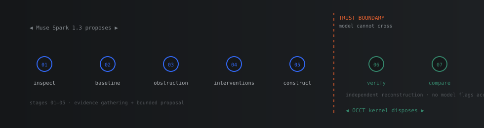
</p>

### Stage 01–02 — Inspect and baseline

A package is accepted only as a flat `assembly.step` (AP214 or AP242, explicit uniform millimetre units), a `manifest.json`, and an optional `attribution.txt`. Inputs are bounded *before* any native parsing: scripts, external references, symlinks, encrypted archives and arbitrary archive paths are rejected outright.

The import runs in an isolated native worker and produces an immutable revision. Frozen constraints, keep-outs and envelope are hashed into that revision's identity — so a later check against stale inputs cannot silently pass.

The baseline planner then searches for a supported removal path for the frozen target. On B02 it returns `no_path_supported`, **complete**, with two `CONFIRMED_GEOMETRIC_OBSTRUCTION` rejections carrying an actual BRep witness. Note what it refuses to do: it does not invent an operation count for an infeasible baseline, so no percentage improvement against a zero can ever be reported later.

### Stage 03–05 — Obstruction, intervention, construction

The model receives compact structured evidence — never a STEP file, never raw geometry. It is shown the witness position, the rejection certificate, and the finite domains the server will allow:

```python
# backend/src/unlock_engine/templates.py — the model's entire decision space
SERVER_DOMAINS = {
    "T01": dict(
        center_x_mm=(-4.0, 0.0, 4.0),
        center_y_mm=(-24.0, -20.0, -16.0, 0.0),
        width_mm=(24.0, 40.0, 46.0, 52.0),
        depth_mm=(8.0, 12.0, 16.0, 20.0),
    ),
    "T02": dict(offset_y_mm=(-12.0, 12.0, 24.0, 36.0)),
}
```

Twelve numbers. That is the model's entire authority over physical geometry. It cannot widen the domain, cannot add a template, and cannot construct anything outside it — arguments carrying extra fields, invalid IDs, unsupported templates or out-of-domain parameters are rejected before any native process starts.

<p align="center">
  
</p>

Construction happens in an isolated worker and returns a candidate with a real changed solid. **Construction is not verification** — the tool description says so in as many words.

### Stage 06–07 — Verify and compare

The verifier does not receive the candidate the model saw. It reconstructs the bracket *from the frozen parameters*, in a separate process, and compares the result against the original by two-way B-rep difference. Then it runs the twelve mandatory checks, re-plans the removal, replays the path forward, and inserts it in reverse.

Only then does comparison run — under the same target and the same frozen policy, so the two sides of the table are genuinely comparable.

```
┌──────────────────────────────────────────────────────────────────────┐
│  the model                    the boundary        the kernel         │
│  ─────────                    ────────────        ─────────          │
│  reads evidence      ───▶      accepts only       rebuilds from      │
│  picks integers       ───▶      bounded args       frozen params     │
│  cites handles        ───▶      rej_/plan_/ver_    real B-rep ops    │
│  claims "safe"        ───▶      recorded, ignored  decides the pass  │
└──────────────────────────────────────────────────────────────────────┘
```

### The evidence chain

Every artefact carries a content hash, and every hash is checked:

<p align="center">
  
</p>

```text
manifest  ──SHA-256──▶  revision  ──▶  plan  ──▶  candidate
    │                      │             │           │
    └── geometry hash ─────┴── constraint hash ──────┘
                              │
                              ▼
                    verification report
                    (policy digest included in identity)
```

Numerical assumptions live in a single `contracts.Policy`. The full policy is part of the evidence identity, which means changing a tolerance invalidates every geometry and constraint hash derived under the old one. Stale evidence cannot masquerade as fresh evidence.

---

## The trust boundary

This is the idea the whole project turns on, so it gets its own section rather than a footnote.

**The model proposes. The kernel disposes. There is exactly one place they meet, and it is one-way.**

```mermaid
flowchart LR
    subgraph MODEL["Muse Spark 1.3 — untrusted proposer"]
        A[Reads structured evidence] --> B[Reasons about the obstruction]
        B --> C[Chooses template + integers]
        C --> D[Cites run-issued evidence handle]
    end

    subgraph BOUNDARY["The dispatcher — the only door"]
        E{Schema valid?<br/>Identity frozen?<br/>Domain finite?<br/>Handle citable?}
    end

    subgraph KERNEL["OCCT kernel — trusted authority"]
        F[Trusted constructor builds] --> G[Independent reconstruction]
        G --> H[12 mandatory checks]
        H --> I[Re-plan · replay · reverse]
        I --> J[Comparison under frozen policy]
    end

    D --> E
    E -->|"INVALID_PROPOSAL"| D
    E -->|"accepted"| F
    J --> K[Verification report]
    E -.->|"model self-report"| X[(recorded, ignored)]

    style MODEL fill:#1a2233,stroke:#3268f5,color:#e9e8e3
    style BOUNDARY fill:#2a1a14,stroke:#e4602f,color:#e9e8e3
    style KERNEL fill:#14211c,stroke:#34866b,color:#e9e8e3
    style X fill:#1d2023,stroke:#4f5357,color:#7d8287
```

### Why the boundary is worth its cost

The instinct is to treat all this ceremony as overhead. It is worth seeing what it buys, because the alternative is not a slower version of the same thing — it is a different product.

<p align="center">
  
</p>

### The four rules that give it teeth

**1. Every proposal must cite evidence the run itself issued.**
Not a plausible-sounding identifier. Not the model's memory of an earlier turn. A `rej_`, `plan_` or `ver_` handle that this specific run handed out. A proposal citing anything else is refused *before construction starts*.

<p align="center">
  
</p>

**2. Unknown is a distinct result from pass and from fail.**
`clear`, `blocked` and `unknown` are kept as separate statuses and never merged. A mandatory check that is unknown, missing or stale **forbids a passing aggregate**. There is no partial-credit path to green.

**3. Witness sampling may reject. It may never admit.**
Only validated conservative coverage plus complete analytic sweep separation can admit a translation. This is the difference between a checker that is conservative by construction and one that is merely usually right.

**4. The frontend never derives a status.**
It renders what a report says. The single place in the UI that decides how a result is drawn — `ui/Evidence.tsx` — will only paint green when provenance is `live` or `computed_earlier`. An illustrative pass is drawn as an outline, never green.

```tsx
// frontend/src/ui/Evidence.tsx — the whole trust story in nine lines
export function resultLabel(result: CheckResult, provenance: ProvenanceKind) {
  const computed = provenance !== 'illustrative'
  switch (result) {
    case 'pass':
      return { tone: computed ? 'verified' : 'pass-illustrative',
               text: computed ? 'Passed' : 'Pass (illustrative)' }
    // …
  }
}
```

Green is not a colour in this product. It is a claim about provenance.

---

## The eight tools

UNLOCK exposes **exactly eight tools** to Muse Spark 1.3 through the Meta Model API. There is no shell tool, no Python tool, no URL tool, no filesystem tool, no acceptance tool, no release tool. If a capability is not on this list, the model physically cannot invoke it — an unexposed tool returns a typed `TOOL_NOT_ALLOWED` and is never dispatched.

| Tool | What it actually runs | Access |
|:--|:--|:--:|
| `inspect_assembly` | Validated manifest + measured native inventory | read |
| `inspect_constraints` | Frozen constraints, regions, keep-outs, envelope | read |
| `analyze_removal` | Deterministic Stage A `PlanResult` | read |
| `inspect_blocker` | Rejection certificates + actual BRep findings | read |
| `list_interventions` | Server template domains ∩ manifest | read |
| `construct_candidate` | Trusted T01/T02 constructor in an isolated worker | **write** |
| `verify_candidate` | Fresh reconstruction, 12 checks, re-planning, replay, reverse insertion | read |
| `compare_candidates` | Planner comparison, same target, same frozen policy | read |

One tool can change geometry. Everything else is inspection.

```python
# backend/src/unlock_engine/ai/schemas.py — verbatim production descriptions
TOOL_DESCRIPTIONS = {
    "inspect_assembly":     "Declared roles, retaining relations, movement axes and measured bounds for up to 12 components.",
    "inspect_constraints":  "Frozen constraints, protected/editable regions, keep-outs and envelope (empty list = all). Read only.",
    "analyze_removal":      "Authoritative baseline removal search for the frozen target. Returns status, steps and rejection IDs.",
    "inspect_blocker":      "Details of one rejected action: obstacles, evidence classification and BRep witness when available.",
    "list_interventions":   "Server-owned templates enabled for a bracket, with the exact finite parameter values allowed.",
    "construct_candidate":  "Ask the trusted CAD constructor to build one bounded template edit. evidence_ids must include a "
                            "rej_, plan_ or ver_ ID. Construction is not verification.",
    "verify_candidate":     "Independent reconstruction, mandatory constraint checks, removal replanning and reverse insertion.",
    "compare_candidates":   "Authoritative original-versus-candidate comparison under the PRD improvement rule.",
}
```

Note the last sentence of `construct_candidate`. It is in the tool description the model reads, every single turn: *construction is not verification.* The model is told, in its own interface, that building a thing is not the same as proving it.

### What the dispatcher enforces on every call

Arguments reject **extra properties**, invalid or stale IDs, unsupported templates, and out-of-domain parameter values. Imported metadata is treated as untrusted. Project, revision and target identity are checked against the frozen run — a foreign project ID or a stale revision returns `STALE_EVIDENCE` rather than executing.

```python
# every call, without exception
if call.name not in TOOL_ARGS:
    return ToolResult(status="error", error_code="TOOL_NOT_ALLOWED", …)   # never dispatched
model = TOOL_ARGS[call.name]
args = model.model_validate(call.arguments)        # additionalProperties: false
```

### Controller budgets — fixed, not tunable at runtime

| Budget | Limit | Why it is this number |
|:--|:--:|:--|
| Candidates | **3** | Bounds native work per run |
| Tool calls | **12** | Bounds the interaction surface |
| Model turns | **6** | Bounds conversation drift |
| Billed output tokens | **16,000** | Reserved **before every attempt**, retained on failure |
| Wall clock | **120 s** | Native operations each carry a 30 s limit |
| Schema repairs | **1** | A second malformed response is a failure, not a negotiation |

Output tokens are reserved before *every* attempt and retained even when the request fails or is never reported — so the budget cannot be gamed by dropping a response. Plain text that establishes no outcome gets exactly one bounded clarification; it never becomes a fabricated tool call.

### The protocol, exactly as Meta documents it

```python
response = client.chat.completions.create(
    model="muse-spark-1.3",
    messages=history,                      # original assistant tool_calls + tool results
    tools=tool_definitions,                # derived from production TOOL_ARGS schemas
    tool_choice="auto",                    # never forced
    reasoning_effort="medium",             # no higher effort chosen automatically
    max_completion_tokens=16_000,          # not the deprecated max_tokens
)
```

`tool_choice="auto"`, `max_completion_tokens` rather than the deprecated `max_tokens`, SDK retries **off** — the controller owns bounded retries so there is exactly one retry policy in the system. No OpenAI-only response format, no sampling parameters, no log-probabilities, no agent-framework scaffolding.

---

## The live run

Everything in this section is a real call to the Meta Model API against real CAD geometry. The report is committed to the repository as [`backend/evidence/live-b02/live_run.json`](backend/evidence/live-b02/live_run.json) (158 KB) alongside the constructed bracket as a real STEP file.

<p align="center">
  
</p>

```text
UNLOCK AI run run_983d811a0f174f9a  [live_model]
  outcome     VERIFIED_IMPROVEMENT_FOUND  (stop: model_final)
  why         cand_eaafba557ae0 (T01 40 × 16 mm) passed independent verification
              and the planner comparison
  baseline    no_path_supported  complete=True
              geometric blocks ×2  CONFIRMED_GEOMETRIC_OBSTRUCTION
  candidate 1 T01 {'center_x_mm': 0.0, 'center_y_mm': -20.0,
                   'depth_mm': 16.0, 'width_mm': 40.0}
              → VERIFIED_IMPROVEMENT   revised=feasible   reverse=passed
  usage       turns=6  tool_calls=6  candidates=1
              tokens in/out = 28,272 / 2,850   48.147 s
```

### The decision sequence, exactly as recorded

| t (s) | Turn | Tool call | Result |
|--:|:--|:--|:--|
| 16.0 | — | Stage A baseline | `no_path_supported`, complete. Two confirmed obstructions with BRep witness |
| 20.7 | 1 | `inspect_blocker` + `list_interventions` | Blocked witness at (0, −20, 36) mm; T01/T02 finite domains |
| 25.4 | 2 | `construct_candidate` T01 **24 × 12**, citing two `ev_` handles | **Refused before construction** — `INVALID_PROPOSAL` |
| 34.4 | 3 | `construct_candidate` T01 **40 × 16**, citing `rej_17a84dbaf811` | Built. 2,560 mm³ removed, all inside the editable web |
| 44.5 | 4 | `verify_candidate` | Static checks passed, then independent replanning |
| 46.1 | 5 | `compare_candidates` | `verified_improvement: true` |
| 48.1 | 6 | Final JSON (`candidate_proposed`) | **Recorded as a model statement with no authority** |

**Five of the eight tools were called live.** `inspect_assembly`, `inspect_constraints` and `analyze_removal` were not needed — the opening context already carried the baseline rejections. All eight remain covered offline in `tests/test_ai_toolbox.py`.

**One proposal was refused by validation, live, in front of the model.** That is the moment worth watching in the demo video.

### The field that settles the argument

The run report stores the model's closing message alongside an explicit annotation of what it is worth:

```json
{
  "decision": "candidate_proposed",
  "candidate_ids": ["cand_eaafba557ae0"],
  "summary": "T01 cut on bridge clears Z+ witness [0,-20,36]; verified feasible 1-step removal.",
  "structured": true,
  "authority": "none: model statement, not engineering evidence"
}
```

That `authority` field is not a comment someone added later. It is written by the engine, on every run, at the moment the message is stored. The model's own summary of its success is retained in full — and the schema it is stored under declares, in the same breath, that it is not evidence and cannot be cited as such.

It is the trust boundary, expressed as a data type.

### Verification of the result

- **12/12 mandatory checks passed** — integrity, solid validity, trusted reconstruction, actual change (2,560 mm³), editable region (0 mm³ outside it), protected interfaces, hole geometry, fixed components, placements, envelope, keep-outs, assembled intersections.
- **No failed, unknown, missing or stale checks.**
- **Revised plan:** `feasible`, complete, optimal within scope — `target TRANSLATE Z+ 80 mm`, cost `(0,0,0,1)`, with a 0.5 mm non-contact clearance lower bound.
- **Forward replay passed. Reverse insertion passed.**

### The controls

Two deterministic selectors were frozen and run **before** the live call, unmodified, on the same fixture under the same policy:

| | Muse Spark 1.3 (live) | `geometry_ranked` | `stable_enumeration` (PRD C2) |
|:--|:--|:--|:--|
| Outcome | VERIFIED_IMPROVEMENT_FOUND | VERIFIED_IMPROVEMENT_FOUND | NO_VERIFIED_IMPROVEMENT |
| Proposals / built | 2 / 1 (1 refused) | 1 / 1 | 3 / 3 (all failed) |
| Verified design | T01 40 × 16, 2,560 mm³ | T01 24 × 12, 1,152 mm³ | — |
| Revised route | target Z+ 80 mm | same | — |
| Tool calls | 6 | 2 | 4 |
| Runtime | 48.1 s | 24.1 s | 30.3 s |
| Model cost | ≈ $0.030 | $0 | $0 |

<p align="center">
  
</p>

### Stated plainly, because our own evidence says it

**Muse matched the geometry-ranked selector. It did not outperform it.** Its verified relief removes about 2.2× more material than the minimal verified relief; both give the same revised route and cost. It needed one more proposal, four more tool calls and roughly twice the runtime.

One run on one synthetic fixture is a protocol check, not a statistical comparison. We publish this because the control group is the thing that makes the verification layer credible — a claim of model supremacy we could not support would undermine the entire argument.

What the run *does* establish, unambiguously: **a frontier model drove a real CAD redesign loop, was caught by its own guardrails mid-run, recovered, and produced a physically real, independently verified improvement in 48 seconds.**

### API usage

| | Requests | Input tokens | Output tokens | Total | Latency |
|:--|--:|--:|--:|--:|--:|
| Tool-calling check (B01) | 2 | 2,903 | 411 (199 reasoning) | 3,314 | 5.77 s |
| Full redesign (B02) | 6 | 28,272 (16,068 cached) | 2,850 (1,596 reasoning) | 31,122 | 20.0 s model / 48.1 s wall |

Estimated **$0.0054** and **$0.0298** respectively at Meta's public Standard list price. Both figures are list-price estimates from [Meta's published pricing](https://dev.meta.ai/docs/pricing-rate-limits), not account-verified charges — the API reports no credit balance. Reported rate limits: 3,000 requests and 4,000,000 tokens per minute.

---

## Verification

Verification is not a checkbox at the end of the pipeline. It is a separate process that does not trust anything the previous process told it.

<p align="center">
  
</p>

### The twelve mandatory checks

| # | Check | What it actually measures |
|--:|:--|:--|
| 1 | `integrity` | The rebuilt solid is structurally intact |
| 2 | `solid_validity` | OCCT reports a valid B-rep |
| 3 | `trusted_reconstruction` | Independent rebuild, compared by **two-way B-rep difference** |
| 4 | `actual_change` | Material really was removed — 2,560 mm³, measured |
| 5 | `editable_region` | **0 mm³** removed outside the declared editable region |
| 6 | `protected_interfaces` | Mounting pads and interfaces untouched |
| 7 | `hole_geometry` | Hole axes within tolerance (≤ 0.01 mm) |
| 8 | `fixed_components` | Fixed parts are still fixed |
| 9 | `placements` | No placement drifted |
| 10 | `design_envelope` | Still inside the declared envelope |
| 11 | `keep_outs` | No declared keep-out violated |
| 12 | `assembled_intersections` | Assembled state intersects only at declared contacts |

Plus `tool_access`, deferred to state-aware replay rather than judged statically — because whether a screwdriver can physically reach a screw head is a motion question, not a static one.

### Why `trusted_reconstruction` is the important one

Checks 1, 2 and 4–12 would all pass on a shape the model *described correctly*. Check 3 is the one that closes the loop: the verifier throws away the candidate geometry the model's constructor produced and **rebuilds the bracket from the frozen parameters in its own process**, then compares the two solids with a two-way B-rep difference.

If the constructor and the verifier disagree about what those parameters mean, check 3 fails. There is no shared code path that could make them agree by accident.

### The aggregation rule

<p align="center">
  
</p>

```python
# statuses stay separate — they are never coerced into a single boolean
clear ────────▶ a translation is admitted
blocked ──────▶ a translation is refused, with witness evidence
unknown ──────▶ nothing is admitted AND a mandatory unknown forbids a passing aggregate
```

This is the rule that separates a checker from a scorecard. A system that folds `unknown` into `pass` — or quietly into `fail` — produces a green dashboard that means nothing. UNLOCK will return `unknown` and refuse to aggregate rather than round up.

**Original B-reps are never mutated.** OCCT booleans, compound assembly, STEP transfer and tessellation can all silently change shared topology flags, so private deep copies are taken at every mutation boundary. It costs memory. It is the only way to keep the original geometry true.

### Export is verified too

A STEP export is not considered successful because a file appeared. Success requires **real reimport** of the exported file, followed by geometry and path checks on the reimported result. Hierarchy and occurrence placements are preserved; where a part-only fallback was used, it is labelled explicitly rather than passed off as a full assembly.

---

## Architecture

<p align="center">
  
</p>

```text
┌─────────────────────────────────────────────────────────────────────────┐
│  React 19 · TypeScript · Vite 7 · Three.js / R3F                        │
│  renders what a report says · never derives a status of its own         │
├─────────────────────────────────────────────────────────────────────────┤
│  FastAPI coordinator    immutable revisions · frozen targets            │
│                         ordered resumable SSE · cancellation            │
│                         SQLite + FKs · one serial job queue             │
├─────────────────────────────────────────────────────────────────────────┤
│  AI controller          8 allowlisted tools · hard budgets              │
│  (Meta Model API)       output reserved before every attempt            │
├─────────────────────────────────────────────────────────────────────────┤
│  disassembly planner    conservative coverage + analytic sweep          │
│  independent verifier   fresh reconstruction · 12 mandatory checks      │
│  template constructors  T01/T02 · finite server-owned grids             │
├─────────────────────────────────────────────────────────────────────────┤
│  OCCT / CadQuery 2.6.1  real BReps · private deep copies                │
│  isolated subprocesses  30 s wall limit · 120 s parent budget           │
└─────────────────────────────────────────────────────────────────────────┘
```

### The isolation model

Every native operation runs in its **own subprocess**. Credentials are stripped from the worker environment before any process starts. Operations and work directories are allowlisted *before* a process is spawned — not discovered after.

| Property | Value |
|:--|:--|
| Import | Isolated worker, bounded before native parsing |
| Demo prep / verification / export | Separate workers each |
| Native wall limit | 30 s per operation |
| Parent budget | 120 s |
| Peak worker RSS on B02 | ~440 MiB |
| Warm standby | Single-use, one request then exits |

The warm standby exists because OCCT cold-starts cost 4–6 s per native operation under load. A standby imports the libraries, takes exactly one request, lowers its CPU cap to that operation's own limit, and exits. It is best-effort: if the OS refuses a standby, the operation simply cold-starts. Per-operation isolation, independent reconstruction, phase deadlines and credential stripping are all unchanged.

At most one pooled CAD process exists at a time, and a replacement starts only after the operation using the previous one has exited — so peak memory equals the cold path.

### Data flow

```text
  package ─▶ import ─▶ revision (immutable, hashed)
                            │
                            ▼
                     run (frozen target + policy)
                       │            │
              baseline plan    model loop ──▶ candidate
                       │            │              │
                       └───── comparison ◀── verification
                                        │
                                        ▼
                              decision (append-only)
                                        │
                                        ▼
                              checked STEP export
                                        │
                                        ▼
                              reimport + re-verify
```

No candidate from a cancelled, active or superseded run can be accepted or exported. Export re-checks acceptance **both** before native work and again at commit. Artifacts are addressed by SHA-256 rather than caller-supplied paths, so nothing can be smuggled in through a filename.

### Frontend integration

```
src/
  domain/types.ts     contracts mirrored from the PRD — manifest, plan,
                      proposal, verification, events, errors
  api/                UnlockApi interface · fixture adapter · HTTP/SSE adapter
  three/              procedural assembly, studio lighting, label projector
  app/workspace/      state model, tree, viewport + compare, evidence panels
  ui/                 logo, evidence tags — result and provenance rules
```

The `UnlockApi` interface is the single boundary between UI and engine. Screens depend on that interface only, so swapping the bundled illustrative fixture for the live coordinator is a one-line change in `api/index.ts`:

```ts
// frontend/src/api/index.ts
const base = import.meta.env.VITE_UNLOCK_MODE === 'fixture'
  ? undefined
  : (import.meta.env.VITE_UNLOCK_API as string | undefined) ?? 'http://127.0.0.1:8000'

export const api: UnlockApi = base ? createHttpApi(base) : fixtureApi
```

**Illustrative mode is explicit and visibly labelled.** Setting `VITE_UNLOCK_MODE=fixture` runs the UI against prepared records with zero engineering computation, and the interface says so in the header. It is a demo mode that cannot be mistaken for a live one.

---

## Getting started

### Prerequisites

| | Version | Why |
|:--|:--|:--|
| Python | **3.12.x** | Pinned `>=3.12,<3.13` — OCP wheels are version-specific |
| Node | 18+ | Vite 7 |
| Disk | ~1.5 GB | CadQuery + OCP + VTK wheels are large |

### 1 — Backend

```sh
cd backend
python3.12 -m venv .venv
.venv/bin/python -m pip install -r requirements.lock
.venv/bin/python -m pip install --no-deps --no-build-isolation -e .
cp -n .env.example .env          # then add your key, see below

# start the coordinator
.venv/bin/python -m unlock_engine.api --port 8000
```

B01–B08 import once, on first startup — real synthetic STEP assemblies, generated and parsed through the isolated worker. Expect the first start to take a little longer.

### 2 — Frontend

```sh
cd frontend
npm ci
npm run dev -- --host 127.0.0.1 --port 5183 --strictPort
```

Open **http://localhost:5183/projects**.

### 3 — Configure Meta

`backend/.env` is backend-only. **Never put a credential in `frontend/`** — environment files are ignored at every depth, and only `.env.example` templates are committed.

```dotenv
AI_PROVIDER=meta
MODEL_API_KEY=YOUR_REAL_META_KEY
META_MODEL=muse-spark-1.3
META_BASE_URL=https://api.meta.ai/v1
META_REASONING_EFFORT=medium
RUN_META_LIVE_TESTS=0
```

Restart the backend after changing it. `high` effort is available via `META_REASONING_EFFORT`; nothing higher is ever chosen automatically.

### 4 — Run the full workflow

Open **B02**, select `target`, set it as the repair target, then:

```text
Analyze → Run baseline analysis → Explore a redesign → Request redesign
```

With a key configured, that last click performs **real inference** against Meta's Model API. Without one, the baseline remains fully viewable and redesign returns `Model unavailable` — it does not silently fall back to mock.

### Offline demonstration

For a complete, explicitly-labelled offline run — real CAD, real planner, real verifier, scripted AI policy — start the backend with:

```sh
AI_PROVIDER=mock .venv/bin/python -m unlock_engine.api --port 8000
```

The browser reports the scripted provider while performing genuine engineering computation. This is never reported as live Meta.

To inspect the illustrative UI alone, with no engineering computation at all:

```sh
VITE_UNLOCK_MODE=fixture npm run dev
```

### Tests

```sh
cd backend
.venv/bin/python -m pytest -q          # 327 passed, 17 deselected
.venv/bin/ruff check src tests scripts
.venv/bin/python -m pip check
```

Paid `meta_live` tests are **excluded by default** and skip even when a key is present, unless `RUN_META_LIVE_TESTS=1` is also set. Ordinary `pytest` never spends your credits.

### Browser acceptance

With the backend running under `AI_PROVIDER=mock` and the frontend up:

```sh
cd backend
.venv/bin/python scripts/browser_qa.py
```

Drives real headless Chrome through the actual HTTP service: selection → analysis → rejection → revised improvement → comparison → acceptance → checked export. Screenshots and a request/error report are written to `.work/meta-validation/browser/`.

### On a Mac without Python 3.12

If `python3.12` is not on your machine, [`uv`](https://docs.astral.sh/uv/) gets you a pinned interpreter in seconds without touching system packages:

```sh
curl -LsSf https://astral.sh/uv/install.sh | sh
uv python install 3.12
uv venv --python 3.12 .venv
uv pip install --python .venv/bin/python -r requirements.lock
uv pip install --python .venv/bin/python --no-deps --no-build-isolation -e .
```

Verified working on macOS ARM64 with Python 3.12.16, CadQuery 2.6.1, cadquery-ocp 7.8.1.1.post1, Pydantic 2.12.3, pytest 8.4.2.

---

## The demo in five minutes

If you are judging this and have a short clock, this is the path that shows the most per second. No API key required for any of it.

<p align="center">
  
</p>

### Minute 0 — get it running

```sh
cd backend && python3.12 -m venv .venv && .venv/bin/python -m pip install -r requirements.lock
.venv/bin/python -m pip install --no-deps --no-build-isolation -e .
AI_PROVIDER=mock .venv/bin/python -m unlock_engine.api --port 8000 &

cd ../frontend && npm ci && npm run dev -- --host 127.0.0.1 --port 5183 --strictPort &
```

Expect the first backend start to take a minute or two — B01–B08 are real STEP assemblies being generated and parsed, not fixtures loaded from a table.

### Minute 1 — watch it fail honestly

Open **B02**, select `fan_module`, set it as the repair target, then **Analyze → Run baseline analysis**.

This is the most important screen in the product and it shows a failure. The planner reports `no_path_supported`, names two `CONFIRMED_GEOMETRIC_OBSTRUCTION` rejections, and pins one to a BRep witness at `(0, −20, 36)` mm. **Look at what is absent**: no invented operation count, no zero baseline, no percentage improvement against nothing. The system declines to manufacture a number it cannot compute.

### Minute 2 — watch the guardrail fire

Click **Explore a redesign**, then **Request redesign**. With `AI_PROVIDER=mock` the scripted policy reproduces the live run's decision sequence exactly, against real geometry, with the real planner and the real verifier.

Watch for the refused turn. The first proposal is rejected by the dispatcher — `INVALID_PROPOSAL`, citing only `ev_` handles — and the evidence panel shows the refusal with the citable handles named. Then the corrected proposal, `T01 40 × 16`, builds and verifies.

**A guardrail that never fires is an untested guardrail.** Seeing it reject a proposal in the UI is the single fastest way to understand what this project is.

### Minute 3 — check the green is earned

Open the verification panel on the accepted candidate. Twelve mandatory checks, all passing, each with provenance attached. Note that `tool_access` is reported separately rather than folded in.

Then look at the provenance tags. The UI will not paint a check green unless its provenance is `live` or `computed_earlier`. An illustrative pass renders as an outline. This is the entire trust story expressed as a CSS rule.

### Minute 4 — see the route change

Switch to compare view. Left: `no_path_supported`. Right: `feasible`, revised route `target TRANSLATE Z+ 80 mm`, cost `(0,0,0,1)`, forward replay passed, reverse insertion passed. Same target, same frozen policy, both sides.

### Minute 5 — export, and confirm the export is checked

Accept the candidate and export. The bundle is reimported and re-verified before it is called a success — the file you receive is the file that was checked. It lands in `.work/` as a real AP214 STEP; open it in FreeCAD or any CAD tool if you want to see the relief with your own eyes.

### If you have a key

Add `MODEL_API_KEY` to `backend/.env`, set `AI_PROVIDER=meta`, restart the backend, and repeat steps 3–5. The same four clicks now perform real inference against Meta's Model API. Expect roughly 48 seconds and about three cents.

To see the full recorded live run without spending anything, read [`backend/evidence/live-b02/live_run.json`](backend/evidence/live-b02/live_run.json) — every tool response, plan, certificate and hash, exactly as the engine wrote it.

---

## The API surface

Interactive documentation is served at **http://127.0.0.1:8000/docs**. Artifacts are immutable SHA-256 identifiers rather than caller-supplied filesystem paths — nothing can be smuggled in through a filename.

| Method | Path | Purpose |
|:--|:--|:--|
| `GET` | `/health` | Provider, model, credential state — **never the key** |
| `GET` | `/v1/projects` | Fixture and imported projects |
| `GET` | `/v1/projects/{id}` | Project detail and revision list |
| `POST` | `/v1/projects/{id}/imports` | Upload a validated package → job |
| `GET` | `/v1/revisions/{id}` | Manifest, inventory, readiness |
| `POST` | `/v1/revisions/{id}/runs` | Start a frozen-target baseline run |
| `POST` | `/v1/runs/{id}/redesign` | Bounded model loop + independent verification |
| `GET` | `/v1/runs/{id}` | Full run record with candidates and metrics |
| `GET` | `/v1/jobs/{id}/events` | **Ordered, resumable SSE** stage stream |
| `POST` | `/v1/jobs/{id}/cancel` | Cooperative cancellation |
| `GET` | `/v1/candidates/{id}` | Candidate evidence and verification report |
| `POST` | `/v1/candidates/{id}/decision` | Append-only accept / reject |
| `POST` | `/v1/candidates/{id}/exports` | Checked STEP export bundle |
| `GET` | `/v1/artifacts/{id}` | Content-addressed download |

### Errors are typed, not stringly

```json
{
  "error_code": "CONSTRAINT_VIOLATION",
  "message": "editable_region: 41.2 mm³ removed outside the declared region",
  "retryable": false,
  "field_errors": [],
  "evidence_ids": ["ver_8c1a…", "rej_17a84dbaf811"],
  "run_id": "run_983d811a0f174f9a"
}
```

Fifteen error codes cover the real failure surface — `INVALID_PACKAGE`, `UNSUPPORTED_SEMANTICS`, `STALE_REVISION`, `VERIFICATION_UNKNOWN`, `MODEL_SCHEMA_ERROR`, `CANCELLED` and the rest. Every envelope carries the evidence IDs and run ID needed to trace it back to the exact computation that produced it.

### SSE that survives a disconnect

Stage events are ordered and **resumable**. If the stream drops mid-run, the run continues on the server; reconnecting resumes from the last delivered sequence number rather than restarting the analysis. The client tells you this explicitly:

> *"Event stream interrupted. The run continues on the server; reconnect to resume."*

### Idempotency

Every state-changing POST accepts an `Idempotency-Key` header. Retrying a redesign request after a network blip returns the original job rather than burning another 31,000 tokens.

### The coordinator is deliberately not a platform

One serial queue, loopback clients, trusted hosts, explicit CORS origins. It is a local engineering tool with real concurrency limits, not a public multi-user scheduler.

Read-only deployment scaffolding does exist — `unlock_engine/deployment/` provides bounded Modal jobs and read-only engineering snapshots, with a `modal_app.py` / `modal_web.py` entry point and a Vercel config for the frontend. A preflight review was run against it on 30 October 2026 and its disposition was **blocked**: no public Modal endpoint and no Vercel deployment were actually created.

The blocker was not technical. It was rights and billing: the B02 fixture is generated deterministically by `fixtures.py`, and both its source and the exported snapshot carry the annotation *"Redistribution license pending author approval; local engineering fixture."* A commit author is not a redistribution licence, so publication waits on the authors agreeing terms. Billing safeguards were verified in the same review — a $30 workspace limit with a $0 spend limit and $0.00 usage to date.

The local interactive application is unaffected and remains the supported way to run UNLOCK. See [the preflight record](backend/docs/PUBLIC_DEPLOYMENT_PREFLIGHT.md) and [the deployment checkpoint](backend/docs/MODAL_DEPLOYMENT.md) for the full findings.

---

## Evidence & reproducibility

Claims in this README are backed by committed artefacts. Nothing here is a screenshot of a terminal someone typed `figlet` into.

### What is in the repository

<p align="center">
  
</p>

```text
backend/evidence/
├── live-b02/                          the live Meta redesign run
│   ├── live_run.json                  158 KB · full AIRunReport: every tool
│   │                                  response, plan, certificate, hash
│   ├── live_changed_bridge.step       91 KB · the actual constructed bracket
│   ├── live_engineering_summary.json  derived by scripts/summarize_ai_run.py
│   ├── selector_geometry_ranked.json  the deterministic control
│   ├── selector_stable_enumeration.json  the blind control
│   └── worker_*_benchmark.jsonl       cold vs warm timing, measured
├── meta-tool-smoke/                   live native tool-calling check
│   └── live_report.json               15/15 checks passed
├── meta/                              frozen validation record
│   ├── final-pytest.txt               267 passed at freeze time
│   ├── browser-compare.png            real browser, real backend
│   ├── browser-export.png             real browser, real backend
│   ├── checked-export.zip             152 KB · reimported and re-verified
│   ├── SHA256.json                    every artifact, content-addressed
│   └── validation.json                exact commands and counts
└── browser-acceptance/
    └── report.json                    headless Chrome through the real service
```

### Live verification, independently re-run

Native tool calling was verified live: Muse Spark 1.3 requested the real read-only `inspect_assembly` tool, the backend validated and executed it, the result returned under the provider's tool-call ID, and the model's final answer matched the tool payload field by field. **All 15 outcome checks passed**, including a scan confirming the credential never appeared in the report, stdout or stderr.

```text
UNLOCK Meta tool-calling smoke: PASSED
  tool            inspect_assembly  (1 structured call, finish_reason=tool_calls)
  tool-call id    call_28a…385a     preserved verbatim, 41 characters
  tool execution  ok · evidence ev_0ea1a6dc61f8 · 7.2 ms · 5 real records
  grounding       final answer matched the tool payload · no invented components
  geometry        input STEP + manifest SHA-256 unchanged · nothing constructed
  secrets         key absent from report, stdout and stderr
```

### The test suite

**327 tests pass.** They cover the geometry kernel, the planner, template construction, the verifier, the AI controller, the HTTP coordinator, and end-to-end integration over real CAD.

```sh
$ .venv/bin/python -m pytest -q
327 passed, 17 deselected, 17 warnings in 534.28s (0:08:54)
```

The 17 deselected are the paid `meta_live` tests — deselected by default so ordinary CI never spends credits. The 17 warnings are third-party deprecations inside CadQuery and starlette.

Coverage by layer:

| Layer | What the tests actually exercise |
|:--|:--|
| Geometry | B-rep booleans, deep copies, tessellation, envelope math |
| Planner | Six-axis sweep separation, conservative coverage, reverse insertion |
| Templates | T01/T02 constructors, domain bounds, geometric preconditions |
| Verifier | All twelve checks, unknown propagation, aggregation refusal |
| AI controller | Limits, dedup, injection, schema violations, cancellation |
| Meta SDK | Request shape, 401/402/403/404/429/5xx, model substitution, timeouts |
| HTTP | Import → baseline → redesign → verify → export, over real CAD |
| Browser | Headless Chrome through the real service, zero console errors |

### Reproducing the engineering demo

```sh
.venv/bin/python -m unlock_engine plan-demo --output .work/planning
```

Runs the complete real CAD planning demonstration: import genuine STEP, search for a removal path, identify the obstruction with BRep evidence, construct a candidate, verify it independently, and write a content-addressed artifact tree.

```sh
.venv/bin/python -m unlock_engine.ai demo --offline --fixture B02 --output .work/meta-offline
```

Same workflow with the AI loop, explicitly offline. Produces identical candidates and outcomes to the live path — which is how we know the geometry, not the model, is doing the verification.

### A note on how this was built

The integration history is preserved as chronological commits with real validation counts at each milestone. No history was backdated or rewritten. Where a defect was found — and one was, during the live run — it is documented with the commit that fixed it and a regression test that fails on the previous code. See [the integration handoff](backend/docs/META_INTEGRATION_HANDOFF.md) for the full record.

### Do not trust this README. Check it.

Every substantive claim above is falsifiable from the repository alone, without a key, without network access, and without taking our word for anything. Here is the exact check for each one.

| If this README says | Verify it with | What you should see |
|:--|:--|:--|
| 327 tests pass | `cd backend && .venv/bin/python -m pytest -q` | `327 passed, 17 deselected` |
| The live run found a verified improvement | `jq -c '.outcome, .usage.turns' evidence/live-b02/live_run.json` | `"VERIFIED_IMPROVEMENT_FOUND"` then `6` |
| One proposal was refused live | `jq -c '.engineering_evidence.tool_results[] \| select(.status=="rejected") \| .feedback' evidence/live-b02/live_run.json` | `"category":"INVALID_PROPOSAL"` |
| The model cited a bad handle | `jq -r '.engineering_evidence.tool_results[] \| select(.status=="rejected") \| .feedback.message' evidence/live-b02/live_run.json` | `cite at least one rejection, plan or verification evidence ID` |
| 12 of 12 mandatory checks passed | `jq -r '.engineering_evidence.verified[].static_report.checks[] \| "\(.constraint_id) \(.result) mand=\(.mandatory)"' evidence/live-b02/live_run.json` | twelve `pass mand=true`, then `tool_access not_applicable mand=false` |
| Muse matched, did not beat, the control | `jq -c '.candidates[0].comparison \| {original_status, revised_status}' evidence/live-b02/live_run.json` | `"no_path_supported"` → `"feasible"` |
| The model's own claim carried no authority | `jq -r '.final_model_message.authority' evidence/live-b02/live_run.json` | `none: model statement, not engineering evidence` |
| The constructed bracket is real geometry | `file backend/evidence/live-b02/live_changed_bridge.step` | an AP214 STEP file — open it in any CAD tool |
| Tool calling worked live | `jq -r '.checks[] \| "\(.name) \(.status)"' backend/evidence/meta-tool-smoke/live_report.json` | fifteen `pass`, ending `no_secret_in_report pass` |
| The credentials never leak | `grep -c "$MODEL_API_KEY" backend/evidence/live-b02/live_run.json` | `0` |
| The fixtures are real STEP, not stubs | `find backend -name '*.step' -size +10k` | multiple files, tens of KB each |
| The twelve-number domain is the whole decision space | `sed -n '21,30p' backend/src/unlock_engine/templates.py` | `SERVER_DOMAINS`, twelve values |

**The single most important one.** If you want to confirm that the verifier is genuinely independent of the model, run the offline demo and diff it against the live one:

```sh
.venv/bin/python -m unlock_engine.ai demo --offline --fixture B02 --output .work/offline
```

Same candidates, same outcomes, same check results — produced with no model in the loop at all. That equivalence is the proof that geometry, not the language model, is doing the verification. It is the one claim in this repository we would stake the project on, and it takes about a minute to falsify.

---

## Scope, honestly

A project about verified claims should make verified claims about itself. Here is exactly what UNLOCK is and is not.

### What it genuinely does

- **Parses real STEP assemblies** (AP214/AP242) in isolated workers, with bounded, validated packages.
- **Searches for a supported removal path** using conservative coverage plus complete analytic sweep separation.
- **Finds obstructions** and pins them to coordinates with BRep witnesses.
- **Accepts bounded redesign proposals** from a frontier model, refusing any that cite uncitable evidence.
- **Independently reconstructs and verifies** every candidate against twelve mandatory constraints.
- **Compares original and revised** under one frozen numerical policy.
- **Exports a checked STEP bundle** that is reimported and re-verified before it is called a success.
- **Drives the whole loop from Meta's Muse Spark 1.3**, live, with eight allowlisted tools.

### What it does not do

| Not this | Why not |
|:--|:--|
| **Strength, fatigue or thermal analysis** | The word "safe" in a passing report is scoped to geometry and constraints only. It means nothing structural. |
| **Arbitrary CAD generation** | The model chooses integers from finite grids. General free-form geometry is deliberately out of scope — that is the feature, not a gap. |
| **Torque, cables, clips, adhesives or wiring** | Disassembly is modelled as rigid-body extraction. Soft and electrical systems are not represented. |
| **Restored product function** | A relief that frees a fan does not guarantee the repaired machine works. Nothing here claims otherwise. |
| **Manufacturability** | A verified relief is geometrically valid. Whether it can be cast, machined or moulded is not assessed. |
| **A hosted, multi-user product** | Not yet, and deliberately. A read-only public demonstration serves only fixtures released under CC BY 4.0 with their contributors' authorization; it accepts no uploads and runs no jobs. Auth and ownership remain open work. |
| **A benchmark** | One live run, on B02. The gallery's other five fixtures ran under the offline scripted policy and show engine behaviour across layouts, not model performance. The two deterministic controls make it a protocol check, not a leaderboard entry. |

### The honest headline

On the fixture it ships with, UNLOCK's model-driven run **matched** — did not beat — a deterministic geometry-ranked selector. Its value is not that a language model out-searched a heuristic. It is that a language model was admitted *at all* into a safety-relevant engineering loop, with zero trust and bounded authority, and produced a physically real, independently verified result — while being caught by its own guardrails mid-run and recovering.

That is the generalisable result. The specific fixture is an example of it.

---

## Built during the hackathon

This was built for the **Meta Global AI Developer Hackathon**, on the **Push the Frontier** track, in the Cerebral Valley batch.

### The timeline, as git records it

Four days, 56 commits, no history rewritten. This is derived from the commit dates rather than from memory:

```text
day 1 · Oct 27    the workspace
                  frontend: landing, projects list, engineering workspace

day 2 · Oct 28    the presentation layer
                  banner and README asset work

day 3 · Oct 29    the engine, and the Meta integration     ← the big one
                  ├─ preserve the CAD planner and AI controller baseline
                  ├─ direct Meta configuration, secure environment loading
                  ├─ cancellable Meta SDK transport + native tool calling
                  ├─ enforce retry budgets, retain authoritative evidence
                  ├─ gated Meta smoke and real-engine live acceptance tests
                  ├─ preserve evidence handles, validate provider usage
                  ├─ connect persistent jobs to real analysis, redesign, export
                  └─ reproducible CAD API and browser validation evidence

day 4 · Oct 30    the proof it survives contact
                  05:23  real-service browser acceptance harness, B02 journey
                  05:29  genuine upload, rejected packages, failures, recovery
                  05:32  keep the whole assembly in narrow viewports
                  05:46  fit the camera to tessellated parts, not the envelope
                  05:55  record full browser acceptance results and evidence
```

Day 3 carries the project. It is where the geometry engine, the model transport, the budget enforcement and the evidence-preservation layer all landed in a single sitting — and where the integration tests that still guard them were written.

### The defect worth telling you about

During the live run, the model's first proposal was refused by the dispatcher — it cited two weak `ev_` handles where the schema demands a `rej_`, `plan_` or `ver_` ID. That refusal is **in the committed evidence**, timestamped at t = 25.4 s.

It exposed a real gap: the refusal message did not initially tell the model *which* handle to use. That was fixed — the dispatcher now names the citable handles explicitly — and the fix carries a regression test that fails on the previous code. The model resubmitted nine seconds later citing `rej_17a84dbaf811`, and the proposal built and verified.

**A guardrail that never fires is an untested guardrail.** Ours fired, on a live paid run, in front of the model, and the system is better because of it. That story is in [`backend/docs/META_INTEGRATION_HANDOFF.md`](backend/docs/META_INTEGRATION_HANDOFF.md).

### Scale

```text
backend/src        13,627 lines   kernel, planner, verifier, AI controller, API
backend/tests       6,542 lines   327 tests, all passing
frontend/src        7,832 lines   React 19 workspace, Three.js viewport

backend/evidence/       5.9 MB    committed evidence, four sets:
  browser-acceptance/   3.7 MB    headless Chrome run: 16 screenshots + report
  meta/                 1.6 MB    frozen validation record, export bundle
  live-b02/             584 KB    the live run, its controls, benchmarks
  meta-tool-smoke/       20 KB    live native tool-calling verification
```

---

## Roadmap

Where this goes next, in the order we would do it.

**Near — bounded expansion of the decision space.**
More server-owned templates (relief windows, access hatches, break-away tabs), each with finite grids and geometric preconditions. The trust boundary does not change; only the size of the menu.

**Next — soft and electrical systems.**
Representing cables, clips and adhesives as first-class obstruction types with their own removal semantics, so "extract the module" accounts for the harness as well as the bracket.

**Next — structural preflight.**
Not replacing FEA, but adding a cheap conservative pre-screen: a relief that thins a load path below a stated threshold gets flagged as `unknown` for strength rather than silently green.

**Then — richer targets.**
Multiple simultaneous targets, and targets that are assemblies rather than single components, so the planner solves an ordering problem as well as a path problem.

**Then — a verification certificate.**
A signed, portable bundle: policy digest, geometry hashes, check results, evidence chain. Something a third party can re-run and compare byte-for-byte, making "verified" transferable between organisations.

**Always — the boundary stays one-way.**
Every item above widens what the *kernel* can do. None of them widen what the *model* can decide. That asymmetry is the product.

---

## Design decisions and what they cost

Every interesting engineering choice is a trade we accepted somewhere. These are the six that shaped the system, with what each one actually cost us.

### 1 — Bounded grids instead of generated code

**Decision.** The model selects integers from server-owned finite domains. It never emits code and never emits geometry.

**What it cost.** Generality, immediately and obviously. A generated CadQuery script could express a relief shape these twelve numbers cannot. Adding a template means writing a constructor, proving geometric preconditions, and adding tests — not asking the model nicely.

**Why it was worth it.** The model's total authority is legible by reading one dictionary, and there is no code path from model output to unbounded behaviour. That property cannot be retrofitted onto generated code later, because by then the code has already run.

### 2 — Independent reconstruction rather than inspecting the candidate

**Decision.** The verifier throws away the geometry the constructor produced and rebuilds the bracket from the frozen parameters in its own process, then compares by two-way B-rep difference.

**What it cost.** Roughly a doubling of verification work, and a second implementation of the same parameter interpretation that must be kept in sync.

**Why it was worth it.** It is the only check that fails when the constructor and the verifier disagree about what a parameter means. Inspecting the candidate the model's pipeline produced would only confirm that the code did what it said it did.

### 3 — `unknown` as a first-class result

**Decision.** `clear`, `blocked` and `unknown` are distinct, never merged, and a mandatory `unknown` forbids a passing aggregate.

**What it cost.** The system returns "we don't know" in situations where a scorecard would return a number. Reviewers have asked why a check is not simply red.

**Why it was worth it.** Folding `unknown` into `fail` under-reports capability. Folding it into `pass` over-reports safety. Keeping it distinct is the only option that does not lie in one direction or the other — and witness sampling may reject or leave unknown, but can never admit.

### 4 — Finite policy baked into evidence identity

**Decision.** The full `contracts.Policy` digest is part of every evidence identity, so changing a tolerance invalidates geometry and constraint hashes derived under the old one.

**What it cost.** Debugging is more annoying. Adjusting a tolerance invalidates prior evidence, and you cannot quietly compare a fresh run against stale results.

**Why it was worth it.** Stale evidence cannot masquerade as fresh evidence. The alternative — hashes over geometry only — lets a pass computed under one set of assumptions be replayed against a different policy, which is exactly the failure that makes a verification layer decorative.

### 5 — Per-operation subprocess isolation

**Decision.** Every native operation runs in its own subprocess with a 30 s wall limit. Credentials are stripped from worker environments before any process starts.

**What it cost.** Process-spawn overhead on every operation, and the need for a warm standby just to make OCCT's import cost tolerable. Peak RSS sits around ~440 MiB.

**Why it was worth it.** A hung or corrupted kernel cannot take the coordinator with it, the blast radius of a native crash is one operation, and the credential-stripping property is enforceable rather than aspirational.

### 6 — One retry policy, owned by the controller

**Decision.** SDK retries are disabled. The controller owns bounded retries, with exactly one schema repair allowed per run.

**What it cost.** More controller code, and we reimplemented backoff ourselves.

**Why it was worth it.** With SDK retries on, a 429 would be retried invisibly below the layer that tracks budgets, and a run could silently exceed its stated cost and latency envelope. One retry policy in the system means one place to reason about it — and a second malformed response fails the run rather than entering a negotiation with a model.

---

## Security model

The threat model is not "a hostile user." It is **a language model that produces plausible nonsense with full confidence, running in a process that can modify real geometry.** Everything below follows from taking that seriously.

<p align="center">
  
</p>

### What the model can reach

Eight tools. Seven are read-only inspection. One — `construct_candidate` — can affect geometry, and only by choosing integers from a finite server-owned grid. There is no shell tool, no filesystem tool, no URL tool, no Python tool, no acceptance tool and no release tool. A tool that is not on the list returns a typed `TOOL_NOT_ALLOWED` and is never dispatched, so the capability set is enumerable by reading one dictionary.

### How imported geometry is treated

A package is untrusted input. `load_zip` enforces a strict **filename allowlist of exactly three entries** — `assembly.step` (or `.stp`), `manifest.json`, optional `attribution.txt`. Anything else raises `unsafe or unsupported ZIP path`, which is what rejects scripts, external references and archive-path tricks: not by detecting malice, but by refusing everything that is not on the list. On top of that it rejects **encrypted** archives, **non-regular members** (which is the symlink check, via `stat.S_ISLNK`), unsupported compression methods, and duplicate entries. Extraction is bounded twice — 25 MiB compressed, 100 MiB expanded — and the expanded size is re-checked against the bytes actually read, so a lying header cannot overflow the budget.

Artifacts are addressed by SHA-256 rather than caller-supplied paths, so nothing can be smuggled in through a filename.

### How the geometry process is contained

Every native operation runs in its **own subprocess** with a 30 s wall limit and a 120 s parent budget. Operations and work directories are allowlisted *before* a process is spawned, not discovered after. **Credentials are stripped from the worker environment before any process starts** — which is why the tool-calling smoke test includes a check that scans the report, stdout and stderr for the key and asserts it is absent.

A hung or corrupt OCCT call cannot take the coordinator down, and the blast radius of a native crash is exactly one operation.

### How state is kept honest

Revisions are immutable, and frozen constraints, keep-outs and envelope are hashed into a revision's identity. Every evidence identity includes the full policy digest, so changing a tolerance invalidates everything derived under the old one. A foreign project ID or a stale revision returns `STALE_EVIDENCE` rather than executing. No candidate from a cancelled, active or superseded run can be accepted or exported, and export re-checks acceptance both before native work and again at commit.

### What we are explicitly *not* claiming

This is a **local, single-queue engineering tool**, not a hardened multi-tenant service. The coordinator binds to loopback with trusted hosts and explicit CORS origins. There is no authentication, no project ownership, no rate limiting per user, and no sandboxing beyond the subprocess boundaries described above. **Do not expose it to the public internet in its current form.**

Read-only cloud scaffolding has been written and reviewed, and the review concluded it should not be published yet — see [the public deployment preflight](backend/docs/PUBLIC_DEPLOYMENT_PREFLIGHT.md). The grounds were fixture redistribution rights and billing safeguards, not a security defect, and no public endpoint was created. Auth, ownership and multi-tenant rate limiting remain open work.

## Performance, measured

Every number in this section comes from committed benchmark files under `backend/evidence/live-b02/`, run on a loaded machine rather than an idle one. We publish the load average because a benchmark that hides its conditions is a marketing slide.

### The cost of OCCT, and what the warm worker does about it

Native geometry operations pay an import cost. On a loaded machine (1-minute load ≈ 5), measured across repeated runs:

| | Cold worker | Warm standby | Δ |
|:--|--:|--:|--:|
| Full run wall time | 46.12 s / 47.00 s | 29.52 s / 29.69 s | **−36%** |
| Stage A (import + baseline) | 11.1 s / 10.2 s | 7.3 s / 7.0 s | −34% |
| Mean native tool operation | 8.73 s / 9.20 s | 5.55 s / 5.68 s | −36% |

The improvement is consistent rather than dramatic, which is the honest shape of it: the warm standby removes import overhead, not compute. Peak memory is unaffected because the standby takes exactly one request and exits, so only one CAD process exists at a time and a replacement starts only after the previous one has exited.

### Where the warm worker does *not* help

Worth showing, because it bounds the claim. Under the full policy benchmark, holding everything else constant:

| Simulated model turn latency | Cold | Warm | Δ |
|:--|--:|--:|--:|
| 0 s (geometry-bound) | 59.16 s | 55.25 s | −6.6% |
| 3.0 s (realistic) | 80.47 s | 60.03 s | **−25%** |

When the model is slow, the geometry work overlaps with waiting, so the ceiling is set by inference either way. When the model is fast — the 0 s case — the run is geometry-bound and the standby buys almost nothing. **The warm worker optimises the part of the loop that is not the model, and it says so.**

### The live run, end to end

<p align="center">
  
</p>

| Stage | Time | Share |
|:--|--:|--:|
| Import | 13.26 s | 27.5% |
| Baseline search | 2.73 s | 5.7% |
| Model inference (total) | 20.05 s | 41.6% |
| Verification + comparison + the rest | 12.11 s | 25.2% |
| **Wall clock** | **48.15 s** | budget: 120 s |

Two things follow. First, the run used **40% of its wall-clock budget** — the 120 s ceiling was never a risk on this fixture. Second, **inference is the plurality but not the majority**: over half the run is geometry and verification, which is exactly the split this architecture argues for. If the model were the bottleneck, the verifier would be the wrong investment.

### Limits, stated as limits

| Property | Value |
|:--|:--|
| Components per assembly | 5–12 |
| Maximum envelope | 500 mm |
| Archive package | ≤ 25 MiB compressed |
| Native operation wall limit | 30 s |
| Parent run budget | 120 s |
| Peak worker RSS on B02 | ~440 MiB |
| Reported API rate limits | 3,000 req/min · 4,000,000 tok/min |

These are deliberate. A 12-component ceiling keeps the removal search tractable; a 500 mm envelope keeps B-rep booleans within the 30 s native limit. Widening them is straightforward engineering. The constraints that *cannot* widen are the twelve-number decision space and the one-way dispatcher, and neither is a performance trade-off.

---

## Objections we would raise ourselves

A project that claims to verify everything should expect to be interrogated. These are the eight questions we asked of it, answered as honestly as we can.

**"Isn't this just a language model with a CAD plugin?"**
No — and the distinction is the project. A plugin trusts the model's output. Here the model's output is a proposal, bounded to twelve integers, and nothing downstream of the dispatcher accepts anything the model asserts. The kernel rebuilds geometry from frozen parameters and compares it against the original by two-way B-rep difference. If the model vanished mid-run, the verification would still be valid; if the model lied about its own result, the verification would still be correct. That independence is the thing being built, not a refinement of it.

**"Why not let the model write a CadQuery script? It is more general."**
It is more general, and that is the problem. Generated code is an unbounded action space: it can build any solid, but it can also silently violate a constraint in a way nobody detects until a part is on a machine. Bounded grids trade generality for a property you cannot retrofit — *the model's authority is enumerable by reading one dictionary*. Every additional template widens the kernel. None of them widen the model's reach.

**"The deterministic selector found a smaller relief, faster, for free. Why pay for the model?"**
It did, and we say so plainly in [the live run](#the-live-run). Two answers. First, on this fixture the task was small enough that a heuristic sufficed; `stable_enumeration` — included precisely as a harder control — tried three candidates and found nothing. Second, the point of the run was never to win a benchmark. It was to establish that a frontier model can be *admitted* to this loop at all with zero trust and bounded authority, and reach a verified result. That generalises to tasks where no heuristic exists. This fixture was the protocol check.

**"One run on one synthetic fixture is not evidence of much."**
Correct, which is why the README calls it a protocol check rather than a result, and why the two deterministic controls were frozen *before* the live call rather than chosen afterwards. The credible claim is narrow and defensible: the loop works end to end, the guardrails fire on real input, and the verification is genuinely independent. Generalisation across fixtures is the work that comes next, and the roadmap says so.

**"Where is the model actually necessary?"**
In the reasoning step between evidence and action. The planner can tell you *that* the bracket blocks extraction and *where* the witness is. It cannot decide that the right move is to relieve the web rather than relocate the mounting, that a 40 × 16 window is sufficient, or to read a rejection certificate and change tactics when the first attempt is refused. Those are judgements over unstructured evidence — and when the model gets one wrong, as it did at t = 25.4 s, the system catches it rather than trusting it.

**"Is `unknown` not just a slower way of saying `fail`?"**
No, and the distinction matters operationally. A `fail` says *this translation is impossible under this policy*. An `unknown` says *we could not establish whether it is possible*, and — critically — forbids a passing aggregate. Folding `unknown` into `fail` would silently under-report capability. Folding it into `pass` would silently over-report safety. Keeping it distinct is the only option that does not lie in one direction or the other, which is why witness sampling may reject or leave unknown but can never admit.

**"What stops someone from shipping a `pass` that means nothing?"**
Three things. Every check carries provenance, and the frontend only paints green for `live` or `computed_earlier` — an illustrative pass renders as an outline. The policy digest is bound into the evidence identity, so a pass computed under different tolerances cannot be replayed against a different policy. And the exported STEP is reimported and re-verified before it is called a success, so the artefact a machinist receives is the artefact that was checked, not one that merely shares a name.

**"Does the model ever see the geometry?"**
Never. It receives compact structured evidence — coordinates, rejection certificates, finite domains, measured bounds. Not a STEP file, not a mesh, not a tensor. This is partly a cost decision and partly a trust one: the model reasons about a *description* of the geometry, and the kernel reasons about the geometry. Keeping those two objects separate is what makes check 3, `trusted_reconstruction`, meaningful.

---

## The whole thing in ninety seconds

If you read nothing above, read this.

```text
YOU          point UNLOCK at an assembly, name the dead part
  │
  ▼
PLANNER      searches for a way out. Finds none.
             no_path_supported · two confirmed obstructions · BRep witness at (0, −20, 36) mm
  │
  ▼
MUSE         reads the evidence, picks a relief from a twelve-number domain.
             Proposes T01 24 × 12. Cites two ev_ handles.
  │
  ▼
DISPATCHER   REFUSES IT. Construction never starts.
             "cite a rej_, plan_ or ver_ handle"
  │
  ▼
MUSE         resubmits T01 40 × 16, citing rej_17a84dbaf811.
  │
  ▼
KERNEL       builds it. Rebuilds it again from scratch, in its own process.
             Runs twelve mandatory checks. 12/12. Replans. Replays. Reverses.
  │
  ▼
COMPARISON   original vs revised, same target, same frozen policy.
             VERIFIED_IMPROVEMENT. Route: target TRANSLATE Z+ 80 mm. Cost (0,0,0,1).
  │
  ▼
YOU          accept it. Export a checked STEP bundle that is reimported
             and re-verified before anyone calls it a file.

48.1 seconds. 31,122 tokens. About three cents.
The model's own final "safe": true was recorded — and then ignored.
```

The part that could not be serviced can now be serviced. That is the whole project.

---

## Glossary

Terms this README uses that may be unfamiliar if you do not work in mechanical CAD.

<dl>

<dt><strong>B-rep</strong> (boundary representation)</dt>
<dd>The standard way CAD software represents a solid: not a mesh of triangles, but an exact mathematical description of its faces, edges and vertices. UNLOCK works on real B-reps throughout, which is why verification means something — a mesh could be approximate, a B-rep cannot.

<dt><strong>STEP file</strong></dt>
<dd>A neutral, vendor-independent file format (<code>.step</code>, ISO 10303) for exchanging 3D geometry. AP214 and AP242 are the two flavours accepted here. If a CAD tool can open it, UNLOCK can read it.

<dt><strong>Assembly</strong></dt>
<dd>Multiple parts, each a solid, positioned relative to one another. UNLOCK treats parts as discrete components with declared roles, so it knows which one failed and which ones are fixed.

<dt><strong>Keep-out / protected region</strong></dt>
<dd>An area of the model that must not be touched — a mounting interface, a sealing surface, a clearance zone. Declared up front, hashed into the revision's identity, checked on every candidate.

<dt><strong>Envelope</strong></dt>
<dd>The bounding volume the design must stay inside. Removing material outside it would break the assembly's fit, so it is a mandatory check.

<dt><strong>Removal path</strong></dt>
<dd>The trajectory a part takes to leave its assembly. Here it is searched along six axes with tool-approach constraints, using conservative coverage plus complete analytic sweep separation.

<dt><strong>Sweep separation</strong></dt>
<dd>Proving that as a part moves along a path, no other solid ever intersects the volume it swept through. It is the geometric core of "can this part actually come out."

<dt><strong>Conservative coverage</strong></dt>
<dd>Over-approximating a region rather than under-approximating it. If the checker is unsure, it says <code>unknown</code> rather than guessing — the direction of doubt is always toward safety.

<dt><strong>Witness</strong></dt>
<dd>A concrete, inspectable piece of evidence for a claim. When the planner says a bracket blocks extraction, it produces a BRep witness at real coordinates you can open and look at.

<dt><strong>Boolean operation</strong></dt>
<dd>Union, subtraction or intersection between two solids. UNLOCK uses them to remove material and to prove the removal stayed inside the declared region.

<dt><strong>Deep copy at mutation boundaries</strong></dt>
<dd>OCCT, the geometry kernel, can silently mutate shared topology flags during boolean and transfer operations. Taking private copies at each boundary is what keeps the original geometry true.

<dt><strong>Tessellation</strong></dt>
<dd>Converting an exact B-rep into triangles for display. UNLOCK renders tessellated geometry in Three.js but always verifies against the exact B-rep underneath.

<dt><strong>Provenance</strong></dt>
<dd>Where a result came from: computed live, computed earlier, or merely illustrated. The frontend only paints a check green for the first two. An illustrative pass is drawn as an outline.

<dt><strong>Revision</strong></dt>
<dd>An immutable snapshot of imported geometry with its constraints hashed into its identity. Nothing can be edited in place, so evidence computed against one revision cannot be replayed against another.

</dl>

---

## Credits

Built by **[@Shrenzoo](https://github.com/Shrenzoo)** and contributors, with [@maanas-pab](https://github.com/maanas-pab), for the **Meta Global AI Developer Hackathon 2026** — Cerebral Valley batch, **Push the Frontier** track.

**The model:** [Muse Spark 1.3](https://dev.meta.ai) via the Meta Model API. It was chosen because it supports native tool calling with the exact protocol shape this architecture needs — `tool_choice`, `max_completion_tokens`, structured tool results — and because the alternative, a model that had to be trusted, would have made the project impossible.

Everything else is open source, and this project stands on it:

| | |
|:--|:--|
| [OCCT](https://dev.opencascade.org/) / [CadQuery](https://github.com/CadQuery/cadquery) | The B-rep kernel. Twelve checks mean nothing without real topology. |
| [Pydantic](https://docs.pydantic.dev/) | Typed contracts at every boundary — `additionalProperties: false` is doing real security work here. |
| [FastAPI](https://fastapi.tiangolo.com/) | The coordinator, including the SSE plumbing the resumable event stream rides on. |
| [React 19](https://react.dev/) · [Three.js](https://threejs.org/) · [R3F](https://docs.pmnd.rs/react-three-fiber) | The workspace and the viewport. |
| [Vite](https://vite.dev/) · [TypeScript](https://www.typescriptlang.org/) | The frontend toolchain. |

Design system: **Instrument Sans** and **IBM Plex Mono**, on a graphite-and-paper palette. All diagrams in this README are hand-drawn SVG animations built from the same tokens as the product.

### Contribute

Issues and PRs welcome — particularly around new server-owned templates (finite grids and geometric preconditions only, please) and additional invariant checks. If you find a defect, the bar for a good report is the one this project sets for itself: reproduction, evidence, and a specific claim about what should have happened instead.

> **Licensing.** No license file has been chosen for this repository yet — which, legally, means all rights reserved by default. Before this is reused or forked for commercial work, the maintainers should pick one. We would suggest **Apache-2.0** or **MPL-2.0**: both are permissive enough for engineering adoption while keeping patent grants explicit, which matters for anything safety-adjacent. Raising a PR adding a `LICENSE` is a genuinely useful contribution.

---

<p align="center">
  
</p>

<h3 align="center">UNLOCK</h3>

<p align="center">
  <em>Design for the day it breaks.</em>
</p>

<p align="center">
  The model proposes. The kernel disposes. There is exactly one door between them,<br/>
  and it only opens for evidence this run issued itself.
</p>

<p align="center">
  <a href="https://dev.meta.ai/docs/models"></a>
  
  
  
  
</p>

---

## What would change our mind

A project built on verified claims should say what would *disprove* it. These are the specific findings that would make us rewrite the argument rather than patch the code.

**If the offline demo diverges from the live one.** The claim that geometry rather than the model does the verification rests on `--offline` and live runs producing identical candidates and outcomes. If a fixture ever produces different geometry under the two providers, the verifier is reading something it should not be, and the independence argument is gone. This is the single most load-bearing test in the repository.

**If a proposal could reach construction without citable evidence.** The citation gate is the project's central security property. A constructed candidate whose `evidence_ids` contain no `rej_`, `plan_` or `ver_` handle from the current run would falsify it outright — and would be a one-line test to write.

**If a mandatory `unknown` could produce a passing aggregate.** Any code path that coerces `unknown` into `pass`, or drops an unchecked mandatory constraint from the total, invalidates the aggregation rule and with it every green check in the product.

**If the verifier agreed with the constructor by shared code.** Check 3, `trusted_reconstruction`, is only meaningful if the reconstruction path is genuinely independent. If both were found to read a common parameter interpretation or cached solid, the check would pass on shapes it was built to catch.

**If a mutated original survived a run.** The immutability guarantee is that original B-reps are deep-copied at every mutation boundary. A test showing an original shape changed after a candidate was built would mean the baseline comparison is against a moving target.

**If a stale policy pass could be replayed.** The policy digest is bound into evidence identity precisely so a pass computed under one tolerance cannot be presented against another. Reproducing that bypass would make every reported number unverifiable across time.

**If a deterministic selector beat the model across a fixture suite.** We already report that `geometry_ranked` matched Muse on B02. If a broader suite showed it matching or winning consistently, the honest conclusion is that the model does not belong in this loop for template-shaped problems — and the interesting work becomes identifying the task classes where it does.

Each of these is cheap to test and expensive to discover late. The first three are single test cases; we would rather a reviewer write them than take our word.
