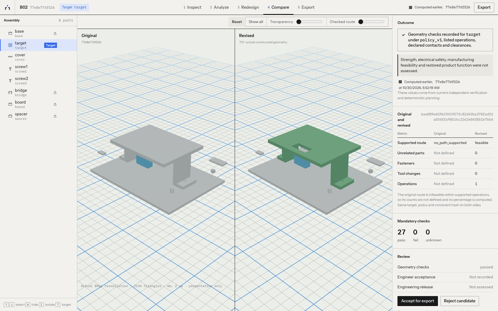
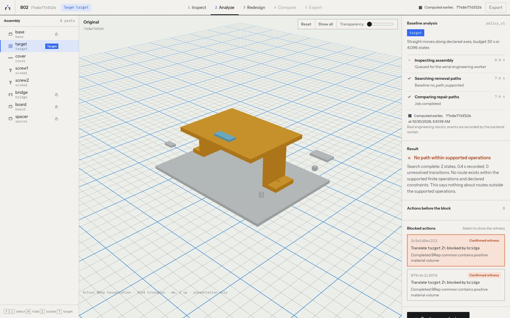

<p align="center">
  
</p>

<h1 align="center">UNLOCK</h1>

<p align="center">
  <em>Design for the day it breaks.</em>
</p>

<p align="center">
  An AI agent that redesigns a physical product so its failed part can actually be replaced —<br/>
  then proves the redesign is valid with a CAD kernel <strong>before anyone cuts metal.</strong>
</p>

<p align="center">
  
  
  
  
  
</p>

<p align="center">
  <!-- Demo video: add the link here when it is recorded. -->
  <a href="#the-demo-in-five-minutes"><strong>Run the demo</strong></a> ·
  <a href="#the-live-run"><strong>The live run</strong></a> ·
  <a href="#check-our-claims"><strong>Check our claims</strong></a> ·
  <a href="#deep-dives"><strong>Deep dives</strong></a>
</p>

<p align="center">
  
</p>

<p align="center"><sub>A real screenshot from the browser acceptance run. Left: the original assembly, with no supported removal route for <code>target</code>. Right: the revised bridge with a relief cut, a feasible route, and every check passing.</sub></p>

---

## In ninety seconds

```text
YOU          point UNLOCK at an assembly and name the part that failed
  │
PLANNER      searches for a way out. Finds none.
  │          no_path_supported · two confirmed obstructions · B-rep witness at (0, −20, 36) mm
  │
MUSE         reads the evidence and picks a relief from a finite, server-owned menu: T01 24 × 12.
  │          It cites two ev_ handles instead of a rejection, plan or verification ID.
  │
DISPATCHER   REFUSES IT before construction. The geometry was never judged, only the citation.
  │
MUSE         resubmits citing rej_17a84dbaf811, and chooses a larger cut: T01 40 × 16.
  │
KERNEL       builds it, then rebuilds it from scratch in a separate process.
  │          12/12 mandatory checks pass. Re-plans. Replays forward. Reinserts in reverse.
  │
COMPARISON   original vs revised, same target, same frozen policy.
  │          VERIFIED_IMPROVEMENT · route: target TRANSLATE Z+ 80 mm
  │
YOU          accept it and export a STEP bundle that is reimported and re-verified first.

48.1 seconds. 31,122 tokens. About three cents.
The model's own closing claim of success is stored with authority: "none".
```

A part that could not be serviced can now be serviced, and the claim is checked by geometry rather than by the model.

---

## Contents

<table>
<tr>
<td width="50%" valign="top">

**What it is**
<ol>
<li><a href="#the-problem">The problem</a></li>
<li><a href="#what-unlock-does">What UNLOCK does</a></li>
<li><a href="#why-this-pushes-the-frontier">Why this pushes the frontier</a></li>
<li><a href="#what-exists-and-whats-different">What exists, and what's different</a></li>
<li><a href="#how-it-works">How it works</a></li>
<li><a href="#the-live-run">The live run</a></li>
<li><a href="#verification">Verification</a></li>
<li><a href="#architecture">Architecture</a>&#160; &#160; &#160; &#160; &#160; &#160; &#160; &#160; &#160; &#160; &#160; &#160; &#160; &#160; &#160; &#160; &#160; &#160; &#160; &#160; &#160; &#160; &#160; &#160; &#160; &#160; &#160; &#160; &#160; &#160; &#160; &#160; &#160; &#160; &#160; &#160; &#160; &#160; &#160; &#160; &#160; &#160; &#160; &#160; &#160; &#160; &#160; &#160; &#160; &#160; &#160; &#160; &#160; &#160; &#160; &#160; &#160; &#160; &#160; &#160;</li>
</ol>

</td>
<td width="50%" valign="top">

**Run it and check it**
<ol start="9">
<li><a href="#getting-started">Getting started</a></li>
<li><a href="#the-demo-in-five-minutes">The demo in five minutes</a></li>
<li><a href="#check-our-claims">Check our claims</a></li>
<li><a href="#scope-honestly">Scope, honestly</a></li>
<li><a href="#built-during-the-hackathon">Built during the hackathon</a></li>
<li><a href="#roadmap">Roadmap</a></li>
<li><a href="#deep-dives">Deep dives</a></li>
<li><a href="#credits-and-license">Credits and license</a>&#160; &#160; &#160; &#160; &#160; &#160; &#160; &#160; &#160; &#160; &#160; &#160; &#160; &#160; &#160; &#160; &#160; &#160; &#160; &#160; &#160; &#160; &#160; &#160; &#160; &#160; &#160; &#160; &#160; &#160; &#160; &#160; &#160; &#160; &#160; &#160; &#160; &#160; &#160; &#160; &#160; &#160; &#160; &#160; &#160; &#160; &#160; &#160; &#160; &#160; &#160; &#160; &#160; &#160; &#160; &#160; &#160; &#160; &#160; &#160;</li>
</ol>

</td>
</tr>
</table>

<sub>New to CAD terms like B-rep, STEP or keep-out? See the <a href="docs/glossary.md">glossary</a>.</sub>

---

## The problem

Every product is designed for the factory. Very few are designed for the day they break.

Picture a fan module inside a sealed enclosure, with a bracket that was never meant to come off sitting directly above it. The service manual says *replace the fan*. The geometry says *the fan cannot leave*. So the whole unit is scrapped, and a $200 part failure becomes a $2,000 replacement plus the embodied carbon of a new machine.

Multiply that across every product line. The world generated **62 million tonnes of e-waste in 2022, and only 22.3% of it was documented as properly collected and recycled** ([UN Global E-waste Monitor 2024](https://unitar.org/about/news-stories/press/global-e-waste-monitor-2024-electronic-waste-rising-five-times-faster-documented-e-waste-recycling)). Regulation is moving: the EU's right-to-repair directive ([Directive (EU) 2024/1799](https://circular-cities-and-regions.ec.europa.eu/support-materials/eu-regulations-legislation/directive-eu-20241799-repair-goods)) places repair obligations on manufacturers. But a law can't make a part removable when a bracket is in the way. The obstruction is a shape, and it has to be fixed at design time.

**Who it's for.** A mechanical design engineer reviewing a service module before design freeze: someone who has the STEP data, knows which part is meant to be replaceable, and can still change the design. A repair shop usually can't change a product that has already been manufactured; the engineer upstream can.

<p align="center">
  
</p>

<sub><code>fixture B02</code>: the baseline search returns <code>no_path_supported</code> with two confirmed geometric obstructions and a B-rep witness. After the relief, the route is a single verified translation. Both halves of this diagram are computed results, not illustrations.</sub>

---

## What UNLOCK does

You point it at a mechanical assembly and name the part that failed. UNLOCK runs a seven-stage loop:

```text
 01  inspect       ── parse the STEP assembly, measure real bounds, freeze a revision
 02  baseline      ── search for a supported removal path for the failed part
 03  obstruction   ── find what is actually in the way, with B-rep evidence
 04  interventions ── list the finite redesigns the server allows
 05  construct     ── build the proposed edit with a trusted CAD constructor
 06  verify        ── independently reconstruct and check twelve mandatory constraints
 07  compare       ── original versus revised, under one frozen policy
```

Stages 01–02 are deterministic and run before the model is called. In stages 03–05, **Muse Spark 1.3** drives: it reads the obstruction evidence, chooses a template and its parameters, and revises when the system pushes back. In stages 06–07 the model has no say. A CAD kernel rebuilds the geometry from frozen parameters and decides for itself.

The output is a **verification report**: a machine-checkable claim that, under a named numerical policy, on a named revision, with named evidence handles, this part can now be removed along a stated axis by a stated number of millimetres.

**What it refuses to claim.** A passing report is a geometry result for one target under one stated policy. UNLOCK says plainly, in the product itself, that it has **not** assessed strength, stiffness or fatigue; electrical safety; manufacturing feasibility; restored product function; or torque, cables, clips and adhesives.

---

## Why this pushes the frontier

> **Push the Frontier.** Use Meta's models to tackle challenges in software, robotics, manufacturing, energy, materials and beyond. Give a machine a new capability, accelerate a scientific experiment, or unlock a better way to understand and control a physical system. Show us what becomes possible when these models meet the real world.

**What the existing toolchain can't answer.** Ask: *"Can this part be removed, and if not, what is the smallest change to the housing that makes it removable?"* A CAD system will model whatever you draw, but has no opinion on whether a shape is removable. A PLM system knows part numbers and change history, not motion. A simulation package can check a path you supply, but can't invent one or redesign the obstruction.

**What UNLOCK adds.** A loop that can answer the question and prove the answer: a removal planner that finds the obstruction and pins it to a B-rep witness, a bounded menu of redesigns, and an independent verifier that rebuilds the result and checks it. Muse Spark 1.3 is the proposer inside that loop. It reads the evidence, chooses a redesign, and revises when it's refused.

**What one fixture does and doesn't show.** On B02, a hand-written heuristic (`geometry_ranked`) also finds a verified relief: smaller, faster and free. We ran it, and a weaker heuristic that found nothing, as controls *before* the live call, and we publish all three in [the live run](#the-live-run). So the claim is not that Muse out-searched a heuristic. It is this:

> A frontier model can be placed inside a safety-relevant engineering loop with zero trust and bounded authority, and the loop still reaches a correct, physically real, independently verified result, because nothing the model says is accepted until the kernel has checked it.

That pattern transfers to motion planning, materials substitution and any domain where a confident wrong answer is expensive. The case for a model over hand-written rankings is the problems nobody has written a ranking for yet: new templates, new assemblies, several obstructions at once. We haven't shown that yet. It is the first item on the [roadmap](#roadmap).

<p align="center">
  
</p>

| A new capability | What it makes possible |
|:--|:--|
| **Geometric reasoning over real B-reps** | A model reasons about solids it never sees, in millimetres, against measured bounds, and its reasoning is checked against the actual topology rather than its description of it. |
| **Closed-loop redesign under constraint** | The model can only choose from finite, server-owned parameter grids. It can't emit arbitrary geometry, so it can't introduce arbitrary risk. |
| **Feedback from measurements** | When a proposal fails, the model receives the measurement or the rule it broke, and adjusts against real numbers. |
| **Machine-checkable engineering claims** | Every "this works" resolves to a named policy, a geometry hash and twelve checked constraints that a third party can re-run. |

---

## What exists, and what's different

| Approach | Example | What it does | Where UNLOCK differs |
|:--|:--|:--|:--|
| Text-to-CAD | [Zoo Text-to-CAD](https://zoo.dev/text-to-cad) | Generates new geometry from a prompt | UNLOCK edits an existing assembly, only from a finite menu, and verifies each edit against declared constraints |
| Generative design | [Autodesk generative design](https://www.autodesk.com/solutions/generative-design) | Explores shapes against loads and manufacturing constraints | UNLOCK's objective is different: a removal path for a named part |
| Assembly and disassembly planning | [Assemble Them All](https://assembly.csail.mit.edu) (Tian et al., SIGGRAPH Asia 2022) | Finds assembly sequences by simulating disassembly of a fixed design | When no path exists, UNLOCK proposes and verifies a design change |

We don't know of a tool that combines a language-model proposer with an independent B-rep verifier for design-for-repair. If you know of one, we'd like to hear about it.

The obstacles that make this hard, and how UNLOCK handles each:

| The obstacle | How UNLOCK gets past it |
|:--|:--|
| **"Just let the LLM write the CAD script."** Generated code runs and produces a plausible shape, but nobody can say whether it preserved a mounting interface. | The model never writes code or emits geometry. It picks values from a server-owned grid such as `width_mm ∈ {24, 40, 46, 52}`, and a trusted constructor builds the result. |
| **"The model will claim success."** Asked "is this safe?", a language model will say yes fluently and may be wrong. | Model-supplied pass flags are never accepted. The verifier reconstructs the candidate from frozen parameters in a separate process. The model's closing claim is stored with `authority: "none"`. |
| **"LLMs can't reason about physical motion."** Collision-free extraction is a sweep problem over six axes, not a text problem. | The planner does the motion. It admits a translation only with validated conservative coverage plus complete analytic sweep separation. Witness sampling may reject or leave a result unknown; it can never admit one. |
| **"Verification is too slow."** Cold-starting OCCT costs 4–6 s per native operation. | A single-use warm standby worker absorbs the import cost while the model is thinking. The live run finished in **48.1 s** against a 120 s ceiling. |
| **"One demo, no reliability."** A single golden path presented as a product. | Two deterministic selectors were frozen and run before the live call as controls, and the comparison is published, including that the model did not beat the better one. |

---

## How it works

<p align="center">
  
</p>

### Stages 01–02: inspect and baseline

A package is accepted only as a flat `assembly.step` (AP214 or AP242, explicit millimetre units), a `manifest.json` and an optional `attribution.txt`. Scripts, external references, symlinks, encrypted archives and arbitrary archive paths are rejected before any native parsing. The import runs in an isolated worker and produces an immutable revision whose identity includes the frozen constraints, keep-outs and envelope.

The baseline planner then searches for a supported removal path. On B02 it returns `no_path_supported`, **complete**, with two `CONFIRMED_GEOMETRIC_OBSTRUCTION` rejections carrying a real B-rep witness. It deliberately reports no operation count for an infeasible baseline, so no percentage improvement against zero can ever be claimed.

### Stages 03–05: obstruction, intervention, construction

The model receives compact structured evidence, never a STEP file or raw geometry: the witness position, the rejection certificate, and the finite domains the server allows.

```python
# backend/src/unlock_engine/templates.py: the model's entire decision space
SERVER_DOMAINS = {
    "T01": dict(  # rectangular relief cut through the bracket's web
        center_x_mm=(-4.0, 0.0, 4.0),
        center_y_mm=(-24.0, -20.0, -16.0, 0.0),
        width_mm=(24.0, 40.0, 46.0, 52.0),
        depth_mm=(8.0, 12.0, 16.0, 20.0),
    ),
    "T02": dict(offset_y_mm=(-12.0, 12.0, 24.0, 36.0)),  # shift the web sideways
}
```

Nineteen values across five parameters: **196 possible designs** in total (192 for T01, 4 for T02). That is the model's entire authority over physical geometry. It can't widen a domain or add a template, and arguments with extra fields, invalid IDs or out-of-domain values are rejected before any native process starts.

<p align="center">
  
</p>

Construction happens in an isolated worker and returns a candidate with a real changed solid. Construction is not verification, and the tool description the model reads says so in those words.

### Stages 06–07: verify and compare

The verifier doesn't trust the candidate it was handed. It rebuilds the bracket *from the frozen parameters* in a separate process and compares the result with the original by two-way B-rep difference. Then it runs the twelve mandatory checks, re-plans the removal, replays the path forward and reinserts it in reverse. Only then does comparison run, under the same target and the same frozen policy, so both sides of the table are genuinely comparable.

### The trust boundary

**The model proposes. The kernel disposes. They meet in exactly one place, and information crosses it in one direction.**

```mermaid
flowchart LR
    subgraph MODEL["Muse Spark 1.3 — untrusted proposer"]
        A[Reads structured evidence] --> B[Reasons about the obstruction]
        B --> C[Chooses template + values]
        C --> D[Cites run-issued evidence handle]
    end

    subgraph BOUNDARY["The dispatcher — the only door"]
        E{Schema valid?<br/>Identity frozen?<br/>Value in domain?<br/>Handle citable?}
    end

    subgraph KERNEL["OCCT kernel — trusted authority"]
        F[Trusted constructor builds] --> G[Independent reconstruction]
        G --> H[12 mandatory checks]
        H --> I[Re-plan · replay · reverse]
        I --> J[Comparison under frozen policy]
    end

    D --> E
    E -->|"INVALID_PROPOSAL"| D
    E -->|"accepted"| F
    J --> K[Verification report]
    E -.->|"model self-report"| X[(recorded, no authority)]

    style MODEL fill:#1a2233,stroke:#3268f5,color:#e9e8e3
    style BOUNDARY fill:#2a1a14,stroke:#e4602f,color:#e9e8e3
    style KERNEL fill:#14211c,stroke:#34866b,color:#e9e8e3
    style X fill:#1d2023,stroke:#4f5357,color:#7d8287
```



Four rules give the boundary teeth:

1. **Every proposal must cite evidence this run issued.** A `rej_`, `plan_` or `ver_` handle handed out by this specific run. Anything else is refused *before construction starts*.
2. **Unknown is distinct from pass and from fail.** `clear`, `blocked` and `unknown` are never merged, and a mandatory check that is unknown, missing or stale **forbids a passing aggregate**.
3. **Witness sampling may reject, never admit.** Only validated conservative coverage plus complete analytic sweep separation can admit a translation.
4. **The frontend never derives a status.** It renders what a report says. `frontend/src/ui/Evidence.tsx` only paints green when provenance is `live` or `computed_earlier`; an illustrative pass is drawn as an outline.

Every artifact also carries a content hash, and the full numerical policy is part of every evidence identity, so changing a tolerance invalidates everything derived under the old one.

<p align="center">
  
</p>

### The eight tools

UNLOCK exposes **exactly eight tools** to Muse Spark 1.3 through the Meta Model API. There is no shell, Python, URL, filesystem, acceptance or release tool. A tool that isn't on the list returns a typed `TOOL_NOT_ALLOWED` and is never dispatched.

| Tool | What it actually runs | Access |
|:--|:--|:--:|
| `inspect_assembly` | Validated manifest + measured native inventory | read |
| `inspect_constraints` | Frozen constraints, regions, keep-outs, envelope | read |
| `analyze_removal` | Deterministic baseline `PlanResult` | read |
| `inspect_blocker` | Rejection certificates + actual B-rep findings | read |
| `list_interventions` | Server template domains ∩ manifest | read |
| `construct_candidate` | Trusted T01/T02 constructor in an isolated worker | **write** |
| `verify_candidate` | Fresh reconstruction, 12 checks, re-planning, replay, reverse insertion | read |
| `compare_candidates` | Planner comparison, same target, same frozen policy | read |

Every call is validated against a strict schema (`additionalProperties: false`), and project, revision and target identity are checked against the frozen run, so a stale reference returns `STALE_EVIDENCE` instead of executing.

**Controller budgets**, fixed rather than tunable at runtime:

| Budget | Limit | Why |
|:--|:--:|:--|
| Candidates | **3** | Bounds native work per run |
| Tool calls | **12** | Bounds the interaction surface |
| Model turns | **6** | Bounds conversation drift |
| Billed output tokens | **16,000** | Reserved before every attempt and kept on failure, so a dropped response can't hide spend |
| Wall clock | **120 s** | Each native operation also has its own 30 s limit |
| Schema repairs | **1** | A second malformed response fails the run |

The request uses the protocol as Meta documents it:

```python
response = client.chat.completions.create(
    model="muse-spark-1.3",
    messages=history,                      # original assistant tool_calls + tool results
    tools=tool_definitions,                # derived from production TOOL_ARGS schemas
    tool_choice="auto",                    # never forced
    reasoning_effort="medium",             # nothing higher is chosen automatically
    max_completion_tokens=16_000,          # not the deprecated max_tokens
)
```

SDK retries are **off**; the controller owns bounded retries, so there is exactly one retry policy in the system.

---

## The live run

Everything in this section is a real call to the Meta Model API against real CAD geometry. The full report is committed as [`backend/evidence/live-b02/live_run.json`](backend/evidence/live-b02/live_run.json) (158 KB), alongside the constructed bracket as a real STEP file.

<p align="center">
  
</p>

```text
UNLOCK AI run run_983d811a0f174f9a  [live_model]
  outcome     VERIFIED_IMPROVEMENT_FOUND  (stop: model_final)
  why         cand_eaafba557ae0 (T01 40 × 16 mm) passed independent verification
              and the planner comparison
  baseline    no_path_supported  complete=True
              geometric blocks ×2  CONFIRMED_GEOMETRIC_OBSTRUCTION
  candidate 1 T01 {'center_x_mm': 0.0, 'center_y_mm': -20.0,
                   'depth_mm': 16.0, 'width_mm': 40.0}
              → VERIFIED_IMPROVEMENT   revised=feasible   reverse=passed
  usage       turns=6  tool_calls=6  candidates=1
              tokens in/out = 28,272 / 2,850   48.147 s
```

| t (s) | Turn | Tool call | Result |
|--:|:--|:--|:--|
| 16.0 | — | Baseline | `no_path_supported`, complete. Two confirmed obstructions with B-rep witness |
| 20.7 | 1 | `inspect_blocker` + `list_interventions` | Witness at (0, −20, 36) mm; T01/T02 finite domains |
| 25.4 | 2 | `construct_candidate` T01 **24 × 12**, citing two `ev_` handles | **Refused before construction** (`INVALID_PROPOSAL`: citation, not geometry) |
| 34.4 | 3 | `construct_candidate` T01 **40 × 16**, citing `rej_17a84dbaf811` | Built. 2,560 mm³ removed, all inside the editable web |
| 44.5 | 4 | `verify_candidate` | Static checks passed, then independent re-planning |
| 46.1 | 5 | `compare_candidates` | `verified_improvement: true` |
| 48.1 | 6 | Final JSON (`candidate_proposed`) | Recorded as a model statement with no authority |

Five of the eight tools were called live. `inspect_assembly`, `inspect_constraints` and `analyze_removal` weren't needed because the opening context already carried the baseline rejections; all eight are covered offline in `backend/tests/test_ai_toolbox.py`.

### The refusal, told straight

<p align="center">
  
</p>

Muse's first proposal, **T01 24 × 12 at (0, −20)**, was the same design the deterministic control later verified as the minimal valid relief. It was refused because it cited two `ev_` handles instead of the `rej_`, `plan_` or `ver_` handle the schema requires. The geometry was never evaluated.

The refusal message said only *"cite at least one rejection, plan or verification evidence ID"*. It didn't say the parameters were acceptable. Muse resubmitted with a correct citation and, in its own words, a *"larger cut"*: 40 × 16, removing 2.2× the material. That design is valid and verified, but it isn't minimal.

That is a real finding about putting a model in an engineering loop: **the wording of a refusal steers the design, not just the compliance.** We changed the message in [`fffc1e4`](https://github.com/Shrenzoo/unlock/commit/fffc1e4). It now reads *"construction did not start: evidence_ids must include at least one rejection (rej_), plan (plan_) or verification (ver_) ID; correct the citations and resubmit, the same parameters are allowed"*. A regression test (`test_live_regression_uncited_obstruction_is_refused_but_resubmittable`) fails on the old behaviour.

### The model's last word, with no authority

```json
{
  "decision": "candidate_proposed",
  "candidate_ids": ["cand_eaafba557ae0"],
  "summary": "T01 cut on bridge clears Z+ witness [0,-20,36]; verified feasible 1-step removal. Evidence ev_83077a556f31, ev_afa690947095, ev_376f5dc775ac, ev_174b5dfa252c, ev_946617b05d3f.",
  "structured": true,
  "authority": "none: model statement, not engineering evidence"
}
```

The engine writes that `authority` field on every run, at the moment the message is stored. The model's summary is kept in full, and the schema it's stored under says it is not evidence and can't be cited as such.

### The result

- **12/12 mandatory checks passed**: integrity, solid validity, trusted reconstruction, actual change (2,560 mm³), editable region (0 mm³ outside it), protected interfaces, hole geometry, fixed components, placements, envelope, keep-outs, assembled intersections. No failed, unknown, missing or stale checks.
- **Revised plan:** `feasible`, complete, optimal within scope: `target TRANSLATE Z+ 80 mm`, cost `(0,0,0,1)`, with a 0.5 mm non-contact clearance lower bound.
- **Forward replay passed. Reverse insertion passed.**

### The controls

Two deterministic selectors were frozen and run **before** the live call, unmodified, on the same fixture under the same policy:

| | Muse Spark 1.3 (live) | `geometry_ranked` | `stable_enumeration` |
|:--|:--|:--|:--|
| Outcome | VERIFIED_IMPROVEMENT_FOUND | VERIFIED_IMPROVEMENT_FOUND | NO_VERIFIED_IMPROVEMENT |
| Proposals / built | 2 / 1 (1 refused) | 1 / 1 | 3 / 3 (all failed) |
| Verified design | T01 40 × 16, 2,560 mm³ | T01 24 × 12, 1,152 mm³ | — |
| Revised route | target Z+ 80 mm | same | — |
| Tool calls | 6 | 2 | 4 |
| Runtime | 48.1 s | 24.1 s | 30.3 s |
| Model cost | ≈ $0.030 | $0 | $0 |

<p align="center">
  
</p>

**Muse matched the geometry-ranked selector. It did not beat it.** Its first proposal was the same minimal design; after the citation refusal it settled on a relief 2.2× larger, with the same revised route and cost, one more proposal, four more tool calls and about twice the runtime. One run on one synthetic fixture is a protocol check, not a statistical comparison. We publish the controls because they are what make the verification layer credible.

What the run does establish: **a frontier model drove a real CAD redesign loop, was refused mid-run by a guardrail it couldn't bypass, recovered, and produced a physically real, independently verified improvement in 48 seconds.**

### API usage

| | Requests | Input tokens | Output tokens | Total | Latency |
|:--|--:|--:|--:|--:|--:|
| Tool-calling check (B01) | 2 | 2,903 | 411 (199 reasoning) | 3,314 | 5.77 s |
| Full redesign (B02) | 6 | 28,272 (16,068 cached) | 2,850 (1,596 reasoning) | 31,122 | 20.0 s model / 48.1 s wall |

Estimated **$0.0054** and **$0.0298** respectively at Meta's [published list price](https://dev.meta.ai/docs/pricing-rate-limits). These are list-price estimates, not account-verified charges; the API reports no credit balance.

---

## Verification

Verification is a separate process that doesn't trust anything the previous process told it.

<p align="center">
  
</p>

| # | Check | What it measures |
|--:|:--|:--|
| 1 | `integrity` | The rebuilt solid is structurally intact |
| 2 | `solid_validity` | OCCT reports a valid B-rep |
| 3 | `trusted_reconstruction` | Independent rebuild, compared by **two-way B-rep difference** |
| 4 | `actual_change` | Material really was removed (2,560 mm³, measured) |
| 5 | `editable_region` | **0 mm³** removed outside the declared editable region |
| 6 | `protected_interfaces` | Mounting pads and interfaces untouched |
| 7 | `hole_geometry` | Hole axes within tolerance (≤ 0.01 mm) |
| 8 | `fixed_components` | Fixed parts are still fixed |
| 9 | `placements` | No placement drifted |
| 10 | `design_envelope` | Still inside the declared envelope |
| 11 | `keep_outs` | No declared keep-out violated |
| 12 | `assembled_intersections` | The assembly intersects only at declared contacts |

`tool_access` is reported separately and deferred to state-aware replay, because whether a screwdriver can reach a screw head is a motion question. The workspace's check tally is higher than twelve (27 in the screenshot above) because it also lists forward replay, reverse insertion and each route constraint from the planner.

**Why `trusted_reconstruction` matters most.** The other checks would pass on a shape that was *described* correctly. Check 3 discards the candidate geometry the constructor produced, rebuilds the bracket from the frozen parameters in its own process, and compares the two solids. If the constructor and verifier disagree about what the parameters mean, it fails. A dedicated test forges a candidate's geometry, recomputes its hashes, and confirms the verifier still rejects it.

**The aggregation rule.** `clear` admits, `blocked` refuses with witness evidence, and `unknown` admits nothing and forbids a passing aggregate. UNLOCK returns `unknown` rather than rounding up.

**Original B-reps are never mutated.** OCCT booleans, compound assembly, STEP transfer and tessellation can silently change shared topology flags, so private deep copies are taken at every mutation boundary.

**Export is verified too.** A STEP export isn't counted as successful because a file appeared. It requires a real reimport of the exported file followed by geometry and path checks on the reimported result.

---

## Architecture

<p align="center">
  
</p>

```text
┌─────────────────────────────────────────────────────────────────────────┐
│  React 19 · TypeScript · Vite 7 · Three.js / R3F                        │
│  renders what a report says · never derives a status of its own         │
├─────────────────────────────────────────────────────────────────────────┤
│  FastAPI coordinator    immutable revisions · frozen targets            │
│                         ordered resumable SSE · cancellation            │
│                         SQLite + FKs · one serial job queue             │
├─────────────────────────────────────────────────────────────────────────┤
│  AI controller          8 allowlisted tools · hard budgets              │
│  (Meta Model API)       output reserved before every attempt            │
├─────────────────────────────────────────────────────────────────────────┤
│  disassembly planner    conservative coverage + analytic sweep          │
│  independent verifier   fresh reconstruction · 12 mandatory checks      │
│  template constructors  T01/T02 · finite server-owned grids             │
├─────────────────────────────────────────────────────────────────────────┤
│  OCCT / CadQuery 2.6.1  real B-reps · private deep copies               │
│  isolated subprocesses  30 s wall limit · 120 s parent budget           │
└─────────────────────────────────────────────────────────────────────────┘
```

Every native operation runs in its **own subprocess**, with credentials stripped from the worker environment before it starts. A single-use warm standby absorbs OCCT's 4–6 s import cost, and at most one CAD process exists at a time, so peak memory stays around 440 MiB.

The frontend talks to the engine through one interface, `UnlockApi`, with an HTTP/SSE adapter for the live coordinator and a fixture adapter for an explicitly labelled illustrative mode (`VITE_UNLOCK_MODE=fixture`), which the UI announces in its header so it can't be mistaken for a live run.

For the full detail, see [the security model](docs/security-model.md), [performance](docs/performance.md) and [the API surface](docs/api.md).

---

## Getting started

| | Version | Why |
|:--|:--|:--|
| Python | **3.12.x** | Pinned `>=3.12,<3.13`; the OCP wheels are version-specific |
| Node | 18+ | Vite 7 |
| Disk | ~1.5 GB | CadQuery, OCP and VTK wheels are large |

### 1. Backend

```sh
cd backend
python3.12 -m venv .venv
.venv/bin/python -m pip install -r requirements.lock
.venv/bin/python -m pip install --no-deps --no-build-isolation -e .
cp -n .env.example .env          # add your key, see step 3

.venv/bin/python -m unlock_engine.api --port 8000
```

The B01, B02 and B03 fixtures are generated as real STEP assemblies and imported through the isolated worker on first startup, so the first start takes longer.

<details>
<summary>No Python 3.12 on your Mac?</summary>

[`uv`](https://docs.astral.sh/uv/) installs a pinned interpreter without touching system packages. From `backend/`:

```sh
curl -LsSf https://astral.sh/uv/install.sh | sh
uv python install 3.12
uv venv --python 3.12 .venv
uv pip install --python .venv/bin/python -r requirements.lock
uv pip install --python .venv/bin/python --no-deps --no-build-isolation -e .
```

Verified on macOS ARM64 with Python 3.12.16, CadQuery 2.6.1, cadquery-ocp 7.8.1.1.post1, Pydantic 2.12.3 and pytest 8.4.2.

</details>

### 2. Frontend

```sh
cd frontend
npm ci
npm run dev -- --host 127.0.0.1 --port 5183 --strictPort
```

Open **http://localhost:5183/projects**.

### 3. Configure Meta (optional)

`backend/.env` is backend-only. **Never put a credential in `frontend/`.**

```dotenv
AI_PROVIDER=meta
MODEL_API_KEY=YOUR_REAL_META_KEY
META_MODEL=muse-spark-1.3
META_BASE_URL=https://api.meta.ai/v1
META_REASONING_EFFORT=medium
RUN_META_LIVE_TESTS=0
```

Restart the backend after changing it. Without a key, the baseline stays fully viewable and a redesign returns `Model unavailable`; it never silently falls back to the scripted policy.

### Offline and illustrative modes

```sh
# Real CAD, real planner, real verifier; a scripted policy stands in for the model.
AI_PROVIDER=mock .venv/bin/python -m unlock_engine.api --port 8000

# The UI alone, against prepared records, with no engineering computation at all.
VITE_UNLOCK_MODE=fixture npm run dev
```

Both modes say so in the UI. Neither is ever reported as live Meta.

### Tests

```sh
cd backend
.venv/bin/python -m pytest -q          # 335 passed, 18 deselected (about 6 minutes)
.venv/bin/ruff check src tests scripts
```

The 18 deselected tests are the paid `meta_live` tests. They are excluded by default, and even with a key present they skip unless `RUN_META_LIVE_TESTS=1` is also set.

With the backend running under `AI_PROVIDER=mock` and the frontend up, `.venv/bin/python scripts/browser_qa.py` drives headless Chrome through the real HTTP service, from selection through checked export, and writes screenshots and a request/error report to `.work/meta-validation/browser/`.

---

## The demo in five minutes

The shortest path to seeing what the project does. No API key needed.

<p align="center">
  
</p>

**Minute 0: get it running.** Start the backend with `AI_PROVIDER=mock` and the frontend as in [Getting started](#getting-started). Installing the CAD wheels is the slow part; once installed, the first backend start takes a minute or two while the fixtures are generated and imported.

**Minute 1: watch it fail honestly.** Open **B02**, select `target` in the assembly tree, set it as the repair target, then **Analyze → Run baseline analysis**.

<p align="center">
  
</p>

The planner reports no path within supported operations and two confirmed witnesses: *Translate target Z+, blocked by bridge*. Note what's absent: no invented operation count and no percentage improvement against nothing.

**Minute 2: watch the kernel overrule a proposal.** Click **Explore a redesign**, then **Request redesign**. With `AI_PROVIDER=mock`, a scripted policy stands in for the model, and the UI says so. Everything downstream is real. The policy picks the relief nearest the witness, smallest first:

- **T01 24 × 8** is constructed, then **rejected by re-planning** (`NO_REPAIR_PATH`): the target still has insufficient clearance.
- **T01 24 × 12** is constructed and verified.

That first rejection is the kernel overruling a proposal on measured geometry, with no model judgement involved.

**Minute 3: check the green is earned.** Open the verification panel on the accepted candidate. Every check carries provenance, and the UI only paints a check green when its provenance is `live` or `computed_earlier`.

**Minute 4: see the route change.** Switch to compare view. Left: `no_path_supported`. Right: `feasible`, revised route `target TRANSLATE Z+ 80 mm`, forward replay passed, reverse insertion passed. Same target, same frozen policy.

**Minute 5: export.** Accept the candidate and export. The bundle is reimported and re-verified before it's reported as a success, and it lands in `.work/` as a real AP214 STEP you can open in FreeCAD or any CAD tool.

**With a key**, set `AI_PROVIDER=meta`, restart the backend and repeat minutes 2–5. The same clicks now run real inference against Meta's Model API, typically in under a minute for a few cents. A live model won't necessarily repeat the recorded run's choices; [`live_run.json`](backend/evidence/live-b02/live_run.json) has that run's every tool response, plan, certificate and hash.

---

## Check our claims

Every substantive claim in this README can be checked from the repository alone, without a key or network access. Run these from the repository root (they need [`jq`](https://jqlang.github.io/jq/)).

| Claim | Command | Expected |
|:--|:--|:--|
| The live run found a verified improvement | `jq -c '.outcome, .usage.turns' backend/evidence/live-b02/live_run.json` | `"VERIFIED_IMPROVEMENT_FOUND"`, then `6` |
| One proposal was refused live, for its citation | `jq -c '.engineering_evidence.tool_results[] \| select(.status=="rejected") \| .feedback \| {category, message}' backend/evidence/live-b02/live_run.json` | `INVALID_PROPOSAL`, `cite at least one rejection, plan or verification evidence ID` |
| The refused design was the control's minimal design | `jq -cS '.events[] \| select(.status=="rejected") \| .arguments.proposal.parameters' backend/evidence/live-b02/live_run.json` and `jq -cS '.candidates[0].proposal.parameters' backend/evidence/live-b02/selector_geometry_ranked.json` | the same four values twice: centre (0, −20), width 24, depth 12 |
| 12 of 12 mandatory checks passed | `jq -r '.engineering_evidence.verified[].static_report.checks[] \| "\(.constraint_id) \(.result) mand=\(.mandatory)"' backend/evidence/live-b02/live_run.json` | twelve `pass mand=true`, then `tool_access not_applicable mand=false` |
| Muse matched one control and beat the other | `for f in live_run selector_geometry_ranked selector_stable_enumeration; do jq -r --arg f "$f" '"\($f): \(.outcome)"' backend/evidence/live-b02/$f.json; done` | `VERIFIED_IMPROVEMENT_FOUND` twice, then `NO_VERIFIED_IMPROVEMENT` |
| The model's claim carried no authority | `jq -r '.final_model_message.authority' backend/evidence/live-b02/live_run.json` | `none: model statement, not engineering evidence` |
| The constructed bracket is real AP214 geometry | `grep -m1 FILE_SCHEMA backend/evidence/live-b02/live_changed_bridge.step` | `AUTOMOTIVE_DESIGN` (the AP214 schema) |
| Native tool calling worked live | `jq -r '.checks[] \| "\(.name) \(.result)"' backend/evidence/meta-tool-smoke/live_report.json` | fifteen `pass` lines |
| The key never reached the evidence | `jq -r '.checks[] \| select(.name=="no_secret_in_report") \| .result' backend/evidence/meta-tool-smoke/live_report.json` | `pass` (with your own key set, `grep -cF -- "${MODEL_API_KEY:?}" backend/evidence/live-b02/live_run.json` prints `0`) |
| The decision space is 19 values | `sed -n '/^SERVER_DOMAINS/,/^}/p' backend/src/unlock_engine/templates.py` | five parameter tuples holding 3 + 4 + 4 + 4 + 4 values |

### The check that matters most

The central claim is that the verifier is independent of the model: a forged candidate, a false success claim, an uncited proposal or an unknown check can't produce a pass. Each of those is a test. From `backend/`:

```sh
.venv/bin/python -m pytest -q tests/test_templates_verification.py tests/test_ai_toolbox.py tests/test_ai_controller.py \
  -k "forged or never_passes or false_success or never_start_construction or uncited_obstruction or keepout_cannot or constraint_mutation or original_and_other"
# 12 passed, in under a minute
```

Then run the whole loop offline, with real CAD and a scripted policy instead of the model:

```sh
.venv/bin/python -m unlock_engine.ai demo --offline --fixture B02 --output .work/offline
```

It reproduces the demo above: T01 24 × 8 rejected by re-planning, T01 24 × 12 verified. For the deterministic planning demonstration without any AI loop, run `.venv/bin/unlock-engine plan-demo --output .work/planning`.

[Objections, and what would change our mind](docs/objections.md) lists the findings that would falsify the project, and the test that guards each one.

---

## Scope, honestly

**What it does:** parses real STEP assemblies (AP214/AP242) in isolated workers; searches for a supported removal path with conservative coverage and analytic sweep separation; pins obstructions to coordinates with B-rep witnesses; accepts bounded redesign proposals from Muse Spark 1.3, refusing any without citable evidence; independently reconstructs and verifies every candidate against twelve mandatory constraints; compares original and revised under one frozen policy; and exports a checked STEP bundle that is reimported and re-verified.

| What it doesn't do | Why not |
|:--|:--|
| **Strength, fatigue or thermal analysis** | A passing report is scoped to geometry and declared constraints. It says nothing structural. |
| **Arbitrary CAD generation** | The model chooses from finite grids. Free-form geometry is deliberately out of scope. |
| **Torque, cables, clips, adhesives or wiring** | Disassembly is modelled as rigid-body extraction. Soft and electrical systems aren't represented yet. |
| **Restored product function or manufacturability** | A relief that frees a part doesn't guarantee the machine works, or that the relief can be cast, machined or moulded. |
| **A hosted, multi-user product** | It's a local, single-queue tool with no authentication. Read-only cloud scaffolding exists, but [a preflight review](backend/docs/PUBLIC_DEPLOYMENT_PREFLIGHT.md) held publication. |
| **A benchmark** | One fixture, one live run, two controls: a protocol check, not a leaderboard entry. |

---

## Built during the hackathon

Built for the **Meta Global AI Developer Hackathon 2026**, **Push the Frontier** track, Cerebral Valley batch, over four days and more than 130 commits.

```text
day 1 · Oct 27    the workspace
                  frontend: landing page, projects list, engineering workspace

day 2 · Oct 28    the presentation layer
                  banner and README assets

day 3 · Oct 29    the engine, and the Meta integration
                  ├─ engine imported in one commit (c18342f, see below)
                  ├─ direct Meta configuration, secure environment loading
                  ├─ cancellable Meta SDK transport + native tool calling
                  ├─ retry budgets, authoritative evidence retention
                  ├─ gated Meta smoke and real-engine live acceptance tests
                  ├─ persistent jobs connected to real analysis, redesign, export
                  └─ reproducible CAD API and browser validation evidence

day 4 · Oct 30    the live run and the proof it survives contact
                  live B02 redesign, refusal-message fix, browser acceptance harness,
                  upload, failure and recovery journeys, deployment preflight
```

**About commit `c18342f`.** The engine (CAD kernel wrapper, planner, verifier and AI controller: 88 files, about 21,800 lines including tests) was written during the hackathon, between Oct 27 and Oct 29, outside this repository. It entered the repository as a single commit on Oct 29, titled "preserve existing CAD planner and AI controller baseline". Everything after that commit, including the Meta integration, API, browser harness and committed evidence, is in the history as it happened. No history was rewritten.

**The defect worth telling you about** is the refusal at t = 25.4 s, described in [the live run](#the-refusal-told-straight). The fix, its regression test and the full account are in [the integration handoff](backend/docs/META_INTEGRATION_HANDOFF.md).

```text
backend/src         14,059 lines   kernel, planner, verifier, AI controller, API
backend/tests        6,787 lines   335 tests
frontend/src         7,846 lines   React 19 workspace, Three.js viewport

backend/evidence/     6.5 MB       committed evidence
  browser-acceptance/  3.7 MB      headless Chrome run: 16 screenshots + report
  meta/                1.6 MB      frozen validation record, checked export bundle
  modal/               628 KB      deployment preflight record
  live-b02/            584 KB      the live run, its controls, benchmarks
  meta-tool-smoke/      20 KB      live native tool-calling verification
```

---

## Roadmap

In the order we would do it.

1. **Show where the model earns its place.** Run the same three-way comparison (Muse vs. both deterministic selectors) across a fixture suite, starting with B03, which adds a tool-access blocker, and report where the heuristics fail and the model doesn't, and vice versa.
2. **A bigger, still finite menu.** More server-owned templates (relief windows, access hatches, break-away tabs), each with finite grids and geometric preconditions. The trust boundary doesn't change; only the size of the menu does.
3. **Soft and electrical systems.** Cables, clips and adhesives as first-class obstruction types, so "extract the module" accounts for the harness as well as the bracket.
4. **A structural pre-screen.** Not FEA, but a conservative check that flags a relief thinning a load path below a stated threshold as `unknown` for strength.
5. **Richer targets.** Multiple targets, and targets that are sub-assemblies, so the planner solves an ordering problem as well as a path problem.
6. **A portable verification certificate.** A signed bundle of policy digest, geometry hashes, check results and evidence chain that a third party can re-run byte for byte.

Every item widens what the *kernel* can do. None of them widens what the *model* can decide.

---

## Deep dives

| Document | What's in it |
|:--|:--|
| [Design decisions and what they cost](docs/design-decisions.md) | The six trade-offs that shaped the system |
| [Security model](docs/security-model.md) | Threat model, package validation, process isolation, what isn't claimed |
| [Performance, measured](docs/performance.md) | Cold vs. warm workers, the live-run waterfall, limits |
| [The API surface](docs/api.md) | Endpoints, typed errors, resumable SSE, idempotency |
| [Objections, and what would change our mind](docs/objections.md) | The hardest questions we could ask, and the tests that would falsify the project |
| [Glossary](docs/glossary.md) | B-rep, STEP, keep-out, sweep separation and the rest |
| [`backend/README.md`](backend/README.md) and [`backend/docs/`](backend/docs/) | Engine internals, planner, AI controller and integration records |

---

## Credits and license

Built by **[@Shrenzoo](https://github.com/Shrenzoo)** and **[@maanas-pab](https://github.com/maanas-pab)** for the Meta Global AI Developer Hackathon 2026.

**The model:** [Muse Spark 1.3](https://dev.meta.ai) via the Meta Model API, chosen for native tool calling with the protocol this architecture needs: `tool_choice`, `max_completion_tokens` and structured tool results.

UNLOCK stands on open source:

| | |
|:--|:--|
| [OCCT](https://dev.opencascade.org/) / [CadQuery](https://github.com/CadQuery/cadquery) | The B-rep kernel. Twelve checks mean nothing without real topology. |
| [Pydantic](https://docs.pydantic.dev/) | Typed contracts at every boundary; `additionalProperties: false` does real security work here. |
| [FastAPI](https://fastapi.tiangolo.com/) | The coordinator, including the resumable event stream. |
| [React 19](https://react.dev/) · [Three.js](https://threejs.org/) · [R3F](https://docs.pmnd.rs/react-three-fiber) | The workspace and the viewport. |
| [Vite](https://vite.dev/) · [TypeScript](https://www.typescriptlang.org/) | The frontend toolchain. |

Design system: **Instrument Sans** and **IBM Plex Mono** on a graphite-and-paper palette. The diagrams in this README are hand-drawn SVG built from the same tokens as the product.

**Contributing.** Issues and PRs are welcome, particularly new server-owned templates (finite grids and geometric preconditions only) and additional invariant checks. A good defect report has a reproduction, evidence, and a specific claim about what should have happened instead.

**License.** UNLOCK is released under the [Apache License 2.0](LICENSE).

---

<p align="center">
  
</p>

<h3 align="center">UNLOCK</h3>

<p align="center">
  <em>Design for the day it breaks.</em>
</p>

<p align="center">
  The model proposes. The kernel disposes. There is exactly one door between them,<br/>
  and it only opens for evidence this run issued itself.
</p>

<p align="center">
  <a href="https://dev.meta.ai/docs/models"></a>
  
  
  
  
</p>
