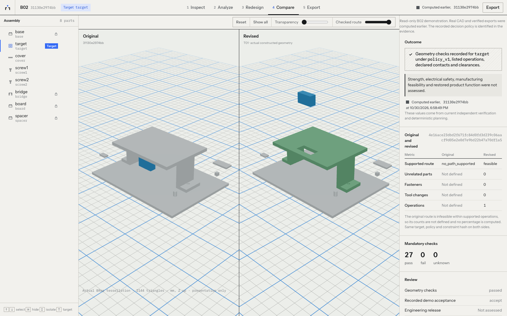
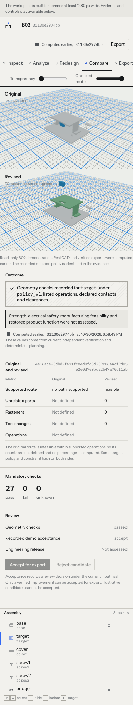

# Cloudflare and Modal read-only launch

Current website: <https://unlock-labs.pages.dev>, Pages production deployment
`0509045b`, application commit `58e7d93`, released 2026-11-01 with judge access
restored. Modal serves the six-project gallery `e972095f8bb145f3979d5f1ad5c9a305`;
the [lighter gallery release record](GALLERY.md#release-record-lighter-geometry-2026-11-01)
lists its jobs and checks. Earlier the same day, `e73c7891` (`15324be`) published
gallery `a0de2889d0634a48a1eb8ac879341e9e`. The licensed B02 job below remains
the original rollback.

[Judge access](JUDGE_ACCESS.md) adds a private code flow for bounded uploads
and fresh offline analysis, following explicit user authorization. The separate
`unlock-judges` gateway authenticates and owns every private job/result request;
the public `unlock-demo` API serves only the licensed read-only snapshots. Live
AI remains disabled. It was first published as Pages deployment
`2b20b62e-d550-4a36-923b-356d7649c157` (application commit `7e01502`). After
judge verification, Modal displayed a $30 usage limit, $0 spend limit and $30.00
credits; the exact native workflow took 76.325 seconds and used one of six
shared attempts.

Previous website release: Pages production deployment
`e1c4326a-98a2-4d25-ae5f-ce8cbf0cdbb9`, application commit `a621071`.
The [scroll performance and Pages release](../../frontend/docs/SCROLL_PERFORMANCE.md)
records the current frontend, browser checks and cost observations. The previous
`unlock-demo.unlock-labs.workers.dev` URL redirects with status 301, preserving
paths and query parameters (static-only version `73c0fcb6`). Modal serves the same
licensed B02 job; its exact CORS allowlist contains the Pages and legacy Workers
origins. No backend application source or billing settings changed for this move.
After the production tests, Modal displayed a $30 usage limit, $0 spend limit and
$30.00 credits. Its Oct 1–31 usage report displayed $0.01 total CPU usage; the
current Usage limit panel displayed $0 usage/charges. These are rounded UI values.

The earlier Cloudflare account subdomain rename from `shreyas-pabbathi` to
`unlock-labs` occurred on 2026-10-31. Historical launch evidence below retains
its original URLs and observations.

Earlier frontend release: [story zoom correction](../../frontend/docs/STORY_ZOOM.md)
records static version `82642357`, a continuous camera approach and verified
responsive framing. The [atmospheric lighting correction](../../frontend/docs/ATMOSPHERIC_LIGHTING.md)
records preceding version `78201c9c`.
The [prior wave refinement](../../frontend/docs/WAVE_REFINEMENT.md) records version
`97a79a61`.
The earlier [spacious reference design](../../frontend/docs/REFERENCE_DESIGN.md)
records version `0131c15a`. The earlier [UI presentation update](../../frontend/docs/UI_POLISH.md)
records version `47b955c6`. The original launch evidence below is preserved.

Live and tested on 2026-10-30 (final checks finished 2026-10-31 04:01 UTC):

- Website: <https://unlock-demo.shreyas-pabbathi.workers.dev>
- Read-only API: <https://shreyas-pabbathi--unlock-demo-web.us-east.modal.run>
- Cloudflare `unlock-demo`, static-only version `6eea0e24`, Free plan.
- Modal `unlock-demo`, app `ap-Bd07OyUGaRj7dMS0iNo4Nd`, Starter plan.

This follows merged PR #7 (`7ae322f`) on the new, unmerged
`codex/cloudflare-deployment` branch. The clean managed worktree was reused;
other checkouts and uncommitted work were preserved. A final fetch found main
at `51b22b1`; its intervening changes concern README artwork and documentation,
with no overlap in the engineering or deployed frontend changes. The PR's
three-dot diff preserves that work. PR #7's merged state was rechecked through
GitHub. No new PR was merged.

## Rights and regenerated evidence

The [B02 provenance record](B02_PROVENANCE.md) documents the account holder's
ownership statement and confirmation that his brother agreed to CC BY 4.0.
The grant covers original B02 geometry and generated demonstration evidence;
application source and dependencies retain their own terms. Historical evidence
and pending-license snapshots were not modified.

The replacement snapshot was generated by a new private CPU-only Modal run:

| Field | Value |
| --- | --- |
| Workspace | `shreyas-pabbathi`, Starter |
| App | `ap-M2J9qeqBqQew9zawXaxmKx` |
| Image | `im-3D7rpGgjtlcSlQEL2hgZfO` |
| Job | `9ad44594b93d4d0b860e8efda623b2d6` |
| Function call | `fc-01M67KZKJXD8QQP2XN8X17K21P` |
| Run | `run_22762d8604a74b9eac8b1b08` |
| Outcome | `VERIFIED_IMPROVEMENT_FOUND` |
| Main workflow wall time | 53.402 seconds |
| Recorded artifact bytes | 1,793,898 |
| Export SHA-256 | `473f81514fcb51eb1004d8b16444d7c89ead3a3e6aa1cb56d8b550cc3d032d9a` |
| Model inference | None; explicitly offline scripted decision policy |

The new export includes attribution, a license URI, change indications and
dependency notices in its checked inventory. Geometry, independent checks and
full assembly STEP reimport ran again. All 14 persisted artifact hashes and
every ZIP member were verified after download from the Volume. The publication
guard validates the single B02 snapshot, source grant, offline provenance,
verified export and licensing bytes before serving it. It refuses the historical
pending-license snapshot without importing CAD or private compute modules.

## Free hosting review

Native browser control confirmed that Cloudflare's current Workers plan is Free,
initially with no applications and a `shreyas-pabbathi.workers.dev` subdomain.
The chosen workflow is **Workers Static Assets**, with no Worker script, function,
database, storage binding, paid feature or purchased domain. Direct upload avoids
a new GitHub integration. The selected project name is `unlock-demo`.

The current [self-serve terms](https://www.cloudflare.com/terms/) and
[Developer Platform terms](https://www.cloudflare.com/service-specific-terms-developer-platform/)
were reviewed. The latter expressly permits content hosting and requires rights
and dependency-license compliance. Neither reviewed agreement imposes Vercel
Hobby's personal/noncommercial-only restriction. Based on those terms, this
authorized static demonstration fits Free hosting: it collects no payments or
private CAD and serves rights-cleared B02 evidence.

[Static-asset billing](https://developers.cloudflare.com/workers/static-assets/billing-and-limitations/)
makes asset requests free and unlimited, with no extra asset storage charge.
[Free limits](https://developers.cloudflare.com/workers/platform/limits/)
allow 20,000 asset files and 25 MiB per file. The build has 19 small static files;
the largest is approximately 704 KB. Worker scripts have separate quotas, but
this configuration has no script or `run_worker_first`. No paid subscription,
add-on or payment information was required during setup.

## Build and connection

Verified repository settings: project directory `frontend`, React/Vite/Three.js,
build command `npm run build`, output `dist`. A locally prepared public upload
uses `npm run build:public` to enforce the actual HTTPS Modal origin and reject
illustrative fixture mode. Both builds run TypeScript and preserve notices for
69 installed production dependencies, in addition to upstream legal comments.

Vite embeds `VITE_UNLOCK_API` at build time. A Cloudflare runtime variable cannot
change an already uploaded bundle. The published build uses the actual Modal
origin above; the placeholder draft was discarded unpublished. Public builds reject absent,
local, non-Modal or credential-bearing URLs, and illustrative fixture mode.

`frontend/wrangler.jsonc` records the equivalent assets-only CLI configuration.
The dashboard upload uses only built `dist` contents, Worker name `unlock-demo`,
assets directory `/`, HTML handling `auto-trailing-slash`, and not-found handling
`single-page-application`. `_headers` supplies `nosniff`, a referrer policy, frame
denial and disabled camera/microphone/location permissions.

**For every dashboard update upload, expand Advanced settings and explicitly
select Not found handling → single-page-application.** The update form defaults
to `none` rather than retaining the previous version's SPA selection. Verify
`/projects` and `/projects/fixture_B02` return the application after deployment.
The checked-in Wrangler configuration already selects this fallback for CLI use.

Modal retains the working bounded integration. `modal_web.py` mounts only the
selected job subdirectory read-only, attaches no secret, and allows the exact
Cloudflare origin through CORS. Private compute requires authenticated Modal
workspace access. Public uploads, AI calls, acceptance mutations, redesign and
CAD execution remain disabled. The billing dashboard was reloaded before the
new cloud run: Starter, $30 usage cap, $0 spend cap and $30.00 displayed credits.
No billing settings, payment methods or subscriptions were changed. Dashboard
amounts are rounded; metered reports must be recorded separately.

## Acceptance

Initial licensing/export tests: **14 passed**. New-snapshot local security checks
denied 42 mutations, exercised 15 GET routes, hash-checked 14 downloads, and
passed private-path, origin, host and rate-limit checks. The 406 payload scans
covered known credentials, credential test markers, source, actual evidence,
ZIP members and a fresh build, with no finding and no credential values logged.
The limiter resets on cold start; Modal's billing protections remain outer bounds.

`tests/browser/test_production.py` is opt-in through `UNLOCK_PRODUCTION_WEB` and
`UNLOCK_PRODUCTION_API`, which must explicitly identify public HTTPS endpoints.
It starts no local service and requests no engineering work. It checks desktop
and mobile navigation, actual WebGL original/revised models, comparison and path
playback, verification evidence, disabled mutations, deep-link reloads and a ZIP
download matched against its outer and member hashes. Server-side mutations and
private paths are also checked. Screenshots and the browser report must come
from actual execution before success is reported.

## Final production acceptance

All **3 production cases passed**, zero failures/errors, in 47.22 seconds, against
the real URLs above, using installed Chrome 156 in headless mode. The tested
application commit is `e114bd9`; the public byte inventory independently identifies
the actual version. No local backend or frontend was started for these tests.

- Desktop 1600×1000 and mobile 390×844: homepage, original CAD mesh, eight-part
  tree, camera orbit/reset, baseline obstruction, offline proposal provenance,
  revised mesh, comparison and checked disassembly route playback.
- Evidence accurately distinguishes an original `no_path_supported` result from
  a revised `feasible` route, with 27 mandatory checks passed and physical safety
  and manufacturing limitations visible. Acceptance and recomputation remain disabled.
- Browser ZIP downloads match the recorded outer SHA-256 and all 16 inventory
  member hashes. The full-assembly STEP round trip is passed; attribution,
  licensing and dependency notices are in the package.
- Both project deep-link reloads and navigation back to the project list work.
  No horizontal page overflow or overlapping mobile comparison canvases remains.
  All browser API calls were GETs, with no localhost requests, console errors,
  JavaScript errors or failed HTTP requests in the final runs.
- Seven public mutation routes return 403. Private paths return 403/404 or the
  static HTML shell, never private file contents. All 18 served assets match the
  upload byte-for-byte, with security headers. All 14 public artifact blobs were
  independently downloaded and hash-checked again.
- The final served release and artifact payloads were compared against known
  local Meta/API and Modal credentials without printing or storing their values;
  zero credential findings. No private input CAD, Python source, source maps,
  local engineering database or credential file is in the static upload.

Full offline regression: **337 passed**, 18 deselected, 731.37 seconds. Licensing
and real export tests: **14 passed**. Local read-only browser test against the
new cloud snapshot: **1 passed**. Public TypeScript/build, four invalid public
configuration rejection cases, Ruff and formatting passed. The production test
warnings concern dependency/Pillow deprecations; they did not fail checks. No
standalone frontend lint script or hosted CI pipeline is configured. Tests were
executed locally and against production as stated, not claimed as hosted CI.

Raw browser outcomes: [production-browser.json](../evidence/cloudflare/production-browser.json).
Final byte/hash checks: [static-assets.json](../evidence/cloudflare/static-assets.json).
Consolidated results: [validation.json](../evidence/cloudflare/validation.json).

## Actual usage and cost protections

Final authenticated billing capture: 2026-10-31 approximately 04:01 UTC, October
cycle, including earlier smoke runs and failed startup attempts. It is a point
in time report; usage can continue and billing can lag.

| Resource | Actual reported amount |
| --- | --- |
| Ephemeral compute, including earlier UNLOCK runs | $0.00354567 |
| Deployed gateway compute, including failed startup deployment | $0.00081187 |
| Total of those compute breakdowns | **$0.00435754** |
| New licensed B02 run alone, CPU + memory report rows | $0.00105588 |
| Network egress | $0.00005184, fully offset by allowance |
| Volume storage billed | $0 |
| LLM tokens billed | $0 |
| Actual billed cost | **$0** |
| Dashboard remaining credits | **$30.00 displayed, rounded** |
| Usage limit / spend limit | **$30 / $0**, unchanged after reload |
| Retained Volume data | 3,585,371 bytes, 32 files, two job directories |
| Cloudflare upload | 1,592,424 bytes, 19 files; largest 704,237 bytes |

The new B02 workflow took **53.402 seconds** and recorded **1,793,898 artifact
bytes**. These are observed workflow values, not a CPU-time estimate. The report
provides resource costs rather than exact CPU seconds or peak measured memory.
The private worker remains CPU-only, maximum one container, one CPU and 4 GiB
hard memory, bounded by 420 seconds. The public gateway allows at most one
container, 0.5 CPU and 512 MiB hard limits, eight concurrent reads, 30-second
request timeout and no warm containers, with a two-second scale-down window.
No private job remains running; the selected B02 Volume subdirectory is mounted
read-only by the public app and no Modal Secret is attached.

The CLI's top-level `metered_cost` is $0.00005184 and omits the compute amounts
shown separately in `metered_cost_breakdown`. Raw summary/report JSON is preserved
without forcing those fields to reconcile. Summing rounded resource rows can
differ by $0.00000001. The dashboard supplies only rounded remaining credits;
an exact remaining-credit ledger was not available. No hackathon promotional
grant was observed; these are Starter's monthly included credits.

Cloudflare confirms static-only requests are served at no charge and does not
provide request metrics for this configuration. There is no Worker script,
binding, queue or purchased domain. Retained Modal storage is far below the
published free allowance. No payment method, plan, billing limit or paid feature
was changed. See [raw billing summary](../evidence/cloudflare/modal-billing-summary.json)
and [hourly resource report](../evidence/cloudflare/modal-billing-report.json).

## Resolved problems and ongoing limits

Modal initially rejected an image environment layer after a non-copied source
mount. Function environment settings resolved this. Remote startup then lacked
the helper import and selected job environment; explicitly packaging `modal_app`
and passing job/CORS settings fixed it. The unhealthy deployment was stopped;
its small startup costs are included above. The replacement API passed actual
health and browser requests.

Production tests found a run-recovery navigation race, fixed by honoring an
explicit workflow choice, and Cloudflare's reset SPA setting, corrected on each
upload. Visual review then found mobile canvas overflow that functional pixel
checks alone missed. Bounded grid rows/canvases and new containment assertions
fixed it; the entire production suite passed again on the final release. The
landing footer now scopes illustrative claims to marketing geometry.

The demo stays limited to rights-cleared synthetic B02. Private engineering
compute requires authenticated Modal SDK access. No public CAD uploads, live
Meta inference or unrestricted engineering computation is enabled. The request
limiter is per container and resets on cold start; account limits are the outer
cost controls. The mobile layout stacks models and evidence, while dense editing
is intended for a larger screen. Geometry checks are not a manufacturing or
physical safety release. Future new inputs, AI inference or paid features need
separate authorization and cost/security review.
