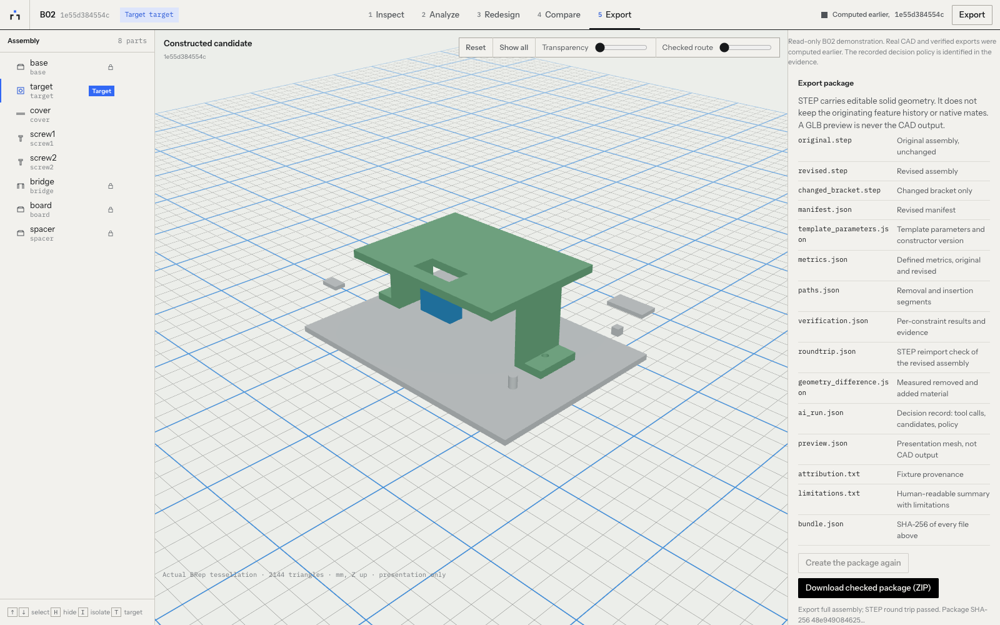

# Modal deployment checkpoint

This branch prepares a public read-only engineering demonstration and private
Modal engineering jobs. Public deployment still requires the account holder's
approval. The existing local interactive application remains available.

## Account safeguards

Verified after saving and reloading on October 30, 2026:

- Workspace: `shreyas-pabbathi`, Starter plan.
- Billing cycle: October 1–31, 2026.
- Available compute credits: $30.00; usage and charges: $0.00.
- Workspace usage limit: $30, set by the user.
- Workspace spend limit: $0.

The dashboard warns that volume storage charges can still accrue after workloads
stop. Modal currently includes 1 TiB of Volume storage and 1 TiB of monthly egress
on Starter. This integration must keep its own storage far below that allowance;
other workspace resources also count. Recheck the entire workspace before any
cloud run and at billing-cycle rollover. No payment details are recorded here.

## Architecture decision

The current FastAPI coordinator has a local SQLite WAL database, a serial Python
queue and bounded native subprocesses. Background threads alone are unsuitable
for a scale-to-zero web container: they are not durable Modal inputs. Sharing a
writable SQLite WAL file across Volume mounts is also unsafe.

Use a private CPU Function with one container and one input at a time. Each job
owns a local temporary SQLite database, runs the existing coordinator and saves
immutable engineering artifacts plus JSON record/event snapshots to a dedicated
directory on a Volume. A second, read-only ASGI Function serves only a separately
selected B02 demonstration snapshot. It never opens a writable SQLite database,
accepts uploads or invokes the model. Private jobs require Modal workspace SDK
authentication and never become public merely because their ID is known.

Submit private jobs with `.spawn()`, keep the returned FunctionCall ID, and poll
with `.get(timeout=0)` or inspect durable progress. CAD processing never depends
on a browser request remaining connected. The HTTP API retains existing GET
routes, resumable SSE evidence and hash-checked artifact downloads. All public
mutations are rejected before request-body processing.

The default decision policy is explicitly `mock`. Geometry construction,
independent verification and exports are real; the decision policy is scripted.
Live Meta execution requires a separate explicit operator opt-in and a Modal
Secret containing `MODEL_API_KEY`. The Meta adapter and geometry code are reused.

## Current official references

Reviewed October 30, 2026:

- https://modal.com/docs/guide/budgets
- https://modal.com/pricing
- https://modal.com/docs/guide/volumes
- https://modal.com/docs/guide/webhooks
- https://modal.com/docs/guide/webhook-timeouts
- https://modal.com/docs/guide/resources
- https://modal.com/docs/guide/scale
- https://modal.com/docs/guide/trigger-deployed-functions
- https://vercel.com/docs/frameworks/frontend/vite

Volumes do not provide distributed file locking; concurrent changes to one file
can lose data. ASGI requests time out at 150 seconds. CPU/memory are billed at
the higher of requests and actual consumption, including cold starts and idle
scaledown windows. Cost estimates must include those periods and image builds.

## Resource and access policy

| Resource | Configuration |
| --- | --- |
| Private engineering Function | 1 physical CPU requested and capped; 2 GiB requested, 4 GiB hard memory limit |
| Engineering execution | One container, serial input delivery, no automatic retries; 300 s workflow budget, 420 s Function timeout |
| Public read-only ASGI Function | 0.125 CPU requested, 0.5 capped; 256 MiB requested, 512 MiB capped; one container, eight HTTP inputs |
| Idle capacity | Zero minimum/buffer containers, 2 s scaledown window |
| API rate ceiling | 120 requests/minute and 720/hour per serving container, including all visitors |
| Uploads | Private authenticated SDK only; existing flat STEP/manifest or ZIP validation; 25 MiB compressed, 100 MiB expanded |
| Artifact storage | 256 MiB per job, 1 GiB total reservation ceiling; refuse more jobs when full |
| Public data | One explicitly selected completed synthetic B02 job, mounted read-only by subdirectory |
| Private data | Separate UUID job directories; no public route lists or selects them |
| AI | Mock by default; no GPU or Modal inference endpoint; Meta adapter retained |

Only workspace-authorized SDK clients may start engineering jobs. Workspace
members share the workspace's administrative trust; this is not a new multi-user
SaaS authentication system. Public visitors can inspect real saved meshes,
verification and exports, but cannot start analysis, redesign, review or upload.
The local interactive HTTP workflow is retained.

The private demonstration job records an automated acceptance of an independently
checked candidate solely to exercise checked export. The public view labels it
as recorded demo acceptance; it is not a claim of human engineering release.

SQLite is created on container-local temporary storage and is never mounted on a
Volume. Committed records and ordered events are exported as JSON snapshots.
Actual immutable STEP, manifest, preview and verification bytes retain SHA-256
identities. Volume commits publish progress and terminal state. Failed jobs keep
their evidence; preempted/killed workers become explicitly interrupted on status
read after the heartbeat grace period. They are never silently replayed.

The selected public snapshot is fixed for the lifetime of a web container. Choose
a new job ID and redeploy to publish a different verified demonstration. Rate
counters reset on container restart; the workspace billing limits remain the
outer protection. Do not run overlapping copies of the private worker app.

## Executed Linux smoke test

The private ephemeral Modal app `ap-XVxxSaKn0e1IY7kYVfliw5` completed an actual
CPU-only B02 workflow. No public ASGI endpoint was created and no model inference
ran. Python 3.12, the pinned CadQuery/OCP stack and native Linux dependencies
installed successfully in image `im-FcfKbzYYeM3hhE9leExxtZ`.

- Durable job: `6a2d843e1bf5462b93d0d6b12affa6ea`.
- FunctionCall: `fc-01M67H5J8QMGJR5D0Y4TTYWRGN`.
- Result: `VERIFIED_IMPROVEMENT_FOUND`, full assembly export, STEP round trip passed.
- Complete workflow: **71.443 s**, artifacts **1,791,109 bytes**.
- Stage event times: fixture 3.952 s, baseline 8.293 s, redesign 32.269 s,
  export 18.516 s. Remaining time includes snapshots and commits.
- Export SHA-256: `48e94908462543c87692b478ca6c2c89863a9410d9e1a161efdc5a4ac0857ea8`.
- A separate fresh Modal container read the durable result and independently
  checked the exported bytes against their hash (`persisted_export_integrity=passed`).
- The cloud artifacts were downloaded and served through the read-only API to
  real Chrome: comparison, disabled write controls and checked ZIP download passed.

The earlier local browser benchmark measured an 18.41 s redesign and a 9.86 s
export on an Apple M5. This Linux run measured 32.269 s and 18.516 s respectively;
it uses one capped physical CPU and cold native processes, not that desktop's
resources. This establishes compatibility, not a performance improvement.

At the current published Function rates, one CPU plus the **maximum** 4 GiB costs
`0.0000131 + 4 * 0.00000222 = $0.00002198/s`. The observed 71.443 s body is about
**$0.00157** at those caps, excluding image build, cold start, idle and web serving.
A planning allowance of **$0.003 per complete B02 run** implies roughly **10,000
runs per $30**, before shared web/build usage. This is an estimate, not an invoice
or guaranteed run count. Model tokens are separate and were not used.
At the observed artifact size, the conservative storage reservation policy admits
roughly 450 retained jobs before requiring operator archival/cleanup. The compute
estimate does not override that storage ceiling, and evidence is not auto-deleted.

After the smoke test and a billing-page reload, the dashboard still displayed
$30.00 credits and $0.00 charges, with the $30 usage and $0 spend limits intact.
Those displays are rounded and billing can lag; the small compute usage above is
an estimate, not a claim that cloud compute consumed nothing.

## Operator commands and remaining deployment steps

Use a separate tooling environment with `pip install -r requirements-modal.txt`.
The configured workspace is `shreyas-pabbathi`; verify it with `modal profile list`.
The v2 Volume `unlock-engineering-artifacts` already exists and holds the smoke
artifacts. Do not recreate or delete it as part of deployment.

Private smoke without publishing HTTP:

```sh
cd backend
modal run modal_app.py
```

For durable job submission after private worker deployment:

```python
import uuid
import modal
worker = modal.Function.from_name("unlock-engineering", "engineering_job")
job_id = uuid.uuid4().hex
call = worker.spawn(job_id)  # returns promptly; record both identifiers
print(job_id, call.object_id)
# In a later authenticated process:
result = modal.FunctionCall.from_id(call.object_id).get(timeout=0)
# Progress is also available from the private job_status Function.
```

Private uploads pass a bounded `files={"assembly.step": step_bytes,
"manifest.json": manifest_bytes}` and `target_id`. They are never selected as a
public demo. Public compute authentication is intentionally not introduced.

**Wait for the account holder's public-deployment approval before these steps:**

1. Select/create a Vercel **Hobby** project with repository root `frontend` and
   determine its free production `.vercel.app` origin, without a domain purchase.
2. Recheck workspace credits, $0 spend protection and total free storage usage.
3. Deploy private jobs if needed: `modal deploy modal_app.py`.
4. Set `UNLOCK_DEMO_JOB=6a2d843e1bf5462b93d0d6b12affa6ea` and
   `UNLOCK_CORS_ORIGINS=https://<actual-project>.vercel.app`, then deploy the
   separate read-only API: `modal deploy modal_web.py`. Capture its actual HTTPS URL.
5. Set Vercel `VITE_UNLOCK_API` to that URL. Keep `VITE_UNLOCK_MODE` unset.
   The build rejects a missing/non-HTTPS production URL. Deploy the feature branch
   without merging it, then verify deep links, real meshes and export downloads.
6. Confirm the repository fixture's documented redistribution approval before
   public publication. Existing records still mark it as pending.

Meta credentials are optional for the public snapshot. For a **separately approved
live private run**, create a named Modal Secret through the dashboard with
`MODEL_API_KEY`; select it using `UNLOCK_META_SECRET` and explicitly opt in with
`UNLOCK_ALLOW_LIVE_META=1` when building/deploying the private app. An invocation
must additionally pass `live=True`. Never add provider keys or Modal tokens to
Vercel or any `VITE_*` variable. This task did not run live inference.

## Remaining scope

- Modal ASGI and Vercel production end-to-end verification awaits deployment
  approval. The ASGI definition has been validated with the real Modal SDK.
- Public access is read-only. Interactive engineering remains local or private
  through the Modal SDK. The browser is not an authenticated cloud CAD editor.
- Cloud testing covered B02 and durable evidence, not the full backend regression
  suite on Linux. The full regression/browser suites run locally.
- Geometric verification does not establish strength, fatigue, electrical safety,
  manufacturing readiness, restored function or engineering release approval.
- Exact test results and the initial failures/retries are in
  `../evidence/modal/validation.json`; raw logs remain in `.work/modal-validation/`.

## Final validation results

- Final offline backend regression: **335 passed**, zero failures/errors, 664.90 s. Paid and browser markers were excluded.
- Existing browser suite: 13 passed initially, one page-load timeout; that desktop case passed on targeted retry. All 14 cases were exercised successfully.
- Additional cloud-backed read-only browser acceptance: **1 passed**; no compute POSTs, real meshes and checked ZIP download.
- Ruff lint and formatting, dependency consistency, frontend TypeScript and production build passed. No separate frontend lint script is configured.
- Vercel's missing-URL guard correctly rejects the build; the configured HTTPS build passed.
- No live Meta test or model call ran. No public deployment or merge occurred.


