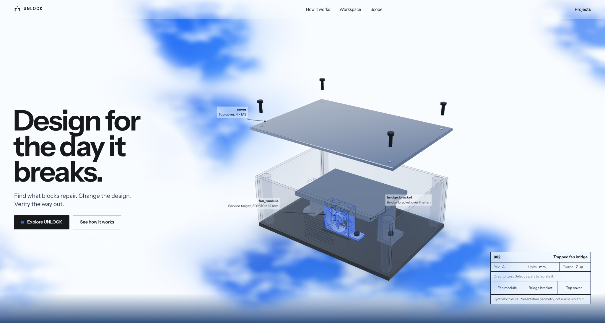
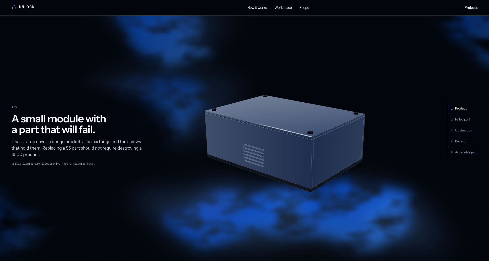
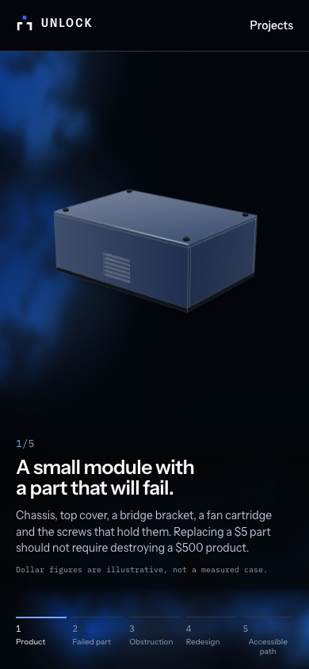

# Atmospheric blue lighting correction

Live at <https://unlock-demo.shreyas-pabbathi.workers.dev>, Cloudflare static
version `78201c9c`, application commit `1dc3e97`, verified 2026-10-31.
This replaces the preceding ribbon treatment while retaining the accepted layout.

| Before | After |
| --- | --- |
| Continuous stroked curves and a wide filled ribbon | Separate irregular filled light volumes, with displacement and density noise breaking up their silhouettes |
| Broad saturated blue bands | Translucent blue transitions, concentrated pockets of cobalt/electric light and clean white space |
| Strong ribbon contrast across the dark section | Deep black dominates, with smaller pools of light around the model and a faint lower glow |
| Contour-like texture | Fine monochrome grain without repeating contour lines |
| Continuous drift, cursor response and reduced-motion handling | Existing motion timings and accessibility behavior retained |

The correction changes the underlying foundation rather than adding blur to the
old paths: no stroked wave path remains in the decorative SVGs. Low-frequency
noise deforms asymmetric filled shapes; a separate density field varies their
internal opacity. A broad translucent layer supplies diffusion behind those
smaller volumes. The dark palette restrains the upper light and preserves the
lower pockets. Seeded fields avoid repeated vector curves and keep the visual
result reproducible. The filters are static image content, not recalculated by
JavaScript or animated filter parameters.

Only the three existing decorative SVGs and `noise-field.css` changed. Together
the SVG source files total 4,104 bytes. No page structure, component, dependency,
layout CSS, typography, camera, CAD geometry, control, model animation or scroll
logic was changed. Decorative layers retain `pointer-events: none`. The existing
CSS transform loop still moves without hovering; pointer response is secondary,
and hidden-tab/reduced-motion behavior is preserved.

## Visual and functional verification

Actual local and live screenshots of both sections were inspected against the
original supplied reference, including 2048×1094 desktop views. Three visual
passes corrected brightness and internal cloud detail. The final view has no
continuous ribbon outline: the bright section retains clear white space and the
dark section uses localized atmospheric illumination around the existing model.

Before/after geometry at 2048×1094, 1440×1000 and 390×844 was compared against the
preceding public release. **All 120 measured bounding boxes match exactly, with
0 px maximum difference.** This includes section dimensions, headline, copy,
both CTAs, navigation, CAD containers, technical panel, story rail, workspace,
scope and footer. Hero height is still 1094 px and 1000 px at the two desktop
sizes, and the phone layout is unchanged.

A separate background-only screenshot measurement temporarily hid foreground
content without changing layout. At 2048×1094, approximately **69.2%** of the hero
background met the recorded near-white threshold; **83.0%** of the story background
met the dark threshold, with **5.6%** meeting the bright-blue threshold. These are
descriptive pixel measurements, not perceptual design scores. The definitions and
all three viewport results are recorded below.

TypeScript and the optimized public build passed. All **6 local landing browser
cases passed in 96.92 seconds**, covering five viewport sizes, actual idle pixel
movement before cursor input, pointer direction, part selection, all story
states/step controls, the section seam, live reduced-motion changes and WebGL
fallback. Idle motion changed 6.9–11.0% of visible pixels over the short samples.
Sampled rAF medians were about 16.7 ms and p95 values 16.7–16.8 ms, with no gaps
over 50 ms in idle or the desktop scroll sample. These are short installed-Chrome
156 samples on this Mac, not physical-phone or universal frame-rate guarantees.

All **3 live production cases passed in 48.32 seconds**: desktop/mobile original
and revised 3D views, orbit/reset, comparison, route playback, evidence, licensed
ZIP and member hashes, navigation/reload, disabled controls and refused mutations.
Both journeys reported no application console, page, HTTP or failed-request
errors. An additional live hero check verified actual model dragging (31.1% of
canvas pixels changed), selecting the fan module and clearing the selection,
with no page errors. Existing dependency/Pillow deprecation warnings remain.

All **18 served static files** match the tested public build byte for byte.
The 19-file upload includes `_headers` configuration; deep links and security
headers pass. All **14 public artifact blobs** retain their hashes, and the
known-credential comparison found zero findings. The read-only API, snapshot,
public capabilities and billing settings were preserved; no paid feature, public
CAD upload, live inference or engineering computation was enabled.

- [Exact layout comparison](atmospheric-lighting/layout-comparison.json)
- [Background coverage and thresholds](atmospheric-lighting/background-coverage.json)
- [Motion and responsive acceptance](atmospheric-lighting/local-motion-checks.json)
- [Live engineering journey](atmospheric-lighting/production-journey.json)
- [Additional hero interaction check](atmospheric-lighting/hero-interaction.json)
- [Served bytes and download integrity](atmospheric-lighting/production-assets.json)

The [prior wave report](WAVE_REFINEMENT.md) and earlier evidence are preserved.

