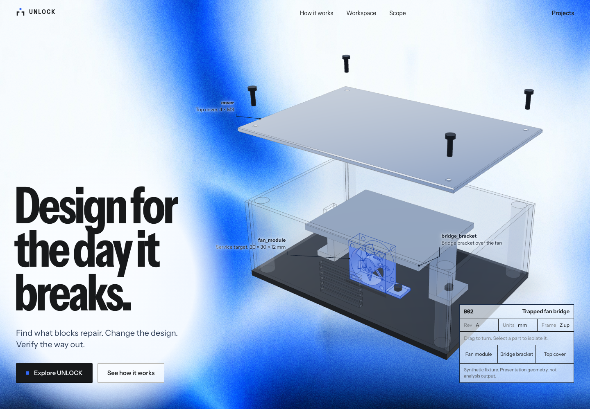
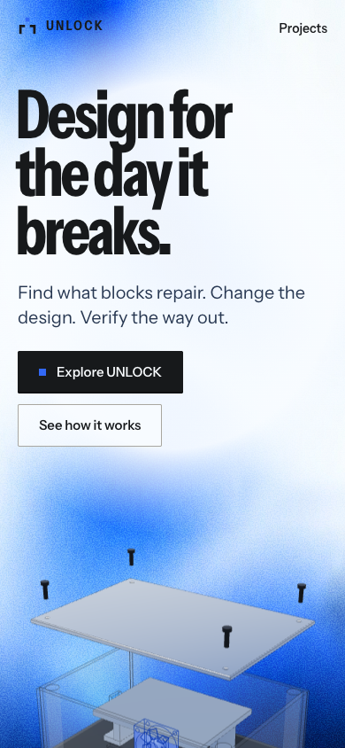
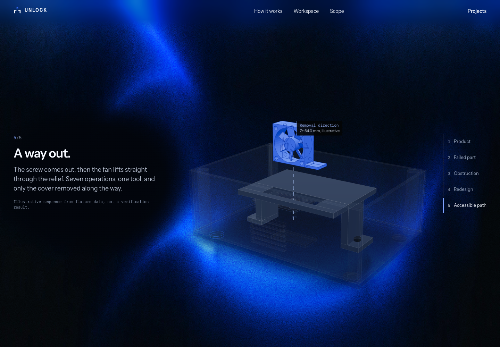

# Landing model scale and headline layout

Live at <https://unlock-demo.unlock-labs.workers.dev>, Cloudflare Static Assets
version `5f566d30`, application commit `e2748ce`. This follows the light-field
background from PR #14 (`de60d1f`).

| Before | After |
| --- | --- |
| Centered hero copy with a wider headline | Larger condensed Instrument Sans at width 75 and weight 700, anchored to the lower left on desktop |
| Hero model in six grid columns | Eight columns, more vertical room and tighter aspect-aware bounds fitting |
| Smaller story model with later poses near the canvas edge | Wider stage, larger initial framing and a gradual recenter after the cover fades |
| Camera approaches while scrolling | Approach retained, with framing radius 1.2 → 0.98 so the extracted assembly has breathing room |

The two gradient plates, shader, NoiseField component, grain and background CSS
are byte-for-byte unchanged from `de60d1f`. Model geometry, material finishes,
part choreography, motion timings, backend and API settings are unchanged.
The phone layout keeps the content stacked and the part controls reachable.

## Actual size comparison

Installed Chrome compared the previous live release with this exact build at
five viewport sizes. The numbers below compare the width of detected cool-metal
pixels with background, annotations, copy and title block hidden. The detector
excludes the neutral contact shadow and saturated fan; these are descriptive
rendered-size measurements, not physical CAD dimensions.

| Browser viewport | Hero width increase | Closed story width increase |
| --- | --- | --- |
| 1774 × 887 | 23.0% | 8.3% |
| 1440 × 1000 | 43.5% | 19.4% |
| 1024 × 768 | 23.9% | 6.4% |
| 390 × 844 | 18.5% | 13.1% |
| 360 × 640 | 21.8% | 8.0% |

All five story stages were captured and visually reviewed. The closed and
extracted assembly bounds fit their canvases; the obstruction pose deliberately
introduces a driver shaft from above. The final story model is wider than its
starting pose at every tested size. Headline glyphs remain inside the viewport,
copy/buttons remain within the hero and no horizontal overflow was detected.
These are headless Chrome viewport checks, not physical-device tests.

TypeScript and the public production build passed. Live desktop/mobile checks
confirmed continuous idle movement, cursor response, live reduced-motion pausing,
the WebGL fallback, part selection and all five story controls without page errors.
Actual hero dragging was also checked at 1774×887, 1440×1000 and 390×844;
the resulting poses were visually inspected and that runner exited normally.
All 20 served static files match the tested build. Direct root/Projects/B02 routes,
security headers, all 14 existing artifact hashes and the known-credential scan
passed. The public API reports read-only mode with no live inference credentials.

All three existing production assertion blocks completed: desktop and mobile
original/revised 3D, comparison, evidence, route playback, licensed ZIP/member
integrity, navigation/reload, refused writes and hidden private paths. The runner
then stalled in `browser.close()` and was interrupted after the cases completed;
its exit code was 130. This is a browser-driver cleanup limitation, not a clean
runner exit. The independent live landing and asset checks exited normally.

- [Rendered-size measurements](model-layout/model-measurements.json)
- [Live motion and controls](model-layout/live-motion.json)
- [Deployed asset integrity](model-layout/production-assets.json)
- [Production assertion completion and cleanup limitation](model-layout/production-checks.json)

