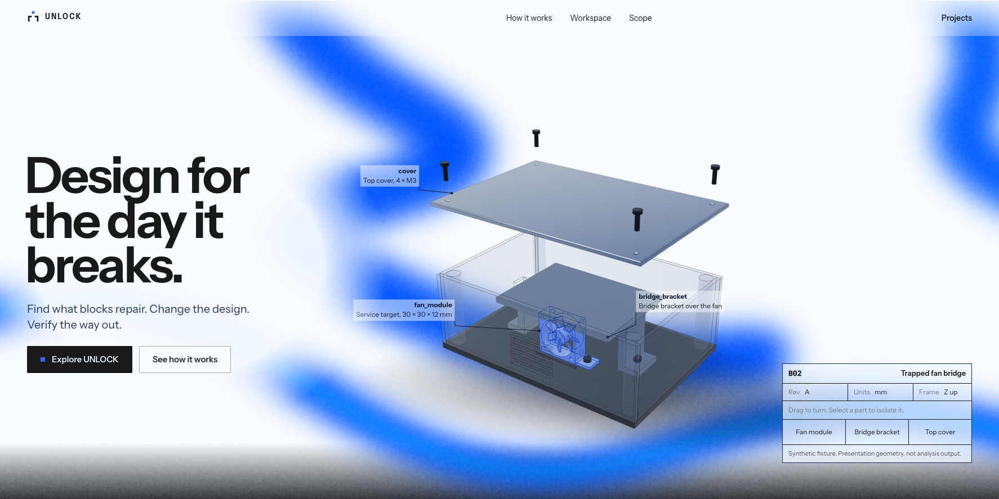
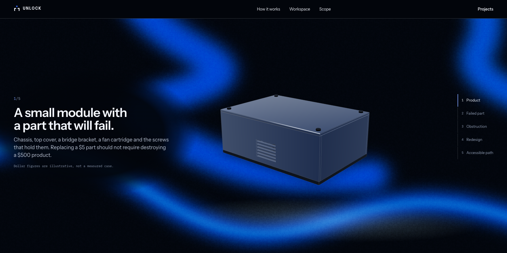
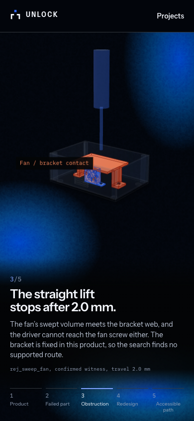

# Spacious reference design and continuous motion

Live at <https://unlock-demo.shreyas-pabbathi.workers.dev>, Cloudflare Static Assets
version `0131c15a`, verified 2026-10-31 at 14:30 UTC. The deployed application is
commit `64cae5c` on `codex/reference-landing`, based on main after merged PR #10.
Later commits save the acceptance evidence and this report. This branch remains
unmerged.

The supplied reference defines the white and black surfaces, saturated blue
flow, broad headline, exploded assembly with projected callouts, technical title
block and vertical story navigation. The user's follow-up explicitly asks for
larger sections and panels than the compressed reference image. Desktop hero
and story stages therefore fill the viewport, with a minimum hero height of
820 px, generous typography, a larger title block and 44 px minimum part/step
controls. Phone layouts stack the content and retain useful model space rather
than shrinking a desktop composition. The reference screenshot is not bundled
or published as an asset.

| Before | After |
| --- | --- |
| Compact presentation sections and control panels | Full viewport desktop stages, larger controls and a responsive stacked phone layout |
| Assembly framed using a fixed distance | Camera fits the complete exploded presentation assembly, including the raised cover and screws |
| Separate light/dark surfaces | One persistent grained field with a spatial mask that crosses the story boundary smoothly |
| Slow drift could look still during an easing turnaround | The blue field travels continuously around a 32-second linear loop without a stationary turnaround |
| Phone motion inherited a percentage displacement too small to see | A 32 px minimum travel distance and extra layer coverage keep idle motion visible on narrow screens |
| Pointer movement supplied most perceptible change | Autonomous motion continues without any cursor event; damped cursor-direction movement adds a secondary response |
| Hidden landing canvases could redraw on pointer movement | Intersection-aware invalidation, demand rendering and a 1.5 maximum pixel ratio reduce unnecessary work |
| Motion preference sampled only on mount | Live reduced-motion changes stop background/parallax motion and resume it when the preference changes |

The white field uses saturated blue and a restrained black undertow; the dark
field replaces that undertow with a light haze. Wide, feathered contrast scrims
protect fixed text. Gradient transforms run through CSS; pointer state uses refs
and a settling animation-frame loop rather than per-frame React updates. Hidden
tabs pause ambient animation. The noise texture and flow paths are authored SVG,
with no new dependency or remote texture request.

Cool studio lighting and polished metal finishes apply only to the landing
illustrations. Their display geometry is cloned before adding finish colors and
disposed afterwards; shared primitives and engineering data are preserved. The
landing continues to label its geometry as illustrative. The existing matching
favicon is retained.

## Production acceptance

The public build runs TypeScript and the optimized Vite build successfully.
The new landing suite completed **6 passed** in **92.88 seconds**, and the
existing production journey completed **3 passed** in **45.93 seconds**. The
browser sessions ran sequentially and exited normally. Existing dependency and
Pillow deprecation warnings remain; no application console or network errors
were found during the production engineering journeys.

The landing suite checks 1774×887, 1440×1000, 1024×768, 390×844 and 360×640 browser
viewports: readable copy/model separation, panel containment, no horizontal
overflow, all five story states, part selection, step navigation and the
light-to-dark boundary. Idle animation is checked with actual screenshot pixel
changes **before any pointer event**. At the tested instant, 11.0–15.9% of wide
viewport pixels and 2.0–2.1% of phone viewport pixels changed over the idle sample.
A first local run exposed imperceptible phone motion; it was fixed and both
phone cases passed locally before this complete live run. Reduced-motion changes
and the unavailable-WebGL drawing fallback also passed.

Each viewport's idle sample contains 89 requestAnimationFrame intervals. Observed
medians were approximately 16.7 ms and p95 values 16.7–16.8 ms, with no intervals
over 50 ms. The 1440×1000 scroll sample also measured a 16.7 ms median/p95 and no
intervals over 50 ms. These are short samples in installed Chrome 156 on this
Mac, using headless browser viewport sizes; they are not physical-phone or
universal frame-rate guarantees.

The independent production journey verifies original/revised BRep rendering,
orbit and reset, comparison, checked route playback, engineering evidence,
licensed export download and every ZIP member's hash, mobile layout, navigation
and direct-link reload. Uploads and computations remain disabled, mutation
requests are refused and private source paths are hidden.

All **18 served static files** exactly match the local public build; `_headers`
is configuration rather than a served asset. All three application deep links
return the application, security headers pass, and all **14 artifact blobs**
retain their content hashes. The final local/deployed credential comparison
found zero known credentials. Export SHA-256 remains
`473f81514fcb51eb1004d8b16444d7c89ead3a3e6aa1cb56d8b550cc3d032d9a`.
Only the 19 built static files were uploaded to the existing free static-assets
project. No Worker script, binding, paid service, new AI call, public CAD upload
or engineering computation was enabled. The existing API, snapshot and billing
settings were not changed. Historical launch and UI-polish evidence are retained.

- [Motion, dimensions and accessibility results](reference-design/motion-checks.json)
- [Production engineering journey](reference-design/production-journey.json)
- [Served asset, security and artifact integrity](reference-design/production-assets.json)

Reproduce the landing checks from `backend/` with `UNLOCK_LANDING_WEB` set to the
live URL and `PYTHONPATH=src .venv/bin/python -m pytest -q -m browser
tests/browser/test_landing_design.py`. Select the existing production suite with
`UNLOCK_PRODUCTION_WEB` and `UNLOCK_PRODUCTION_API` as documented in
[the launch report](../../backend/docs/CLOUDFLARE_DEPLOYMENT.md).

