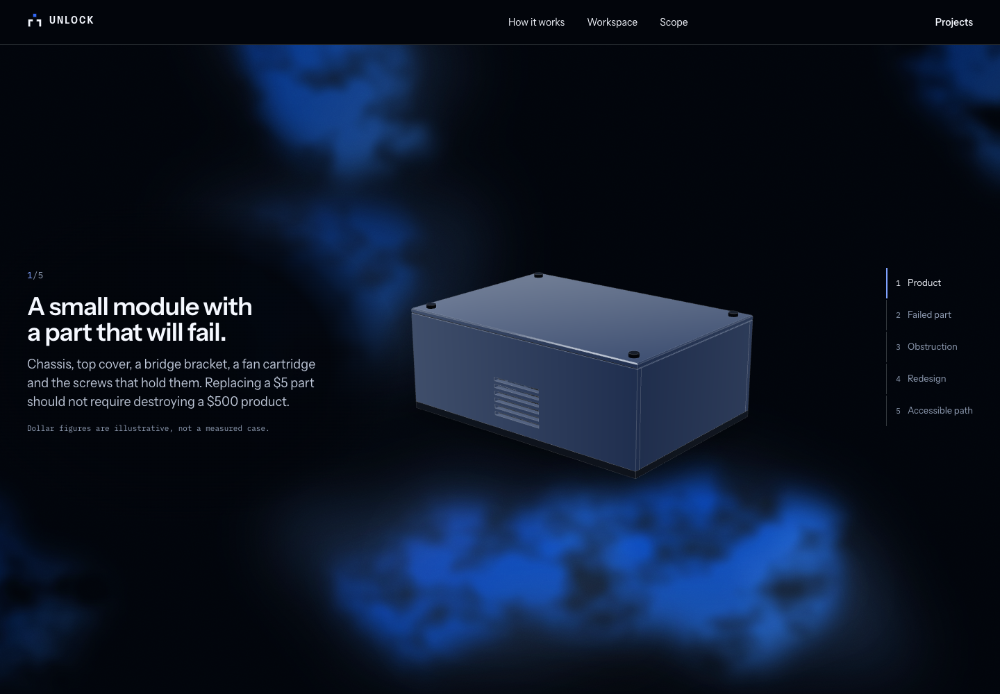
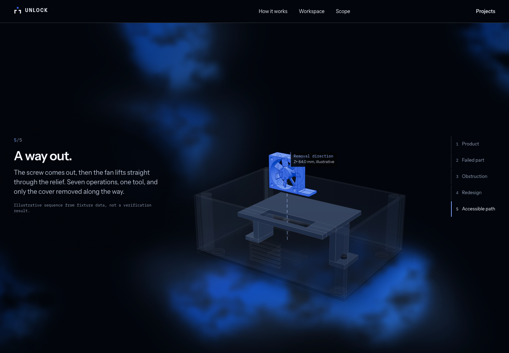

# Story scroll zoom

Current URL: <https://unlock-labs.pages.dev>. Originally checked
at `unlock-demo.shreyas-pabbathi.workers.dev`, static version `82642357`,
application commit `8f90847`, on 2026-10-31.
This follows merged PR #11 on the separate `codex/story-scroll-zoom` branch.

| Before | After |
| --- | --- |
| Camera framing radius grows from 1.3 to 1.6 as the cover opens, shrinking the model | Radius decreases from 1.3 to 1.0 over the full scroll story, moving the camera closer |
| Opening-related pullback | Continuous scroll-linked approach through all five stages, reversing naturally when scrolling back |

The initial framing and aspect-aware fit are retained. Model geometry, part
poses, camera direction/target choreography, section sizing, backgrounds,
typography, controls, scroll timing and reduced-motion behavior are unchanged.
Only the story camera's distance envelope changes.

TypeScript and the public build passed. The final build's six landing browser
checks passed in **97.17 seconds**, covering five viewport sizes, all story
stages/controls, layout, continuous background motion, live reduced-motion
changes and the WebGL fallback. Existing dependency deprecation warnings remain.

The final live site was sampled at scroll progress .02, .10, .16, .23, .48, .70
and .93 in 1440×1000 and 390×844 viewports. The detected visible metal-colored
model bounds never became narrower across those samples and ended approximately
**20% wider** in both cases. Actual screenshots of the model, annotations and
later stages were inspected. No page errors were reported. These are browser
viewport checks, not physical-phone tests.

All 18 served static files match the tested build; direct project links,
security headers, the 14 public artifact hashes and the known-credential scan
passed. API capabilities and billing settings were preserved.

- [Responsive/motion checks](story-zoom/landing-checks.json)
- [Live rendered zoom measurements](story-zoom/production-zoom.json)
- [Deployed build integrity](story-zoom/production-assets.json)

