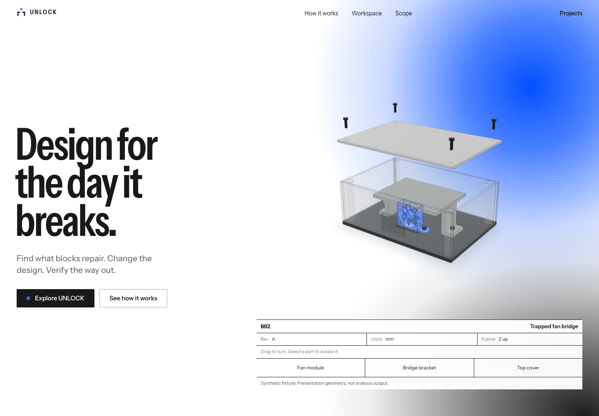
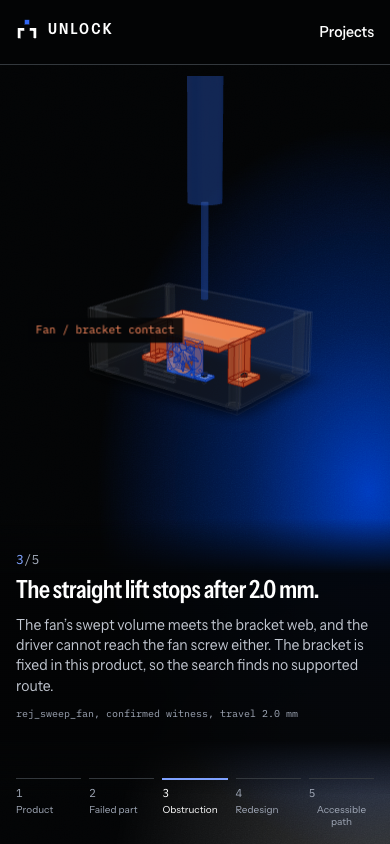

# Landing motion and CAD presentation

Live at <https://unlock-demo.shreyas-pabbathi.workers.dev>, Cloudflare static
version `47b955c6`. Application commit `af6759e`, based on main after merged PR #9.
This follow-up changes the frontend presentation. The existing read-only API,
licensed snapshot, billing settings and engineering permissions are unchanged.

| Before | After |
| --- | --- |
| Flat cream and graphite section backgrounds | White with black and saturated blue grain gradients; black sections use blue with a small white haze |
| Separate section surfaces | One persistent background field, with scroll-driven palette blending through the story and closing section |
| Stationary background | Slow ambient drift and damped pointer movement that follows cursor direction; copy stays fixed and has contrast protection |
| CAD drawn behind the hero copy and title block | A dedicated model column with a full assembly frame and aligned caption/part controls below |
| Crowded story model, annotations and side rail | Separate copy/model areas, a consistent bottom step rail and bounded annotation backplates; stacked areas on phones |
| Favicon used a closed bracket unlike the header mark | Matching open bracket and floating blue square, light/dark favicon colors and a refreshed icon URL |

No new dependency was added. Grain is a static generated SVG texture; only the
cloud transforms animate. Pointer updates use refs and a settling animation
frame loop rather than React renders. The field pauses in a hidden tab, and
reduced-motion mode disables its ambient and pointer animation. The CAD scenes
keep demand rendering. Landing illustrations remain explicitly labelled;
the recorded engineering workspace still identifies its actual source.

## Validation

TypeScript, the optimized public build and Git diff checks passed. Both local and
live Chrome checks exercised 1440×1000, 1024×768, 390×844 and 360×640 viewports.
Each checked all five CAD story stages, viewport/annotation containment, no
horizontal page overflow, animated drift, reversed pointer direction, hero part
selection, favicon geometry matching and absence of JavaScript errors. A separate
reduced-motion browser context verified the static field. These are browser
viewport checks, not physical-phone tests.

The existing production read-only suite completed **3 passed**, zero failures or
errors, in **35.14 seconds** on the final release. It exercised original/revised
WebGL rendering, orbit/reset, evidence, comparison, disassembly playback, checked
downloads, disabled mutations, mobile layout, navigation and project reloads.
The first attempt passed all cases but stalled closing its browser while other
browser checks ran; it was interrupted, and the sequential retry completed
normally. Dependency/Pillow deprecation warnings remain in the existing suite.

All **18 served static files** match the public build, security headers and
project deep links pass, all **14 public artifact blobs** retain their hashes,
and the final credential comparison found zero known credentials. Only built
static assets were uploaded; no paid feature or Worker script was added.

- [Motion and viewport results](ui-polish/motion-checks.json)
- [Completed production journey](ui-polish/production-journey.json)
- [Served asset and artifact integrity](ui-polish/production-assets.json)

