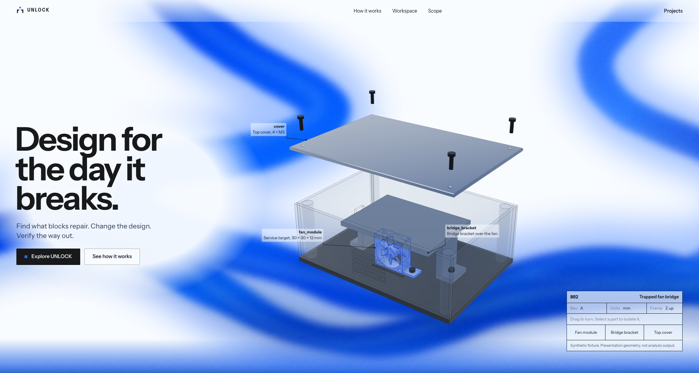
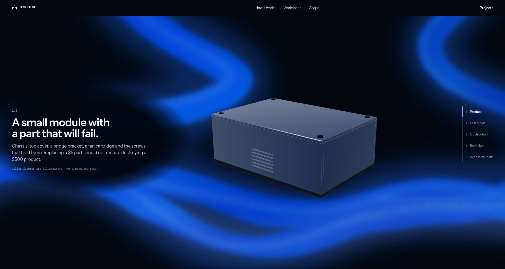
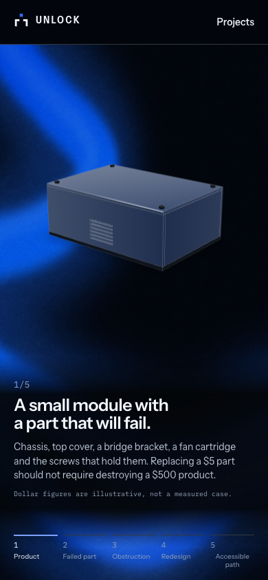

# Connected waves with the existing layout

The later [atmospheric lighting correction](ATMOSPHERIC_LIGHTING.md) replaces this
ribbon treatment and records current static version `78201c9c`. This report
preserves the preceding evidence.

Originally published at <https://unlock-demo.shreyas-pabbathi.workers.dev>, Cloudflare static
version `97a79a61`, application commit `5b071bb`, checked 2026-10-31.
This refines the atmosphere of the prior reference design while preserving its
section heights, typography, spacing, navigation, controls and CAD presentation.

Only four decorative source files changed: `flow-field.svg`, `flow-atmosphere.svg`,
`flow-grain.svg` and `noise-field.css`. No JavaScript, layout stylesheet, CAD
geometry, model animation, camera, interaction, API or dependency was changed.

| Before | After |
| --- | --- |
| Broad, uniformly blurred strokes and separate radial patches on phones | Connected curved currents and a tapered lower sweep, using the same paths on phones |
| Mostly one blue intensity with a gray undertow | Cobalt and electric-blue bodies, diffused pale-blue highlights and restrained shadow depth |
| Coarse grain | Seamless fine contour texture with a second fine-grain layer |
| Gray-looking blend into the story | Blue illumination that blends into the dark navy foundation at the existing section boundary |
| Continuous idle motion, directional pointer response and reduced-motion support | The same motion timing, pointer behavior and accessibility handling retained |

The illustration remains the focus: the upper field preserves white space and
existing text contrast protection; the dark field uses the same wave paths with
controlled light diffusion. The existing fixed background, palette mask and
compositor transform animations are reused. Decorative layers remain behind the
content with `pointer-events: none`. All three authored SVGs together total
4,916 source bytes. Filters and grain are static image content; their parameters
are not animated. No remote texture or new dependency is needed.

## Verification

Before changing the background, the prior public build was measured at 2048×1094
(the supplied desktop screenshot size), 1440×1000 and 390×844. The final deployed
site was then measured at the same sizes and fixed scroll positions, with
reduced motion for stable measurement. **All 120 bounding boxes match exactly,
with a maximum difference of 0 px.** These include both sections, the headline,
description, both buttons, navigation, CAD canvas containers, technical panel,
story text and step rail, workspace, scope and footer. Hero height remains
1094 px at 2048×1094 and 1000 px at 1440×1000; phone layout also matches exactly.
The implementation was visually reviewed against the supplied reference after
multiple passes to refine the curves, highlights and texture.

TypeScript and the optimized public build passed. The six existing landing
browser cases passed against that exact build locally in **104.63 seconds**:
five viewport sizes, visible autonomous motion before any pointer event,
directional pointer response, part controls, all story states and step
navigation, the palette seam, live reduced-motion changes and unavailable-WebGL
fallback. No landing JavaScript errors were found.

Idle samples contained 89 requestAnimationFrame intervals per viewport, with
approximately 16.7 ms medians, 16.8 ms p95 values and no intervals over 50 ms.
The desktop scroll sample had a 16.7 ms median, 16.8 ms p95 and **one interval over
50 ms**. These short installed-Chrome 156 samples are recorded as observed;
they do not guarantee a frame rate on other hardware or physical phones.

The independent live production journey completed **3 passed** in **48.43 seconds**,
covering desktop/mobile original and revised 3D views, orbit/reset, comparison,
route playback, engineering evidence, download and ZIP-member integrity,
navigation, reload, disabled controls and refused public mutations. Both journeys
reported zero application console, page, HTTP or failed-request errors. Existing
dependency/Pillow deprecation warnings remain.

All 18 served static files match the tested public build byte for byte; `_headers`
is upload configuration, giving 19 uploaded files. Direct project routes and
security headers pass, all 14 public artifact hashes match, and the known-secret
comparison found zero exposed credentials. Only built assets were uploaded to
the existing free static project. Billing settings and public capabilities were
preserved; no live inference, CAD upload or engineering computation was enabled.

- [Exact layout comparison](wave-refinement/layout-comparison.json)
- [Local motion and responsive acceptance](wave-refinement/local-motion-checks.json)
- [Live production engineering journey](wave-refinement/production-journey.json)
- [Deployed bytes, headers and download integrity](wave-refinement/production-assets.json)

The [earlier reference-design report](REFERENCE_DESIGN.md) and its evidence remain
available for the preceding implementation.

